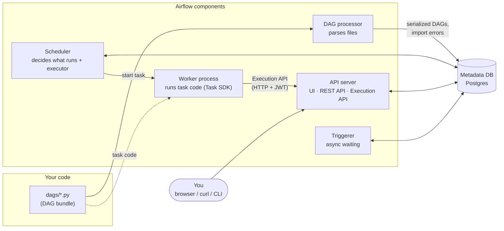
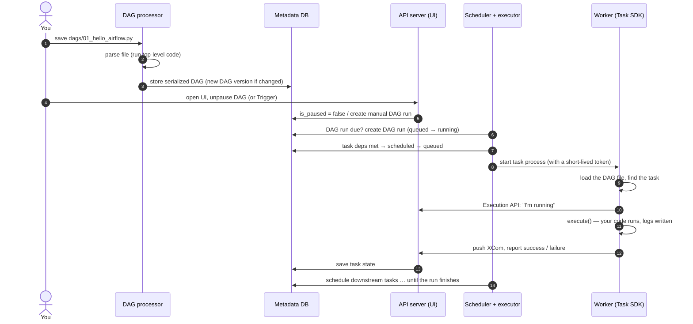
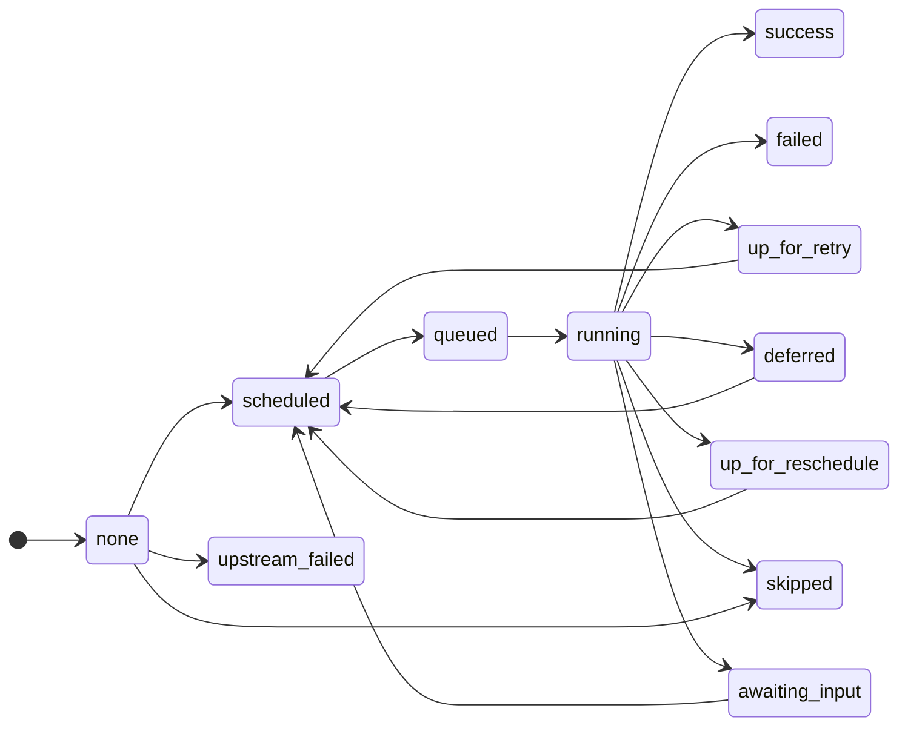

# Airflow 3 architecture

**What you'll learn:** which processes make up Airflow 3, what each one does, how a Python file in
`dags/` turns into tasks running on a worker, what every task state (and its colour in the UI) means,
and how this project's `docker-compose.yaml` maps to those components.

> **Run it**
> With the stack running (`make up`, see [03 · Installation](03-installation-and-setup.md)), run
> `docker compose ps` — every service you see is one of the components below. Then trigger
> `01_hello_airflow` ([../dags/01_hello_airflow.py](../dags/01_hello_airflow.py)) and watch its task
> squares change colour in the Grid view.

---

## The big picture



The important Airflow 3 change: **workers never connect to the metadata database**. They talk to
the **API server** over HTTP (the *Execution API*) using the **Task SDK**. Everything else (the
scheduler, DAG processor, triggerer and API server) shares the metadata database.

## The components

| Component | Command | What it does |
|---|---|---|
| **API server** | `airflow api-server` | Serves the React **UI** (http://localhost:8080), the public **REST API** under `/api/v2`, and the **Execution API** under `/execution` that running tasks use to report state and read XComs, Variables and Connections. |
| **Scheduler** | `airflow scheduler` | The brain. Creates DAG runs when they are due, checks which tasks are ready, applies limits (pools, concurrency) and hands ready tasks to the **executor**. |
| **DAG processor** | `airflow dag-processor` | Reads the Python files in your DAG bundle, runs their top-level code to discover DAGs, and stores a **serialized** (JSON) copy of each DAG in the database. Records **import errors** for broken files. A separate process since Airflow 3.0 — the scheduler no longer parses files. |
| **Triggerer** | `airflow triggerer` | Runs **triggers**: small `asyncio` coroutines that wait for something (a time, a file, an external job) on behalf of **deferrable** operators and sensors, without occupying a worker slot. Also runs deadline-alert callbacks. See [12 · Sensors & deferrable](12-sensors-and-deferrable.md). |
| **Executor** | (inside the scheduler) | The part of the scheduler that decides *how* and *where* a task process is started: a local subprocess, a Celery worker, a Kubernetes pod… |
| **Workers** | depends on executor | The processes that actually run your task code. With the **LocalExecutor** used here, they are child processes of the scheduler container. |
| **Metadata database** | Postgres | Airflow's memory: DAGs, DAG runs, task instances and their states, XComs, Variables, Connections, Pools, users, audit log. |
| **DAG bundle** | config | Where DAG files come from. The default bundle, named `dags-folder`, is the local `dags/` folder. Other bundle types (for example a Git repository, from the `git` provider) let Airflow fetch and version DAG code. |

> 💡 **Words used above.** *Serialized DAG*: a JSON description of a DAG's structure (tasks,
> dependencies, schedule) stored in the database so the UI and scheduler never import your Python
> files. *Executor*: the plug-in that launches task processes. *Trigger*: an async waiting routine run
> by the triggerer. All of these are also in the [glossary](32-glossary.md).

## From a DAG file to a running task

Here is what happens, step by step, after you save a file such as
[`01_hello_airflow.py`](../dags/01_hello_airflow.py).



In words:

1. **You save a file** in `dags/`. In Docker, that folder is mounted into every Airflow container as
   `/opt/airflow/dags`.
2. **The DAG processor finds and parses it.** It checks the bundle for new and changed files (every
   30 seconds in this project: `AIRFLOW__DAG_PROCESSOR__REFRESH_INTERVAL: '30'`; the Airflow default
   is 300) and imports each file in a subprocess. Any **top-level code** in the file runs now — which
   is why DAG files must be fast and must not call databases or APIs at the top level (see
   [28 · Best practices](28-best-practices.md)).
3. **The serialized DAG is stored** in the database. If the file has an error, an **import error**
   is stored instead and shown at the top of the DAGs list. If the DAG's structure changed, Airflow
   records a new **DAG version**.
4. **The DAG appears in the UI — paused.** This project sets
   `AIRFLOW__CORE__DAGS_ARE_PAUSED_AT_CREATION: 'true'`, so you must switch the toggle on.
5. **The scheduler creates a DAG run** when one is due (the time comes according to the
   `schedule`) or when you press **Trigger**. The run starts as `queued`, then becomes `running`
   (subject to `max_active_runs`).
6. **The scheduler checks each task instance.** When all its upstream tasks are finished in a way
   that satisfies its **trigger rule**, the task becomes `scheduled`. When a slot is free (pools,
   `max_active_tasks`, executor parallelism), it becomes `queued` and is sent to the executor.
7. **The executor starts a worker process.** With LocalExecutor this is a subprocess of the scheduler.
   The worker uses the **Task SDK**: it loads your DAG file, finds the task, tells the API server it is
   `running`, and calls your code (`execute()` for operators, the function for `@task`).
8. **While running,** the task reads Variables, Connections and XComs and writes XComs **through the
   Execution API** (`AIRFLOW__CORE__EXECUTION_API_SERVER_URL: 'http://airflow-apiserver:8080/execution/'`).
   Logs are written to `logs/` (a volume shared with the API server, which serves them to the UI).
9. **The task finishes** as `success`, `failed`, `skipped`, `up_for_retry` and so on. A
   **deferrable** task instead becomes `deferred`: its trigger runs in the triggerer, and when the
   trigger fires the task is scheduled again to finish.
10. **The scheduler repeats steps 6–9** for the downstream tasks. When every task is finished, the
    DAG run becomes `success` or `failed`.

> ⚠️ The DAG file is imported **many times**: by the DAG processor on every refresh and by every
> worker that runs one of its tasks. Treat the top level of a DAG file as "describe the shape only".

## Task instance states

A **task instance** is one task in one DAG run (for example `say_hello` in the run for
2026-11-11). It moves through these states. The names below are the exact values of
`TaskInstanceState` in Airflow 3.4 (`from airflow.utils.state import TaskInstanceState`), plus "no
status" for a task that has not been looked at yet. Colours are those of the Airflow 3.4 React UI;
the Grid view has a legend if you are unsure.

| State | UI colour | Meaning |
|---|---|---|
| *no status* (`none`) | grey (outline) | The scheduler has not evaluated the task yet in this run. |
| `scheduled` | dark grey (zinc) | Dependencies are met; waiting for a free slot. |
| `queued` | stone grey/brown | Handed to the executor; waiting for a worker to start it. |
| `running` | cyan | The task code is executing right now. |
| `success` | green | Finished without errors. |
| `failed` | red | Raised an error and has no retries left (or raised `AirflowFailException`). |
| `skipped` | pink | Deliberately not run: a branch not taken, a short-circuit, `AirflowSkipException`, or a Bash exit code 99. |
| `up_for_retry` | yellow | Failed, but has retries left; will run again after `retry_delay`. |
| `up_for_reschedule` | sky blue | A sensor in `mode="reschedule"` gave its slot back and will check again later. |
| `deferred` | purple | Handed to the **triggerer**; waiting asynchronously without using a worker slot. |
| `upstream_failed` | amber/orange | Did not run because an upstream task failed (with the default `all_success` trigger rule). |
| `removed` | slate grey | The task existed when the run was created but has since been removed from the DAG. |
| `restarting` | violet | The task was cleared while it was running; it will be stopped and run again. |
| `awaiting_input` | orange | A **human-in-the-loop** task waiting for someone to respond (Airflow 3.1+). See [22 · Human-in-the-loop](22-human-in-the-loop.md). |

A typical happy path:



**DAG runs** have fewer states: `queued`, `running`, `success`, `failed`.

> 💡 You can watch most of these states with the examples: `up_for_retry` in
> `12_error_handling_and_alerts` (task `flaky_api_call`), `skipped` in `03_operators_and_dependencies`
> (task `bash_skip`), `up_for_reschedule` and `deferred` in `08_sensors_and_deferrable`,
> `upstream_failed` in `16_setup_teardown` with `fail_processing = true` (task `summarise`), and
> `awaiting_input` in `18_human_in_the_loop`.

## Executors in one minute

The **executor** decides where task processes run. Airflow ships several; you choose one in
configuration (`[core] executor`), and you can even configure more than one and pick per task.

| Executor | Where tasks run | Good for |
|---|---|---|
| **LocalExecutor** (this project) | Subprocesses on the scheduler's machine | Learning, small installations, one machine |
| **CeleryExecutor** | A pool of long-running Celery workers, fed through a broker (Redis/RabbitMQ) | Many tasks, several machines, steady load |
| **KubernetesExecutor** | One Kubernetes pod per task | Isolation, per-task resources, bursty load |
| **EdgeExecutor** (`edge3` provider) | Workers in remote locations that pull work over HTTP | Running tasks in other networks/sites |
| Cloud executors (e.g. AWS ECS / Batch, from providers) | Managed cloud compute | Teams already on that cloud |

Switching executors does not change your DAG code. Details, trade-offs and how to switch this
project to Celery: [29 · Executors & production](29-executors-and-production.md).

## How this project's docker-compose maps to the components

[`docker-compose.yaml`](../docker-compose.yaml) is based on the official Airflow 3.4 compose file,
simplified for learning (LocalExecutor, so no Redis or Celery worker).

| Compose service | Airflow component | Notes |
|---|---|---|
| `postgres` | Metadata DB | Postgres 16. Also hosts the `demo` database used by the example DAGs. Exposed on `localhost:5432`. |
| `airflow-apiserver` | API server | `command: api-server`, port `8080`. Health check: `/api/v2/monitor/health`. |
| `airflow-scheduler` | Scheduler + LocalExecutor + workers | `command: scheduler`. Your task code runs **inside this container**. |
| `airflow-dag-processor` | DAG processor | `command: dag-processor`. Re-scans `dags/` every 30 s. |
| `airflow-triggerer` | Triggerer | `command: triggerer`. Needed for deferrable sensors and deadline alerts. |
| `airflow-init` | (one-shot setup) | Migrates the database, creates the `airflow` / `airflow` admin user, imports pools from [`config/pools.json`](../config/pools.json), fixes folder ownership, then exits. |
| `airflow-cli` | (helper) | Only started on demand (`profiles: [debug]`): `make cli` or `docker compose run --rm airflow-cli dags list`. |

All Airflow services share the same settings through the `x-airflow-common` block: the executor,
the database URL, the **FAB auth manager** (the login page), the JWT secret that lets components
trust each other's tokens, the tutorial connections/variables, and the mounted folders:

```yaml
volumes:
  - ${AIRFLOW_PROJ_DIR:-.}/dags:/opt/airflow/dags
  - ${AIRFLOW_PROJ_DIR:-.}/logs:/opt/airflow/logs
  - ${AIRFLOW_PROJ_DIR:-.}/config:/opt/airflow/config
  - ${AIRFLOW_PROJ_DIR:-.}/plugins:/opt/airflow/plugins
  - ${AIRFLOW_PROJ_DIR:-.}/data:/opt/airflow/data
```

Because the folders are mounted, **editing a file on your laptop changes it inside every container
immediately** — no rebuild needed for DAG or plugin code. (Changing installed Python packages does
need a rebuild; see [03 · Installation](03-installation-and-setup.md#adding-python-packages).)

The start-up order is enforced with `depends_on`: Postgres must be healthy, `airflow-init` must
finish successfully, and the scheduler additionally waits for the API server to be healthy (it needs
the Execution API to run tasks).

## Common mistakes

- **Expecting a new DAG file to appear instantly.** The DAG processor picks it up on its next scan
  (up to ~30 s here). Check **import errors** in the UI if it never appears.
- **Forgetting to unpause.** New DAGs are paused in this project; a paused DAG's runs stay queued.
- **Putting slow code at the top level of a DAG file** (API calls, database queries). It runs on
  every parse, in the DAG processor, every 30 seconds.
- **Assuming tasks can use the metadata database.** In Airflow 3, task code goes through the Task SDK
  and Execution API; direct ORM/database access from tasks is not supported.
- **Stopping the triggerer** and wondering why deferrable sensors stay `deferred` forever.
- **Using a different JWT secret per component** in a custom setup — tasks then fail to authenticate
  to the API server. Compose sets one shared `AIRFLOW__API_AUTH__JWT_SECRET`.

## Try it yourself

1. Run `docker compose ps` and match each running service to a row in the components table. Which
   one is missing because it is a one-shot container?
2. Stop the DAG processor (`docker compose stop airflow-dag-processor`), add a copy of
   `01_hello_airflow.py` with a new `dag_id`, and confirm it does **not** appear. Start the processor
   again (`docker compose start airflow-dag-processor`) and watch it appear within ~30 s.
3. Trigger `08_sensors_and_deferrable` and find a task in the `deferred` state. Which container is
   doing the waiting for it?
4. Add `raise ValueError("boom")` at the top level of a copy of a DAG file and find the import error
   in the UI. Then remove it again.

---

**Next →** [03 · Installation and setup](03-installation-and-setup.md) · [Back to the index](README.md)

Official docs: [Architecture overview](https://airflow.apache.org/docs/apache-airflow/stable/core-concepts/overview.html) ·
[Task instance lifecycle](https://airflow.apache.org/docs/apache-airflow/stable/core-concepts/tasks.html#task-instances)
