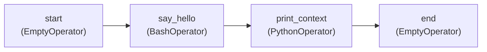

# Your first DAG

**What you'll learn:** how a DAG file is put together, line by line, using the smallest useful example in this project. By the end you will be able to read any classic-style DAG, run it from the UI, and find its logs.

> **Run it**
> - DAG id: `01_hello_airflow`
> - File: [../dags/01_hello_airflow.py](../dags/01_hello_airflow.py)
> - In the UI: find `01_hello_airflow` → switch the toggle on (unpause) → press **Trigger** → open the run in the Grid view.



---

## The whole file at a glance

A DAG file is an ordinary Python file in the `dags/` folder. Airflow imports it, looks for DAG objects, and stores their structure in the metadata database. It has four parts:

| Part | Lines in the file | What it does |
|---|---|---|
| Docstring | the `""" ... """` at the top | Markdown shown on the DAG page in the UI (`doc_md=__doc__`) |
| Imports | `from ... import ...` | Brings in the `DAG` class and the operators |
| Helpers | `default_args`, `_print_context()` | Settings shared by every task, and a Python function a task will call |
| DAG definition | `with DAG(...) as dag:` block | Creates the DAG, its four tasks, and the arrows between them |

We go through each part in order.

---

## 1. Imports

```python
from __future__ import annotations

from datetime import timedelta

import pendulum

from airflow.providers.standard.operators.bash import BashOperator
from airflow.providers.standard.operators.empty import EmptyOperator
from airflow.providers.standard.operators.python import PythonOperator
from airflow.sdk import DAG
```

- `from __future__ import annotations` makes Python treat type hints as text. It is a common habit in Airflow code and has no effect on how the DAG runs.
- `timedelta` is used for the retry delay.
- [`pendulum`](https://pendulum.eustace.io/) is a date library that Airflow uses everywhere. Use it for `start_date` because it makes the timezone explicit.
- `airflow.sdk` is the **Task SDK**, the public authoring interface in Airflow 3. `DAG`, `dag`, `task`, `Param`, `Variable` and friends all come from here. (In Airflow 2 you imported from `airflow` or `airflow.models`; those paths are not the authoring API anymore. See [31-airflow-2-vs-3.md](31-airflow-2-vs-3.md).)
- The three operators come from `airflow.providers.standard`. An **operator** is a template for one kind of work: run a bash command, call a Python function, do nothing. In Airflow 3 the everyday operators live in the *standard provider* package, which is installed together with Airflow. Chapter [07](07-operators-and-dependencies.md) explains providers.

---

## 2. `default_args`

```python
default_args = {
    "owner": "tutorial",
    "retries": 1,  # re-try a failed task once...
    "retry_delay": timedelta(seconds=30),  # ...after waiting 30 seconds
}
```

`default_args` is a plain dictionary. When you pass it to the DAG, **every task in the DAG receives these keyword arguments** unless the task sets its own value.

- `owner` — a free-text label shown in the UI. It does not control permissions.
- `retries` — how many extra attempts a task gets after it fails. With `1`, a task can run at most twice.
- `retry_delay` — how long to wait before the retry.

Any argument that `BaseOperator` accepts can go here (`retries`, `retry_delay`, `execution_timeout`, `pool`, `on_failure_callback` …). Retries and alerts are covered in [16-error-handling-retries-alerts.md](16-error-handling-retries-alerts.md).

---

## 3. A Python callable that reads the context

```python
def _print_context(**context) -> str:
    """A normal Python function. `context` holds run information (dates, run_id, task instance...)."""
    print(f"DAG id:       {context['dag'].dag_id}")
    print(f"Run id:       {context['run_id']}")
    # .get(): runs triggered from the CLI/API without a logical date don't have one.
    print(f"Logical date: {context.get('logical_date')}")
    print(f"Task:         {context['ti'].task_id}, try number {context['ti'].try_number}")
    # Whatever a python_callable returns is stored as an XCom (see example 04).
    return "Hello from Python!"
```

This is a normal function. The `PythonOperator` will call it when the task runs.

Because the function accepts `**context`, Airflow passes in the **task context**: a dictionary with information about the current run. The keys used here:

| Key | What it is |
|---|---|
| `dag` | The DAG object (here we read `.dag_id`) |
| `run_id` | Unique id of this DAG run, e.g. `manual__2026-11-11T10:00:00+00:00` |
| `logical_date` | The date/time the run is "for" (see [04-core-concepts.md](04-core-concepts.md)) |
| `ti` | The **task instance** — this task in this run. `try_number` starts at 1 and goes up on each retry |

The return value `"Hello from Python!"` is saved automatically as an **XCom** (a small value other tasks can read). Chapter [08](08-xcom.md) covers XCom.

The leading underscore in `_print_context` is only a naming convention for "helper, not a task".

---

## 4. The DAG object

```python
with DAG(
    dag_id="01_hello_airflow",  # unique name shown in the UI
    description="The smallest useful DAG: Bash + Python tasks in a line",
    schedule="@daily",  # run once a day at midnight UTC (None = only manual runs)
    start_date=pendulum.datetime(2026, 1, 1, tz="UTC"),  # first date the DAG may run for
    catchup=False,  # don't create runs for every missed day since start_date
    default_args=default_args,
    tags=["tutorial", "01-basics"],
    doc_md=__doc__,  # this file's docstring is shown on the DAG page in the UI
) as dag:
```

`with DAG(...) as dag:` opens a **context manager**. Every operator created inside the indented block is attached to this DAG automatically, so you never pass `dag=dag` to each task.

| Argument | Value here | Meaning |
|---|---|---|
| `dag_id` | `"01_hello_airflow"` | Unique name of the DAG across your whole Airflow. Letters, numbers, `_`, `-`, `.` only. |
| `description` | short text | Shown in the DAG list. |
| `schedule` | `"@daily"` | When runs are created. `@daily` = every day at 00:00 UTC. Other forms: a cron string (`"0 6 * * 1-5"`), a `timedelta`, an Asset, a timetable, or `None` for manual-only. See [18-scheduling-and-timetables.md](18-scheduling-and-timetables.md). |
| `start_date` | 1 Jan 2026, UTC | The earliest date the scheduler may create a run for. It is **not** "when the DAG first runs". |
| `catchup` | `False` | If `True`, the scheduler would create one run for every missed day between `start_date` and today. `False` is the default in Airflow 3; it is written out here so you notice it. |
| `default_args` | the dict above | Passed to every task. |
| `tags` | `["tutorial", "01-basics"]` | Labels for filtering the DAG list. |
| `doc_md` | `__doc__` | Markdown documentation. `__doc__` is the module docstring, so the comment at the top of the file appears on the DAG's page. |

> **Note:** the scheduler creates a scheduled run *at the end* of the period it covers. The run for 2026-11-10 starts just after midnight on 2026-11-11. Chapter [04](04-core-concepts.md) explains logical dates and data intervals.

---

## 5. The tasks

### `EmptyOperator`

```python
    start = EmptyOperator(task_id="start")  # does nothing, useful as a visual marker
```

`EmptyOperator` does nothing. The scheduler marks it successful without even sending it to a worker. It is useful as a clear start/end point, or as a join point when many tasks fan in.

Every task needs a `task_id`, unique inside the DAG. The Python variable name (`start`) is only for your code; the UI shows the `task_id`.

### `BashOperator` with a template

```python
    say_hello = BashOperator(
        task_id="say_hello",
        # {{ ds }} is a Jinja template: replaced by the run's date (YYYY-MM-DD) at runtime.
        bash_command='echo "Hello Airflow! This run is for {{ ds }}" && sleep 2',
    )
```

`BashOperator` runs a shell command in a subprocess on the worker. The task succeeds if the command exits with code 0.

`{{ ds }}` is a **Jinja template**. Before the command runs, Airflow replaces it with the logical date as `YYYY-MM-DD`. Only arguments listed in an operator's `template_fields` are templated; for `BashOperator` these are `bash_command`, `env` and `cwd`. Chapter [14](14-params-variables-templating.md) lists the other template variables.

> If a run has no logical date (for example, an API-triggered run with `logical_date: null`), `ds` is not in the context. Airflow's Jinja environment is strict about undefined names (`StrictUndefined` by default), so the task fails with a template error. Runs triggered from the UI's Trigger dialog get a logical date by default (the current time), so this doesn't happen there.

The last line printed to stdout is also pushed as an XCom.

### `PythonOperator`

```python
    print_context = PythonOperator(
        task_id="print_context",
        python_callable=_print_context,
    )
```

`PythonOperator` calls `python_callable` on the worker. Pass the function itself (`_print_context`), not the result of calling it (`_print_context()`). Because the function has a `**context` parameter, Airflow fills it with the task context.

### The final `EmptyOperator`

```python
    end = EmptyOperator(task_id="end")
```

Same as `start`.

---

## 6. Dependencies with `>>`

```python
    start >> say_hello >> print_context >> end
```

`a >> b` means "**a must finish before b starts**" — `a` is *upstream*, `b` is *downstream*. A chain of `>>` builds the straight line you see in the Graph view. `b << a` means the same thing written the other way round.

By default a task waits until **all** its upstream tasks have succeeded (trigger rule `all_success`). Chapter [09](09-branching-and-trigger-rules.md) shows how to change that.

Without this line all four tasks would be independent and could run at the same time.

---

## The same DAG with `@dag` and `@task`

Airflow also has the **TaskFlow API**, where you decorate Python functions instead of building operator objects. Here is a sketch of how `01_hello_airflow` could look in that style (this is *not* a file in the project; [02_taskflow_api.py](../dags/02_taskflow_api.py) is the TaskFlow example):

```python
from airflow.providers.standard.operators.empty import EmptyOperator
from airflow.sdk import dag, task


@dag(
    dag_id="01_hello_airflow_taskflow",
    schedule="@daily",
    start_date=pendulum.datetime(2026, 1, 1, tz="UTC"),
    catchup=False,
    default_args=default_args,
    tags=["tutorial", "01-basics"],
)
def hello_airflow_taskflow():
    start = EmptyOperator(task_id="start")
    end = EmptyOperator(task_id="end")

    @task.bash
    def say_hello() -> str:
        return 'echo "Hello Airflow! This run is for {{ ds }}" && sleep 2'

    @task
    def print_context(**context) -> str:
        print(f"Run id: {context['run_id']}")
        return "Hello from Python!"

    start >> say_hello() >> print_context() >> end


hello_airflow_taskflow()  # calling the function registers the DAG
```

The task id defaults to the function name. Both styles produce the same kind of DAG, and you can mix them freely. Chapter [06](06-taskflow-api.md) goes deeper.

---

## Keep top-level code light

Airflow does not import your DAG file once. A separate process, the **dag-processor**, re-parses every file in `dags/` on a loop. The default `[dag_processor] min_file_process_interval` is 30 seconds, so each file is imported about every 30 seconds. This project also sets `AIRFLOW__DAG_PROCESSOR__REFRESH_INTERVAL=30` in [docker-compose.yaml](../docker-compose.yaml), so *new* files are found within 30 seconds instead of the default 5 minutes.

So any code at module level — outside a task function — runs every 30 seconds, forever:

```python
# BAD: runs on every parse, not when the task runs
rows = requests.get("https://example.com/big.json").json()

# GOOD: runs only when the task runs
def _download(**context):
    rows = requests.get("https://example.com/big.json").json()
```

Rules of thumb:
- No API calls, database queries, or `Variable.get()` at the top level of a DAG file.
- Import heavy libraries (pandas, ML libraries) **inside** the task function.
- Parsing must finish within `[dag_processor] dag_file_processor_timeout` (50 seconds by default) or the file shows as an import error.

More in [28-best-practices.md](28-best-practices.md).

---

## Running it in the UI

1. **Open the UI** at http://localhost:8080 (login `airflow` / `airflow` with Docker; see [03-installation-and-setup.md](03-installation-and-setup.md)). If the DAG is not there yet, wait up to 30 seconds for the dag-processor. If the file has an error, a red **import errors** banner appears instead.
2. **Unpause it.** This project sets `DAGS_ARE_PAUSED_AT_CREATION=true`, so every new DAG starts paused. Paused DAGs get no scheduled runs, and manually triggered runs stay queued. Click the toggle next to `01_hello_airflow`.
   - Because `schedule="@daily"` and `catchup=False`, unpausing creates one run for the most recent complete day right away.
3. **Trigger a run.** Press the **Trigger** (▶) button. The dialog pre-fills a logical date of "now"; keep it and confirm.
4. **Watch it.** The **Grid** view shows one column per run and one row per task. Squares turn from grey (queued) to light green (running) to dark green (success). The **Graph** tab shows the same tasks as boxes and arrows.
5. **Read the logs.** Click a square (for example `say_hello` in your run) and open the **Logs** tab. You should see:
   - for `say_hello`: `Hello Airflow! This run is for 2026-...` (the date filled in);
   - for `print_context`: the four `print()` lines and `Returned value was: Hello from Python!`.
6. **Look around:** the **XCom** tab on `print_context` shows `return_value`, and **Rendered Templates** on `say_hello` shows the command after `{{ ds }}` was replaced.

Command-line alternatives (`airflow dags unpause`, `airflow dags trigger`, `airflow tasks test`) are in [26-cli-and-rest-api.md](26-cli-and-rest-api.md).

---

## Common mistakes

- **Forgetting to unpause.** The run sits in *queued* forever. Check the toggle first.
- **Dynamic `start_date`** such as `datetime.now()`. It changes on every parse, so the scheduler never sees a stable interval. Use a fixed date.
- **Naive datetimes.** `datetime(2026, 1, 1)` without a timezone is treated as UTC by default, which surprises people outside UTC. Use `pendulum.datetime(..., tz="...")` and be explicit.
- **Calling the function in `python_callable`:** `python_callable=_print_context()` runs it at parse time and passes its return value. Pass `_print_context` without parentheses.
- **Duplicate `dag_id`s** across files. Only one wins and the UI behaves strangely. Keep ids unique (this project prefixes them with the file number).
- **Heavy work at module level** (see the section above).

## Try it yourself

1. Change `bash_command` to also print `{{ run_id }}` and `{{ ti.try_number }}`. Trigger again and check **Rendered Templates**.
2. Make `say_hello` fail with `exit 1` at the end of the command. Watch the task turn orange (*up_for_retry*), wait 30 seconds, and see the second try fail. Then set `retries=0` on that task only (override `default_args`) and compare.
3. Change `schedule` to `"*/5 * * * *"` (every 5 minutes), unpause, and watch runs appear. Set it back afterwards.
4. Rewrite `print_context` in the TaskFlow style shown above and connect it with `>>`.

---

**Next →** [06-taskflow-api.md](06-taskflow-api.md) · [Back to the index](README.md)
