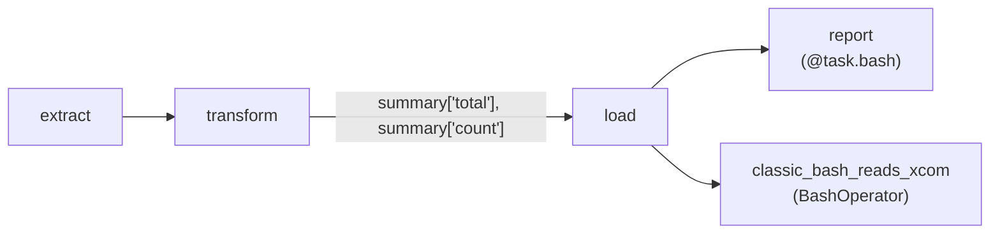

# The TaskFlow API

**What you'll learn:** how to write DAGs as plain Python functions with `@dag` and `@task`, how return values travel between tasks, how to unpack a dict into several outputs, and how TaskFlow mixes with classic operators.

> **Run it**
> - DAG id: `02_taskflow_api`
> - File: [../dags/02_taskflow_api.py](../dags/02_taskflow_api.py)
> - `schedule=None`, so it only runs when you trigger it. Unpause, press **Trigger**, then open each task's **XCom** tab.



---

## Why TaskFlow?

In [05-first-dag.md](05-first-dag.md) we built tasks by creating operator objects and wiring them with `>>`. That works, but passing data between Python tasks is clumsy: you push and pull [XComs](32-glossary.md) by hand.

TaskFlow lets you write:

```python
orders = extract()
summary = transform(orders)
```

and Airflow works out two things for you:
1. **Dependencies:** `transform` uses the output of `extract`, so `extract >> transform` is added automatically.
2. **Data passing:** `extract`'s return value is stored as an XCom, and `transform` receives the real value when it runs.

---

## 1. Imports and the `@dag` decorator

```python
import json

import pendulum

from airflow.providers.standard.operators.bash import BashOperator
from airflow.sdk import dag, task


@dag(
    dag_id="02_taskflow_api",
    schedule=None,  # manual trigger only
    start_date=pendulum.datetime(2026, 1, 1, tz="UTC"),
    tags=["tutorial", "01-basics"],
    doc_md=__doc__,
)
def taskflow_api():
    ...
```

`@dag(...)` takes the **same arguments** as `DAG(...)`. The decorated function is a *DAG factory*: its body creates the tasks. If you leave out `dag_id`, the function name is used.

`schedule=None` means the scheduler never creates runs on its own; you trigger it from the UI, CLI or API.

### The call at the bottom

```python
# Calling the @dag function registers the DAG. Don't forget this line!
taskflow_api()
```

The decorator alone does not create a DAG. Calling the function runs its body and returns a `DAG` object, which Airflow finds when it parses the file. **If you forget this call, the DAG never shows up in the UI** and there is no error message.

---

## 2. `@task` and return values

```python
    @task
    def extract() -> dict:
        """Pretend to download orders. The returned dict is saved as an XCom."""
        data = '{"1001": 301.27, "1002": 433.21, "1003": 502.22}'
        return json.loads(data)
```

`@task` turns the function into a task whose `task_id` is the function name, `extract`. When the task runs on a worker, the function is called and its return value is stored as an XCom with key `return_value`.

Calling `extract()` inside the DAG function does **not** run the code. It creates the task and returns an `XComArg`, a placeholder that means "the output of `extract`, once it exists".

> Return values must be serializable by Airflow: JSON-friendly types (str, int, float, bool, None, list, dict) plus a few extras such as datetimes. They are stored in the metadata database, so keep them small. See [08-xcom.md](08-xcom.md).

---

## 3. `multiple_outputs`

```python
    # multiple_outputs=True stores each dict key as its own XCom, so downstream tasks
    # can use summary["total"] and summary["count"] independently.
    @task(multiple_outputs=True)
    def transform(orders: dict) -> dict:
        total = sum(orders.values())
        return {"total": round(total, 2), "count": len(orders)}
```

With `multiple_outputs=True`, Airflow stores the returned dict **as a whole** (key `return_value`) **and** each key as a separate XCom (`total`, `count`). That lets the next task take only the pieces it needs:

```python
    summary = transform(orders)
    message = load(summary["total"], summary["count"])
```

`summary["total"]` is again a placeholder, pointing at the XCom with key `total`.

> **Heads-up — inferred `multiple_outputs`:** if a `@task` function's return annotation is `dict` (or `dict[str, ...]`, or any `Mapping`), Airflow turns `multiple_outputs` on **automatically**. In this file that means `extract() -> dict` also unrolls its keys into the XComs `1001`, `1002` and `1003`, and `transform` would behave the same without the explicit `multiple_outputs=True`. Open the **XCom** tab of `extract` to see it. If you don't want this, write `@task(multiple_outputs=False)`. Every key must be a string, otherwise the task fails.

---

## 4. Receiving values

```python
    @task
    def load(total: float, count: int) -> str:
        message = f"{count} orders, total value {total}"
        print(message)
        return message
```

Inside the function `total` and `count` are ordinary Python values (`1236.7` and `3`). Airflow pulled them from XCom before calling the function.

---

## 5. `@task.bash`

```python
    # @task.bash: the function RETURNS the bash command to run.
    @task.bash
    def report(message: str) -> str:
        return f'echo "REPORT: {message}"'
```

`@task.bash` is the TaskFlow version of `BashOperator`. The Python function runs first and **returns the command string**; Airflow then renders it as a Jinja template and runs it with bash. Use it when the command depends on upstream values or Python logic. The last line printed to stdout becomes the task's XCom.

---

## 6. Wiring by calling

```python
    # Calling the functions wires everything together:
    orders = extract()
    summary = transform(orders)
    message = load(summary["total"], summary["count"])
    report(message)
```

These four lines create four tasks and three dependencies: `extract >> transform >> load >> report`. No `>>` needed.

If a task does not use another task's output but must still run after it, add the dependency yourself: `extract() >> cleanup()`.

---

## 7. Mixing TaskFlow with classic operators

```python
    # Classic operators mix fine with TaskFlow. Here we read the XCom of `load`
    # with Jinja, and set the dependency with >>.
    classic_bash_reads_xcom = BashOperator(
        task_id="classic_bash_reads_xcom",
        bash_command="echo 'load returned: {{ ti.xcom_pull(task_ids=\"load\") }}'",
    )
    message >> classic_bash_reads_xcom
```

Two things to notice:

- The classic `BashOperator` cannot take `message` as a Python argument. Instead it reads `load`'s XCom inside a **Jinja template** with `ti.xcom_pull(task_ids="load")`.
- Pulling an XCom in a template does **not** create a dependency, so `message >> classic_bash_reads_xcom` adds it. The `>>` works directly on the `XComArg` placeholder.

You can also go the other way: pass a classic operator's output into a `@task` with `operator.output`, e.g. `my_task(bash_op.output)`. `.output` is an `XComArg` for that operator's `return_value`.

---

## Context values in TaskFlow tasks

A TaskFlow task can ask for any task-context value **by naming it as a parameter with a default of `None`**:

```python
@task
def show(ti=None, ds=None, params=None, logical_date=None, run_id=None):
    print(ti.task_id, ds, params, logical_date, run_id)
```

Airflow sees the parameter names, matches them against the context, and fills them in when the task runs. The `=None` default is the convention used throughout this project: it shows readers (and type checkers) that the value is injected, not passed by you. Airflow 3.4 adds the `None` default itself for known context names if you leave it out, but a **different** default such as `ti="x"` is rejected when the DAG is parsed. Examples in this project: `push_with_keys(ti=None)` in [04_xcom.py](../dags/04_xcom.py), `choose_plan(params=None)` and `is_business_day(logical_date=None)` in [05_branching_and_trigger_rules.py](../dags/05_branching_and_trigger_rules.py), `drop_file(ts_nodash=None)` in [08_sensors_and_deferrable.py](../dags/08_sensors_and_deferrable.py).

Commonly used names:

| Name | Type / example |
|---|---|
| `ti` / `task_instance` | the running task instance (`xcom_push`, `xcom_pull`, `try_number`, `map_index`) |
| `dag_run`, `run_id` | the current DAG run and its id |
| `logical_date`, `ds`, `ds_nodash`, `ts`, `ts_nodash` | the run's logical date in different formats (absent if the run has no logical date) |
| `data_interval_start`, `data_interval_end` | the period the run covers |
| `params` | the run's [params](14-params-variables-templating.md) |
| `dag`, `task` | the DAG and task objects |
| `conn`, `var`, `macros` | helpers for connections, variables and macros |

Or take everything at once with `**context`, as in [01_hello_airflow.py](../dags/01_hello_airflow.py).

### `get_current_context()`

If you are deep inside helper code and don't want to thread `ti` through every function, call:

```python
from airflow.sdk import get_current_context

def helper():
    context = get_current_context()
    print(context["run_id"])
```

It only works while a task is running (calling it at parse time raises an error). [06_dynamic_task_mapping.py](../dags/06_dynamic_task_mapping.py) uses it in `process_file`.

---

## Other `@task.*` decorators

`@task` is short for `@task.python`. In the local `.venv` of this project (Airflow 3.4.0 with the standard and common-sql providers), these decorators are available:

| Decorator | Equivalent operator | Use it for | Covered in |
|---|---|---|---|
| `@task` / `@task.python` | `PythonOperator` | Run Python | this chapter |
| `@task.bash` | `BashOperator` | Return a shell command to run | this chapter |
| `@task.branch` | `BranchPythonOperator` | Return the task id(s) to follow | [09](09-branching-and-trigger-rules.md) |
| `@task.short_circuit` | `ShortCircuitOperator` | Return `False` to skip everything downstream | [09](09-branching-and-trigger-rules.md) |
| `@task.sensor` | `PythonSensor` | Return `True`/`PokeReturnValue` when a condition is met | [12](12-sensors-and-deferrable.md) |
| `@task.virtualenv` | `PythonVirtualenvOperator` | Run in a fresh virtualenv with its own `requirements` | — |
| `@task.external_python` | `ExternalPythonOperator` | Run with an existing Python interpreter (`python="/path/to/python"`) | — |
| `@task.branch_virtualenv`, `@task.branch_external_python` | branch variants of the two above | Branching in an isolated environment | — |
| `@task.sql` | `SQLExecuteQueryOperator` (common-sql provider) | Return a SQL string to run on a connection (`conn_id=...`) | — |

The same list also contains `@task.stub` and `@task.analytics`; they are specialised and not used in this project.

Other providers add their own. For example `@task.docker` (Docker provider) and `@task.kubernetes` (cncf.kubernetes provider) run the function inside a container. Those providers are **not** installed in this project's local `.venv` (`make venv`), so the decorators don't exist there. The official `apache/airflow:3.4.0` Docker image ships many more providers; check with `airflow providers list` inside the container.

To list the decorators in your own environment:

```bash
source scripts/local_env.sh
python -c "from airflow.providers_manager import ProvidersManager; print(sorted(ProvidersManager().taskflow_decorators))"
```

All decorated tasks also accept operator arguments: `@task(retries=3, pool="api_pool")`, `@task.bash(env={"X": "1"})`, and so on. To reuse one decorated function several times in the same DAG, change its id with `.override()`:

```python
extract.override(task_id="extract_eu")()
extract.override(task_id="extract_us")()
```

---

## Common mistakes

- **Forgetting `taskflow_api()` at the bottom.** The DAG silently doesn't appear.
- **Expecting real values at parse time.** `orders = extract()` is a placeholder. `print(orders)` in the DAG body prints an `XComArg`, and `orders["1001"]` is another placeholder, not a number.
- **Naming clashes with context keys.** A parameter called `params`, `ds`, `ti`, `run_id` … is always filled from the context. Don't use those names for your own data, and don't give them a default other than `None`.
- **Returning big or non-serializable objects** (DataFrames, open files, clients). Write the data somewhere and return a path; see [08-xcom.md](08-xcom.md).
- **Surprise `multiple_outputs`.** A `-> dict` annotation unrolls the dict into separate XComs. Usually harmless, but it fails if a key is not a string.
- **Assuming a Jinja `xcom_pull` adds a dependency.** It doesn't; add `>>` yourself, as the example does with `message >> classic_bash_reads_xcom`.

## Try it yourself

1. Add a fourth order to the JSON string in `extract` and check that `load` prints `4 orders`.
2. Change `transform` to also return `"max": max(orders.values())`, and print it in a new task that takes `summary["max"]`.
3. Add a task `@task def audit(ti=None, run_id=None)` that prints `ti.try_number` and `run_id`, and run it after `report` using `>>`.
4. Decorate `extract` with `@task(multiple_outputs=False)` instead of `@task`, trigger again, and compare the **XCom** tab of `extract` with the previous run.

---

**Next →** [07-operators-and-dependencies.md](07-operators-and-dependencies.md) · [Back to the index](README.md)
