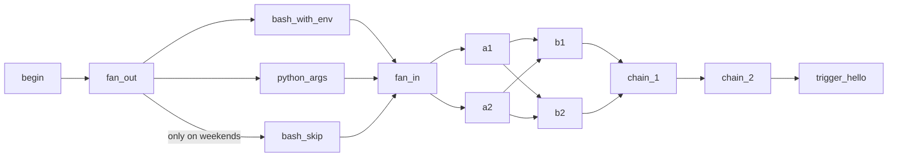

# Operators and dependencies

**What you'll learn:** the main kinds of operators, the most useful options of `BashOperator` and `PythonOperator`, every way to declare "this runs before that", and how one DAG can trigger another. We finish with providers, the packages that bring operators for other systems.

> **Run it**
> - DAG id: `03_operators_and_dependencies`
> - File: [../dags/03_operators_and_dependencies.py](../dags/03_operators_and_dependencies.py)
> - `schedule=None`. Unpause and **Trigger**. The last task triggers `01_hello_airflow`; that run only executes if `01_hello_airflow` is unpaused too.



After a run, `bash_skip` is **skipped** (pink) on purpose, and every other task is green.

---

## Kinds of operators

An **operator** is a class that describes one kind of work. A **task** is an operator placed in a DAG with a `task_id`. Operators fall into a few families:

| Family | What it does | Examples |
|---|---|---|
| **Action** operators | Do something: run code, a command, a query | `BashOperator`, `PythonOperator`, `SQLExecuteQueryOperator` |
| **Transfer** operators | Move data from system A to system B | `S3ToRedshiftOperator`, `GCSToBigQueryOperator` (from providers) |
| **Sensors** | Wait until something is true | `FileSensor`, `ExternalTaskSensor` — see [12](12-sensors-and-deferrable.md) |
| **Control-flow** operators | Decide what runs next | `BranchPythonOperator`, `ShortCircuitOperator` — see [09](09-branching-and-trigger-rules.md); `TriggerDagRunOperator` |
| **No-op** | Structure only | `EmptyOperator` |

TaskFlow decorators (`@task`, `@task.bash` …) are a different way to *create* these operators; under the hood `@task.bash` is a `BashOperator`.

All operators inherit from `BaseOperator`, so they share arguments such as `task_id`, `retries`, `retry_delay`, `trigger_rule`, `pool`, `execution_timeout`, `doc_md` and the callbacks.

---

## The file, section by section

### Imports and a helper function

```python
from airflow.providers.standard.operators.bash import BashOperator
from airflow.providers.standard.operators.empty import EmptyOperator
from airflow.providers.standard.operators.python import PythonOperator
from airflow.providers.standard.operators.trigger_dagrun import TriggerDagRunOperator
from airflow.sdk import DAG, Label, TriggerRule, chain, cross_downstream, task


def greet(name: str, greeting: str = "Hello", *, punctuation: str = "!") -> str:
    message = f"{greeting}, {name}{punctuation}"
    print(message)
    return message
```

Dependency helpers (`chain`, `cross_downstream`, `Label`) and `TriggerRule` come from `airflow.sdk`. `greet` is a plain function with a positional argument, a keyword argument with a default, and a keyword-only argument (after `*`). We'll call it from a `PythonOperator`.

### `begin` and `fan_out`

```python
    begin = EmptyOperator(task_id="begin")
    fan_out = EmptyOperator(task_id="fan_out")
```

Two no-op tasks used as structure.

---

## `BashOperator` in detail

### Environment variables: `env` and `append_env`

```python
    bash_with_env = BashOperator(
        task_id="bash_with_env",
        # `env` sets environment variables for the command; values can be templated too.
        env={"RUN_ID": "{{ run_id }}", "GREETING": "hi"},
        append_env=True,  # keep the normal environment (PATH etc.) as well
        bash_command='echo "$GREETING from run $RUN_ID"; uname -a',
    )
```

- `env` is a dict of environment variables for the command. It is a template field, so `{{ run_id }}` is replaced before the command runs.
- By default (`append_env=False`), passing `env` **replaces** the worker's environment: the command sees only your variables, not `PATH`, `HOME` or the Airflow variables. `append_env=True` adds your variables on top of the normal environment.
- Passing values through `env` and reading `$RUN_ID` in bash is safer than pasting `{{ ... }}` straight into the command, because the shell doesn't interpret the value.

The task's log shows `hi from run manual__...` and the machine's `uname -a`. The **last line** of output (`uname`'s) is pushed as the task's XCom.

### Exit codes: `skip_on_exit_code`

```python
    bash_skip = BashOperator(
        task_id="bash_skip",
        bash_command="echo 'nothing to do today' && exit 99",  # exit 99 => task is SKIPPED
        # skip_on_exit_code=99 is the default. Any other non-zero code => FAILED.
    )
```

| Exit code | Task state |
|---|---|
| `0` | success |
| `99` (the default `skip_on_exit_code`) | **skipped** |
| any other non-zero code | failed (and retried if `retries` > 0) |

You can change the skip code with `skip_on_exit_code=3`, accept several with `skip_on_exit_code=[3, 4]`, or turn skipping off with `skip_on_exit_code=None`.

Other `BashOperator` arguments worth knowing:

| Argument | Meaning |
|---|---|
| `cwd` | Working directory for the command (templated). By default a temporary directory is used. |
| `output_processor` | A function applied to the last output line before it becomes the XCom. |
| `bash_command="script.sh"` | If the command ends in `.sh` or `.bash`, Airflow loads the file (relative to the DAG folder or `template_searchpath`) and renders it as a template. |

Docs: [BashOperator guide](https://airflow.apache.org/docs/apache-airflow-providers-standard/stable/operators/bash.html).

---

## `PythonOperator` with `op_args` and `op_kwargs`

```python
    python_args = PythonOperator(
        task_id="python_args",
        python_callable=greet,
        op_args=["Airflow learner"],  # positional arguments
        op_kwargs={"greeting": "Welcome", "punctuation": " 🎉"},  # keyword arguments
    )
```

Airflow calls `greet(*op_args, **op_kwargs)`, i.e. `greet("Airflow learner", greeting="Welcome", punctuation=" 🎉")`. The log shows `Welcome, Airflow learner 🎉`, and the return value is pushed as an XCom.

- `op_args` and `op_kwargs` are template fields, so values like `"{{ ds }}"` are rendered first.
- If the callable also has `**context` (or parameters named like context keys), Airflow injects the context as in [05-first-dag.md](05-first-dag.md).
- `templates_dict={...}` is another templated dict, passed in the context as `templates_dict`.

---

## Joining after a skip

```python
    # NONE_FAILED: run even though one upstream (bash_skip) was skipped.
    # The default trigger rule ALL_SUCCESS would skip fan_in too. More in example 05.
    fan_in = EmptyOperator(task_id="fan_in", trigger_rule=TriggerRule.NONE_FAILED)
```

With the default `all_success` rule, a skipped upstream task makes the downstream task skipped too. `none_failed` says "run if nothing upstream failed; skipped is fine". All trigger rules are in [09-branching-and-trigger-rules.md](09-branching-and-trigger-rules.md).

---

## Every way to declare dependencies

### `>>` and `<<` with single tasks and lists

```python
    # Lists: one task -> many tasks, many -> one.
    begin >> fan_out >> [bash_with_env, python_args, bash_skip] >> fan_in
```

`a >> b` = "a before b". `b << a` means the same. A list on one side fans out (`fan_out` → each of three) or fans in (each of three → `fan_in`).

You **cannot** put a list on both sides: `[a1, a2] >> [b1, b2]` raises `TypeError`, because Python has no `>>` between two lists. That is what `cross_downstream` is for.

### `set_upstream` / `set_downstream`

The method forms do the same as the operators:

```python
fan_out.set_downstream(bash_with_env)   # fan_out >> bash_with_env
fan_in.set_upstream([a1, a2])           # [a1, a2] >> fan_in
```

The project uses `.set_upstream(...)` in [04_xcom.py](../dags/04_xcom.py). Use whichever reads better; most people prefer `>>`.

### Edge labels with `Label`

```python
    # Labels annotate edges in the Graph view.
    fan_out >> Label("only on weekends") >> bash_skip
```

`Label` puts text on the arrow in the Graph view. It changes nothing about how the DAG runs: `bash_skip` doesn't check the weekday, the label is only documentation. The edge `fan_out → bash_skip` already existed from the list line; this line attaches the label to it. Labels are most useful after branches, as in [09](09-branching-and-trigger-rules.md).

### `cross_downstream`: every task to every task

```python
    a1, a2 = EmptyOperator(task_id="a1"), EmptyOperator(task_id="a2")
    b1, b2 = EmptyOperator(task_id="b1"), EmptyOperator(task_id="b2")
    fan_in >> [a1, a2]
    cross_downstream([a1, a2], [b1, b2])
```

`cross_downstream([a1, a2], [b1, b2])` creates four edges: `a1→b1`, `a1→b2`, `a2→b1`, `a2→b2`. So `b1` and `b2` each wait for both `a1` and `a2`.

### `chain`: long sequences

```python
    @task.bash
    def chain_1() -> str:
        return "echo 'step 1 of the chain'"

    @task.bash
    def chain_2() -> str:
        return "echo 'step 2 of the chain'"
    ...
    # chain(a, b, c) == a >> b >> c. Lists inside chain fan out/in.
    chain([b1, b2], chain_1(), chain_2(), trigger_hello)
```

`chain(a, b, c)` is `a >> b >> c`. It's handy when the list of steps is built in a loop: `chain(*tasks)`.

Lists inside `chain`:
- A list next to a single task fans in or out: `chain([b1, b2], chain_1())` → `b1 >> chain_1`, `b2 >> chain_1`.
- Two lists next to each other are connected **pairwise**, not all-to-all: `chain([a, b], [c, d])` → `a >> c`, `b >> d`. Both lists must have the same length.
- For all-to-all between consecutive lists, use `chain_linear` (also in `airflow.sdk`).

Notice that classic operators (`b1`, `trigger_hello`) and TaskFlow tasks (`chain_1()`) mix freely in `chain` and `>>`.

### Summary

| You want | Write |
|---|---|
| a before b | `a >> b` or `b << a` or `a.set_downstream(b)` |
| one before many | `a >> [b, c]` |
| many before one | `[a, b] >> c` |
| every one of list 1 before every one of list 2 | `cross_downstream([a, b], [c, d])` |
| a long line | `chain(a, b, c, d)` |
| text on an arrow | `a >> Label("why") >> b` |
| data and order together (TaskFlow) | `b(a())` |

---

## Triggering another DAG: `TriggerDagRunOperator`

```python
    # Creates a run of 01_hello_airflow (it only executes if that DAG is unpaused).
    trigger_hello = TriggerDagRunOperator(
        task_id="trigger_hello",
        trigger_dag_id="01_hello_airflow",
        conf={"triggered_by": "03_operators_and_dependencies"},
        wait_for_completion=False,
    )
```

This task creates a new DAG run of `01_hello_airflow`, as if you pressed Trigger in the UI.

- `trigger_dag_id` — the DAG to start.
- `conf` — a dict passed to the new run. The triggered DAG can read it as `{{ dag_run.conf }}` in templates or `context["dag_run"].conf` in Python, and it overrides matching [params](14-params-variables-templating.md). `01_hello_airflow` doesn't read it, but you can see it on that run's details page.
- `wait_for_completion=False` — the task succeeds as soon as the run is *created*. With `True`, the task waits until the other run finishes, checking every `poke_interval` seconds (default 60). It then succeeds if the run ends in one of `allowed_states` (default `["success"]`) and fails if it ends in one of `failed_states` (default `["failed"]`). Add `deferrable=True` to do that waiting in the triggerer instead of holding a worker slot ([12](12-sensors-and-deferrable.md)).
- No `logical_date` is passed, so the new run gets the current time as its logical date (that's why `{{ ds }}` works in `01_hello_airflow`).

Other useful arguments: `trigger_run_id` (choose the run id), `reset_dag_run=True` (clear and re-run if that run id already exists), `skip_when_already_exists=True`, and `fail_when_dag_is_paused=True` (fail instead of creating a run that waits for an unpause).

After a run, open `trigger_hello` in the UI: it has a **Triggered DAG** link that jumps to the run it created.

> `TriggerDagRunOperator` pushes work to another DAG. To *wait* for another DAG's task instead, use `ExternalTaskSensor` ([12](12-sensors-and-deferrable.md)). To start a DAG whenever data is updated, [Assets](13-assets-data-aware-scheduling.md) are often the cleaner tool.

---

## Providers: operators for everything else

Airflow core contains no code for AWS, Google Cloud, Snowflake, Slack and so on. That code lives in **provider packages**: separately installed and versioned Python packages named `apache-airflow-providers-<name>`. A provider can contain operators, hooks ([15](15-connections-and-hooks.md)), sensors, triggers, connection types, TaskFlow decorators and more.

Even the basics come from a provider: `BashOperator`, `PythonOperator`, `EmptyOperator` and `TriggerDagRunOperator` live in `apache-airflow-providers-standard` (import path `airflow.providers.standard...`).

This project's local `.venv` has these providers: standard, common-sql, common-io, common-compat, http, postgres and smtp. The official `apache/airflow:3.4.0` Docker image includes many more (amazon, google, cncf-kubernetes, celery, fab …). To see what's installed:

```bash
airflow providers list          # inside the container (make cli) or after: source scripts/local_env.sh
```

To add one to the Docker image, put it in [requirements.txt](../requirements.txt) and build your own image (see [03-installation-and-setup.md](03-installation-and-setup.md)).

**Where to find operators:**
- The official provider docs index: https://airflow.apache.org/docs/#providers-packages-docs-apache-airflow-providers-index-html — each provider has a page listing its operators, hooks and connection types, with how-to guides.
- The Astronomer Registry: https://registry.astronomer.io — searchable across providers, with examples.

When you need to talk to a system, look for a provider operator **before** writing a `PythonOperator` full of client code. If none fits, write your own operator ([17](17-custom-operators-hooks-plugins.md)).

---

## Common mistakes

- **`[a, b] >> [c, d]`** raises `TypeError`. Use `cross_downstream` (all-to-all) or `chain` (pairwise).
- **`env=` without `append_env=True`** and then `command not found` or missing variables: you replaced the whole environment.
- **Using exit code 99 by accident** in a script and wondering why the task is skipped. Set `skip_on_exit_code=None` if 99 means an error for you.
- **Forgetting that skips spread.** After a skipped task, downstream tasks with the default `all_success` rule are skipped too. Use `none_failed` or `none_failed_min_one_success` on the join.
- **Expecting `TriggerDagRunOperator` to run a paused DAG.** The run is created but waits until the target DAG is unpaused.
- **Thinking `Label` adds logic.** It is display-only.

## Try it yourself

1. Change `bash_skip`'s command to `exit 1`. Trigger the DAG: `bash_skip` fails, and `fan_in` (rule `none_failed`) becomes *upstream_failed*, so everything after it doesn't run.
2. Remove `append_env=True` from `bash_with_env` and check the log. Then add `"PATH": "/usr/bin:/bin"` to `env` and compare.
3. Replace `cross_downstream([a1, a2], [b1, b2])` with `chain([a1, a2], [b1, b2])` and compare the Graph view (pairwise vs all-to-all).
4. Set `wait_for_completion=True` and `poke_interval=10` on `trigger_hello`, unpause `01_hello_airflow`, and watch `trigger_hello` stay running until the other DAG finishes.

---

**Next →** [08-xcom.md](08-xcom.md) · [Back to the index](README.md)
