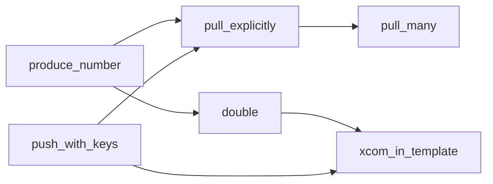

# XCom: passing data between tasks

**What you'll learn:** what XCom is and where it lives, how to push and pull values (automatically, with keys, from several tasks, inside Jinja), why XComs must stay small, and how XCom behaves with mapped tasks.

> **Run it**
> - DAG id: `04_xcom`
> - File: [../dags/04_xcom.py](../dags/04_xcom.py)
> - `schedule=None`. Unpause, **Trigger**, then click each task and open its **XCom** tab. **Browse → XComs** lists all of them.



---

## What is XCom?

Tasks in a DAG are separate processes, often on separate machines. They share no memory, so a Python variable set in one task does not exist in the next.

**XCom** ("cross-communication") is Airflow's built-in way to hand a *small* value from one task to another. Each XCom is a record in the **metadata database** identified by:

| Part | Example |
|---|---|
| DAG id | `04_xcom` |
| run id | `manual__2026-11-11T10:00:00+00:00` |
| task id | `push_with_keys` |
| map index | `-1` for a normal task, `0, 1, 2…` for [mapped](10-dynamic-task-mapping.md) instances |
| **key** | `file_path` |
| value | `"/opt/airflow/data/report.csv"` |

The value is stored as JSON. Airflow's serializer accepts JSON types (str, int, float, bool, None, list, dict) and also some extras such as datetimes and tuples. In Airflow 3 tasks don't touch the database directly: they read and write XComs through the API server's Execution API, using the Task SDK ([02-architecture.md](02-architecture.md)).

XComs belong to **one DAG run**. A new run starts with no XComs, and clearing a task removes the XComs it pushed.

---

## 1. Return values are pushed automatically

```python
    @task
    def produce_number() -> int:
        return 42
```

Whatever a task returns is pushed with the key **`return_value`**. This is true for `@task` functions, `PythonOperator` callables, and many other operators (`BashOperator` pushes its last output line). Set `do_xcom_push=False` on an operator to stop it.

---

## 2. Pushing with your own keys

```python
    @task
    def push_with_keys(ti=None) -> None:
        ti.xcom_push(key="file_path", value="/opt/airflow/data/report.csv")
        ti.xcom_push(key="row_count", value=1234)
```

`ti` is the **task instance**, injected because the parameter has that name ([06-taskflow-api.md](06-taskflow-api.md#context-values-in-taskflow-tasks)). `ti.xcom_push(key, value)` stores extra values under keys you choose. A task can push as many keys as it wants. This task returns `None`, so it has no `return_value` XCom.

---

## 3. Pulling explicitly

```python
    @task
    def pull_explicitly(ti=None) -> dict:
        number = ti.xcom_pull(task_ids="produce_number")  # key defaults to return_value
        path = ti.xcom_pull(task_ids="push_with_keys", key="file_path")
        rows = ti.xcom_pull(task_ids="push_with_keys", key="row_count")
        print(f"number={number}, path={path}, rows={rows}")
        return {"number": number, "path": path, "rows": rows}
```

`ti.xcom_pull(...)` reads a value. Its main arguments:

| Argument | Default | Meaning |
|---|---|---|
| `task_ids` | the **current** task | Which task(s) pushed it. A string returns one value; a list returns a list. |
| `key` | `"return_value"` | Which key. |
| `dag_id` | current DAG | Read from another DAG (rarely needed). |
| `run_id` | current run | Read from another run of the same DAG. |
| `map_indexes` | all instances | Which mapped instance(s); see below. |
| `include_prior_dates` | `False` | Also look at earlier runs. |
| `default` | `None` | Returned when nothing matches. |

If nothing is found, you get `None` (or your `default`) — not an error. That is why a missing dependency shows up as a mysterious `None` rather than a crash.

> **Heads-up:** `pull_explicitly` is annotated `-> dict`, so TaskFlow turns on `multiple_outputs` automatically ([06](06-taskflow-api.md#3-multiple_outputs)). Its XCom tab shows `return_value` **and** separate `number`, `path` and `rows` entries.

---

## 4. Pulling from several tasks at once

```python
    @task
    def pull_many(ti=None) -> list:
        values = ti.xcom_pull(task_ids=["produce_number", "pull_explicitly"])
        print(f"Got: {values}")
        return values
```

Passing a list of task ids returns a **list in the same order**: `[42, {"number": 42, "path": "/opt/airflow/data/report.csv", "rows": 1234}]`.

---

## 5. The TaskFlow way: pass the return value

```python
    @task
    def double(value: int) -> int:
        return value * 2

    number = produce_number()
    ...
    doubled = double(number)
```

`double(number)` does three things: it creates a dependency `produce_number >> double`, it pulls `produce_number`'s `return_value` at runtime, and it passes `42` as `value`. `double` returns `84`. Prefer this style whenever both tasks are TaskFlow tasks.

---

## Explicit pulls need explicit dependencies

```python
    number = produce_number()
    keys = push_with_keys()
    explicit = pull_explicitly()

    # Explicit pulls don't create dependencies automatically, so declare them:
    [number, keys] >> explicit >> pull_many()
```

`pull_explicitly()` is called with no arguments, so Airflow can't know it reads from `produce_number` and `push_with_keys`. Without this line, all three could run at the same time and `pull_explicitly` might read `None`. **Every `xcom_pull` by task id needs a matching `>>`.**

---

## 6. XCom in Jinja templates

```python
    BashOperator(
        task_id="xcom_in_template",
        bash_command=(
            "echo 'doubled = {{ ti.xcom_pull(task_ids=\"double\") }}' && "
            "echo 'file = {{ ti.xcom_pull(task_ids=\"push_with_keys\", key=\"file_path\") }}'"
        ),
    ).set_upstream([doubled, keys])
```

Classic operators can't receive Python arguments from TaskFlow, but any **templated field** can call `ti.xcom_pull(...)`. The log prints:

```
doubled = 84
file = /opt/airflow/data/report.csv
```

`.set_upstream([doubled, keys])` is the method form of `[doubled, keys] >> xcom_in_template` — again, the template pull alone adds no dependency. Open **Rendered Templates** on this task to see the final command.

An alternative for a single `return_value`: classic operators accept an `XComArg` in a templated field directly, e.g. `BashOperator(..., env={"N": doubled})` — this *does* create the dependency.

---

## Keep XComs small

XComs live in the metadata database, the same database the scheduler uses to run everything. Large values slow it down for every DAG, make the UI sluggish, and can hit database column limits.

| Put in XCom | Don't put in XCom |
|---|---|
| ids, counts, flags, short strings | DataFrames, query results with thousands of rows |
| file paths, S3/GCS URIs, table names | file contents, images, model weights |
| small config dicts | anything sensitive (XComs are visible in the UI) |

**Pass references, not data.** Write the data to a file, bucket or table, and push its *location*. The example does exactly this with `file_path` = `/opt/airflow/data/report.csv`. The capstone in [24-capstone-sales-etl.md](24-capstone-sales-etl.md) uses the same pattern.

---

## Custom XCom backends

The storage behind XCom is pluggable via `[core] xcom_backend` (default `airflow.sdk.execution_time.xcom.BaseXCom`, i.e. the metadata database). A custom backend is a subclass of `airflow.sdk.BaseXCom` that overrides `serialize_value` / `deserialize_value` to store the real value elsewhere and keep only a reference in the database.

You rarely need to write one. The **common-io provider** (installed in this project) ships `XComObjectStorageBackend`, which writes XCom values to object storage (S3, GCS, Azure Blob, local disk …) above a size threshold:

```ini
[core]
xcom_backend = airflow.providers.common.io.xcom.backend.XComObjectStorageBackend

[common.io]
xcom_objectstorage_path = s3://my-conn@my-bucket/xcom
xcom_objectstorage_threshold = 1000000   # bytes; -1 (default) = always DB, 0 = always object storage
xcom_objectstorage_compression = gzip     # optional
```

(As environment variables: `AIRFLOW__CORE__XCOM_BACKEND`, `AIRFLOW__COMMON_IO__XCOM_OBJECTSTORAGE_PATH`, …). Docs: [Object Storage XCom Backend](https://airflow.apache.org/docs/apache-airflow-providers-common-io/stable/xcom_backend.html) and [Custom XCom backends](https://airflow.apache.org/docs/apache-airflow/stable/core-concepts/xcoms.html#custom-xcom-backends).

A bigger backend doesn't change the advice above: passing a reference is still clearer and cheaper than shipping data through XCom.

---

## Seeing XComs in the UI

- **Task instance → XCom tab:** every key the task pushed in that run, with its value.
- **Browse → XComs:** a searchable list across DAGs, runs and tasks.
- **Rendered Templates tab:** shows what `{{ ti.xcom_pull(...) }}` turned into.

---

## XComs and mapped tasks

With [dynamic task mapping](10-dynamic-task-mapping.md), one task becomes many **mapped task instances**, each with its own `map_index` and its own XComs.

- In TaskFlow, passing a mapped task's output to a normal task gives you **all** results as a list (in map-index order). That is the "reduce" step: `total(squares)` in [06_dynamic_task_mapping.py](../dags/06_dynamic_task_mapping.py) receives `[1, 4, 9, 16]`. The value is a lazy sequence; iterate it or call `list(values)`.
- With `ti.xcom_pull(task_ids="square")`, you also get a list of every instance's value. To get specific instances, use `map_indexes=0` or `map_indexes=[0, 2]`.
- The XCom tab of a mapped task shows the values per instance (pick the instance first).
- You can only map over a task's `return_value`, not over a custom key.

---

## Common mistakes

- **Missing dependency for an explicit pull** → the pull returns `None`. Add `>>`.
- **Typo in `task_ids` or `key`** → also `None`, no error. Check the XCom tab for exact names.
- **Pushing big data** (DataFrames, whole files). Store it elsewhere and push the path.
- **Non-serializable values** (open connections, custom class instances) → the task fails when pushing.
- **Expecting XComs from another run.** By default pulls only see the current run; use `include_prior_dates=True` or `run_id=...` on purpose.
- **Secrets in XCom.** Anyone who can see the DAG can read its XComs in the UI.

## Try it yourself

1. In `push_with_keys`, also return a value (`return "done"`) and check that a `return_value` entry appears next to `file_path` and `row_count`.
2. Remove the line `[number, keys] >> explicit >> pull_many()` (keep `pull_many()` called somewhere so it still exists) and trigger a few times. Look at the Graph view and at what `pull_explicitly` prints.
3. Add a key that doesn't exist to `pull_explicitly`: `ti.xcom_pull(task_ids="push_with_keys", key="nope", default="fallback")` and print it.
4. Change `xcom_in_template` to read `pull_explicitly`'s `rows` key in the template.

---

**Next →** [09-branching-and-trigger-rules.md](09-branching-and-trigger-rules.md) · [Back to the index](README.md)
