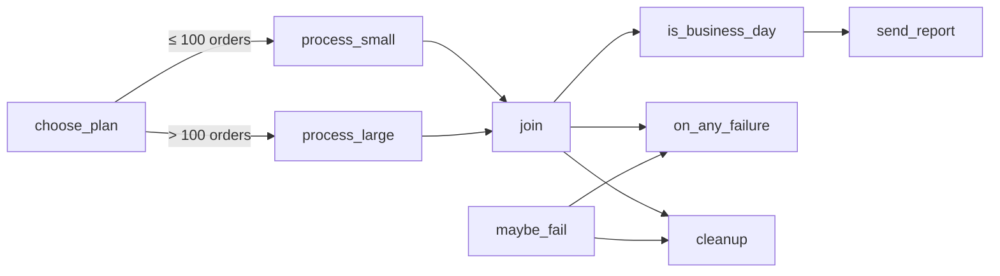
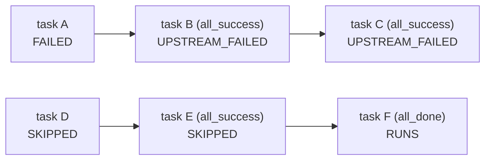

# Branching and trigger rules

**What you'll learn:** how to choose a path at runtime with `@task.branch`, how to stop a DAG early with `@task.short_circuit`, and how **trigger rules** decide whether a task runs after its upstream tasks succeed, fail or are skipped. You'll also see why the task after a branch needs a special rule.

> **Run it**
> - DAG id: `05_branching_and_trigger_rules`
> - File: [../dags/05_branching_and_trigger_rules.py](../dags/05_branching_and_trigger_rules.py)
> - `schedule=None`. Unpause and press **Trigger**. The dialog shows a form with two params, `order_count` and `make_it_fail`. Change them and trigger again to see different paths.



| Task | Kind | Trigger rule |
|---|---|---|
| `choose_plan` | `@task.branch` | default (`all_success`) |
| `process_small`, `process_large` | `@task` | default |
| `join` | `@task` | `none_failed_min_one_success` |
| `is_business_day` | `@task.short_circuit` | default |
| `send_report` | `@task` | default |
| `maybe_fail` | `@task(retries=0)` | default |
| `on_any_failure` | `@task` | `one_failed` |
| `cleanup` | `@task` | `all_done` |

---

## Params that change behaviour

```python
@dag(
    dag_id="05_branching_and_trigger_rules",
    ...
    params={
        "order_count": Param(150, type="integer", minimum=0, description="Orders to process"),
        "make_it_fail": Param(False, type="boolean", description="Force a failure to see trigger rules"),
    },
)
```

**Params** are run-time inputs with defaults and validation (JSON Schema). `order_count` must be an integer ≥ 0; `make_it_fail` is a boolean. Because they are declared, the UI's Trigger dialog shows a form field for each (a number box and a switch), and refuses invalid values. Tasks read them through `params` in the context. Full details in [14-params-variables-templating.md](14-params-variables-templating.md).

---

## 1. Branching with `@task.branch`

```python
    @task.branch
    def choose_plan(params=None) -> str:
        if params["order_count"] > 100:
            return "process_large"
        return "process_small"
```

A **branch task** runs normal Python and **returns the `task_id` of the downstream task(s) to follow**. Airflow then marks every *other* directly-downstream task as **skipped**.

What it may return:
- one task id: `"process_large"`;
- a list of task ids to follow several paths: `["process_large", "audit"]`;
- a [task group](11-task-groups.md) id — Airflow follows that group's first tasks;
- `None` — skip all downstream tasks.

The ids must be tasks directly downstream of the branch; other values raise an error.

With the default `order_count=150`, `process_large` runs and `process_small` is skipped (pink in the UI).

### The classic equivalent: `BranchPythonOperator`

```python
from airflow.providers.standard.operators.python import BranchPythonOperator

def _choose_plan(**context):
    return "process_large" if context["params"]["order_count"] > 100 else "process_small"

choose_plan = BranchPythonOperator(task_id="choose_plan", python_callable=_choose_plan)
```

Other ready-made branch operators in the standard provider: `BranchDateTimeOperator` (by time window), `BranchDayOfWeekOperator` (by weekday), and `BaseBranchOperator` (subclass it and implement `choose_branch(context)`).

### Edge labels

```python
    branch >> Label("≤ 100 orders") >> small >> joined
    branch >> Label("> 100 orders") >> large >> joined
```

`Label` writes the condition on the arrow in the Graph view. It is documentation only; the logic is in `choose_plan`.

---

## 2. Why `join` needs `none_failed_min_one_success`

```python
    # After a branch one path is always skipped. The default rule (all_success) would
    # skip `join` too, so we use NONE_FAILED_MIN_ONE_SUCCESS.
    @task(trigger_rule=TriggerRule.NONE_FAILED_MIN_ONE_SUCCESS)
    def join():
        print("One of the branches finished")
```

A **trigger rule** is the condition, checked against the states of a task's *direct upstream* tasks, that must hold before the task runs. The default is `all_success`: run only if **every** upstream task succeeded.

After a branch, one upstream of `join` is always skipped. Here is what happens with each rule when `order_count=150`:

```mermaid
flowchart LR
    subgraph default["trigger_rule = all_success (default)"]
        A1["process_small<br/>SKIPPED"] --> J1["join<br/>SKIPPED ✗"]
        B1["process_large<br/>SUCCESS"] --> J1
    end
    subgraph fixed["trigger_rule = none_failed_min_one_success"]
        A2["process_small<br/>SKIPPED"] --> J2["join<br/>RUNS ✓"]
        B2["process_large<br/>SUCCESS"] --> J2
    end
```

- With `all_success`, a skipped upstream means "not all succeeded", and Airflow **skips** `join`. That skip then spreads to everything after it: `is_business_day`, `send_report`…
- With `none_failed_min_one_success`, `join` runs when **no upstream failed** and **at least one succeeded**. Skipped is acceptable. This is the standard rule for the task where branches meet again.

Why not `none_failed`? It would also work here, but if *every* upstream were skipped (for example a branch returning `None`), `none_failed` would still run the join, while `none_failed_min_one_success` skips it. Why not `all_done`? It would also run after a **failure** in a branch, which you usually don't want.

---

## 3. Stopping early with `@task.short_circuit`

```python
    @task.short_circuit
    def is_business_day(logical_date=None) -> bool:
        if logical_date is None:  # manual runs may have no logical date
            return True
        return logical_date.weekday() < 5

    @task
    def send_report():
        print("Report sent!")
```

A **short-circuit task** returns a boolean (any truthy/falsy value works):
- truthy → nothing special, downstream tasks run normally;
- falsy → **all downstream tasks are skipped**, however far down they are.

`weekday()` is 0 for Monday … 6 for Sunday, so `< 5` means Monday–Friday. Runs triggered from the UI get the current time as logical date, so on a Saturday or Sunday `send_report` is skipped. If a run has no logical date (e.g. triggered via the API with `logical_date: null`), the task returns `True`.

**`ignore_downstream_trigger_rules`** (default `True`) controls how far the skip reaches:

| Value | Effect when the condition is falsy |
|---|---|
| `True` (default) | Every task downstream is skipped, whatever its trigger rule. |
| `False` | Only the **direct** downstream tasks are skipped; tasks further down follow their own trigger rules (so an `all_done` cleanup can still run). |

```python
@task.short_circuit(ignore_downstream_trigger_rules=False)
def is_business_day(...): ...
```

The classic class is `ShortCircuitOperator` in `airflow.providers.standard.operators.python`.

**Branch vs short-circuit:** a branch picks *which* path; a short-circuit decides *whether* to continue at all.

---

## 4. Trigger rules for failure handling

```python
    @task(retries=0)
    def maybe_fail(params=None):
        if params["make_it_fail"]:
            raise ValueError("Failing on purpose (make_it_fail=true)")
        print("All good")

    @task(trigger_rule=TriggerRule.ONE_FAILED)
    def on_any_failure():
        print("Something upstream failed -> alert the team!")

    @task(trigger_rule=TriggerRule.ALL_DONE)
    def cleanup():
        print("Runs no matter what happened upstream (success, failed or skipped)")
    ...
    failing = maybe_fail()
    [failing, joined] >> on_any_failure()
    [failing, joined] >> cleanup()
```

- `maybe_fail` raises an exception when `make_it_fail` is true. `retries=0` makes it fail at once instead of retrying.
- `on_any_failure` (`one_failed`) runs **as soon as** one upstream has failed, without waiting for the others. If all upstream tasks finish without a failure, it is **skipped**.
- `cleanup` (`all_done`) runs once every upstream task has finished, in any state. Good for releasing resources.

### What you'll see

| Trigger with | `process_small` / `process_large` | `join` | `send_report` | `maybe_fail` | `on_any_failure` | `cleanup` |
|---|---|---|---|---|---|---|
| defaults (`150`, `false`) | skipped / success | success | success on weekdays, skipped at weekends | success | skipped | success |
| `order_count=5` | success / skipped | success | as above | success | skipped | success |
| `make_it_fail=true` | as above | success | as above | **failed** | **success** | success |

> **Surprise: the run is still green when `make_it_fail=true`.** Airflow decides the DAG run's final state from its **leaf tasks** (tasks with nothing downstream): `send_report`, `on_any_failure` and `cleanup`. The run fails only if a leaf ends failed or upstream_failed; it succeeds if every leaf succeeded or was skipped. Here `maybe_fail` failed but every leaf succeeded or was skipped, so the run is marked **success**. That's fine for a demo, but in a real pipeline it can hide failures. Fixes: make the alert task fail on purpose after alerting, use an `on_failure_callback` instead of an alert task ([16](16-error-handling-retries-alerts.md)), or use setup/teardown tasks for cleanup ([20](20-setup-teardown.md)) — teardowns are ignored when deciding the run state.

---

## All trigger rules

The list below is the complete `TriggerRule` enum in Airflow 3.4 (`from airflow.sdk import TriggerRule; list(TriggerRule)`). "Upstream" always means the **direct** upstream tasks. "Failed" includes `upstream_failed`.

| Rule | Runs when… | Otherwise the task becomes… | Typical use |
|---|---|---|---|
| `all_success` *(default)* | all upstream succeeded | skipped if any upstream was skipped; upstream_failed if any failed | normal pipelines |
| `all_failed` | all upstream failed | skipped (as soon as one succeeds or is skipped) | "everything broke" handler |
| `all_done` | all upstream finished, any state | — (waits) | cleanup, notifications |
| `all_done_min_one_success` | all non-skipped upstream finished and at least one succeeded | skipped if any upstream was skipped; upstream_failed if none succeeded | run after partial failures, but not after branches. Newer rule (Airflow 3.1+). |
| `all_done_setup_success` | all upstream finished and at least one upstream **setup** task succeeded | skipped / upstream_failed depending on the setups | teardown tasks; set for you by `as_teardown()` ([20](20-setup-teardown.md)) |
| `one_success` | at least one upstream succeeded (fires immediately) | skipped if all were skipped; upstream_failed if all done without success | "first one wins" |
| `one_failed` | at least one upstream failed (fires immediately) | skipped if all finished with no failure | alerting (`on_any_failure`) |
| `one_done` | at least one upstream succeeded or failed (fires immediately) | skipped if all were skipped | react to the first finished task |
| `none_failed` | no upstream failed (success or skipped) | upstream_failed | join after an optional task (`fan_in` in [07](07-operators-and-dependencies.md)) |
| `none_failed_min_one_success` | no upstream failed and at least one succeeded | skipped if all were skipped; upstream_failed if any failed | **join after a branch** (`join`) |
| `none_skipped` | all upstream finished and none was skipped | skipped | "only if every path really ran" |
| `all_skipped` | all upstream were skipped | skipped (as soon as one is not skipped) | fallback when nothing ran |
| `always` | immediately, no matter what upstream does | — | rarely needed; ignores upstream completely |

Set a rule on any task: `@task(trigger_rule=TriggerRule.ALL_DONE)` or `EmptyOperator(..., trigger_rule="all_done")` (the string works too). Docs: [Trigger rules](https://airflow.apache.org/docs/apache-airflow/stable/core-concepts/dags.html#trigger-rules).

### How skips and failures spread



Each task only looks at its direct upstream. With the default rule a failure turns everything below into `upstream_failed`, and a skip turns everything below into `skipped` — until a task with a more tolerant rule stops the chain.

---

## Common mistakes

- **Leaving the join on `all_success`** after a branch: the join and everything after it are skipped. Use `none_failed_min_one_success`.
- **Returning a task id that is not directly downstream** of the branch (or misspelling it): the branch task fails with "Invalid tasks found".
- **Expecting a failure to turn the run red** when the failing task isn't a leaf and every leaf ends up green (see the surprise above).
- **Using `always` for cleanup.** It may run *before* upstream tasks finish. Use `all_done` (or a teardown task).
- **Forgetting about retries.** A task that will be retried is *up_for_retry*, not failed, so `one_failed` waits until the last attempt fails. If retries come from `default_args` (as in [01](05-first-dag.md)) or `[core] default_task_retries`, the alert is delayed. `maybe_fail` sets `retries=0` explicitly so the demo is immediate.
- **Short-circuit skipping more than intended.** With the default `ignore_downstream_trigger_rules=True`, even an `all_done` task further down is skipped.

## Try it yourself

1. Trigger with `order_count=100`, then `101`. Which branch runs each time? Check the edge labels in the Graph view.
2. Change `join`'s rule to the default (remove `trigger_rule=...`). Trigger and watch `join`, `is_business_day` and `send_report` turn pink.
3. Trigger with `make_it_fail=true`. Confirm that `on_any_failure` ran, then look at the run's final state. Add `raise RuntimeError("alerted")` at the end of `on_any_failure` and trigger again — now the run is red.
4. Make `is_business_day` always return `False`, add a task `@task(trigger_rule=TriggerRule.ALL_DONE) def after_report()` downstream of `send_report`, and compare `ignore_downstream_trigger_rules=True` vs `False`.

---

**Next →** [10-dynamic-task-mapping.md](10-dynamic-task-mapping.md) · [Back to the index](README.md)
