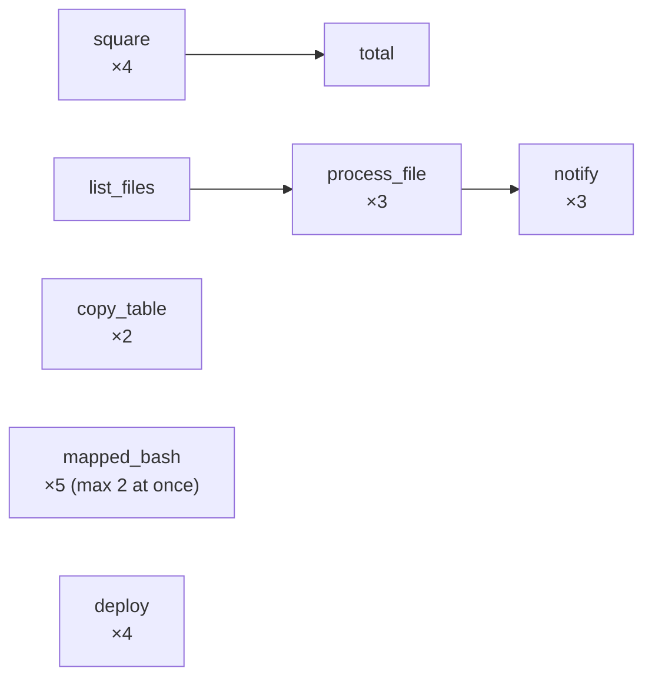

# Dynamic task mapping

**What you'll learn:** how to create a variable number of task instances at runtime with `.expand()`, share fixed arguments with `.partial()`, collect the results in a "reduce" task, transform results with `.map()`, map classic operators, limit concurrency, and what can't be mapped.

> **Run it**
> - DAG id: `06_dynamic_task_mapping`
> - File: [../dags/06_dynamic_task_mapping.py](../dags/06_dynamic_task_mapping.py)
> - `schedule=None`. Unpause and **Trigger**. In the Grid view a mapped task shows a count in brackets, e.g. `square [4]`. Click it to see each **mapped task instance**.

The DAG contains seven independent mini-examples:



---

## The idea

Often you don't know *how many* things to process until the DAG runs: files in a folder, rows in a table, partitions to rebuild. Writing a `for` loop in the DAG file doesn't help, because the file is parsed long before the run, and running a query at parse time is bad practice ([05](05-first-dag.md#keep-top-level-code-light)).

**Dynamic task mapping** solves this. You write a task once and call `.expand()` on it with a list. At runtime Airflow creates **one task instance per item**, each with its own `map_index` (0, 1, 2 …), logs, retries and XCom. They are ordinary task instances, so they run in parallel up to your concurrency limits.

It works like Python's built-in `map()`, except each call is a separate task.

---

## 1. Map over a literal list

```python
    @task
    def square(x: int) -> int:
        return x * x

    squares = square.expand(x=[1, 2, 3, 4])  # creates 4 task instances
```

`.expand(x=[...])` replaces calling `square(x=...)`. You get four instances with `map_index` 0–3, returning 1, 4, 9 and 16.

Arguments to `.expand()` must be **keyword arguments** and each value must be a **list or a dict** (or a reference to an upstream result that will be one). Mapping over a dict gives each instance a `(key, value)` tuple.

## 2. Reduce: collect all results

```python
    @task
    def total(values: list[int]) -> int:
        result = sum(values)
        print(f"Sum of squares = {result}")
        return result

    total(squares)
```

Passing the output of a mapped task to a **normal** (unmapped) task gives it **all** the results, in map-index order: `[1, 4, 9, 16]`. `total` logs `Sum of squares = 30`. This is the "map → reduce" pattern.

`values` is a *lazy sequence*: values are fetched from XCom as you iterate. `sum()`, `for` and `len()` work; call `list(values)` if you need a real list (for example to return it as XCom).

## 3. Map over an upstream result, with `partial()`

```python
    @task
    def list_files() -> list[str]:
        # In real life: list an S3 prefix, query a table, call an API…
        return ["orders_north.csv", "orders_south.csv", "orders_east.csv"]

    # partial() = arguments shared by every instance; expand() = one instance per value.
    # map_index_template shows the file name instead of 0,1,2 in the UI.
    @task(map_index_template="{{ file_name }}")
    def process_file(file_name: str, bucket: str) -> dict:
        context = get_current_context()
        context["file_name"] = file_name  # used by map_index_template above
        rows = len(file_name) * 10  # pretend work
        print(f"Processing s3://{bucket}/{file_name} -> {rows} rows")
        return {"file": file_name, "rows": rows}

    processed = process_file.partial(bucket="raw-data").expand(file_name=list_files())
```

This is the real power of mapping: **the number of instances comes from an upstream task at runtime**.

- `list_files()` returns a list of three names. Airflow waits for it, reads its XCom, then creates three `process_file` instances.
- `.partial(bucket="raw-data")` sets arguments that are the **same for every instance**. `.expand(file_name=...)` sets the argument that **varies**.
- The dependency `list_files >> process_file` is created automatically.

### Readable labels with `map_index_template`

By default the UI lists instances as `0`, `1`, `2`. `map_index_template` is a Jinja template rendered **after** each instance runs, against its context. The task puts `file_name` into the context with `get_current_context()`, so the UI shows `orders_north.csv`, `orders_south.csv`, `orders_east.csv` instead. If the template fails to render, the UI falls back to the number.

For classic operators you can reference the operator's own (rendered) fields, e.g. `map_index_template="{{ task.bash_command }}"`.

## 4. `.map()`: transform results before mapping again

```python
    def to_message(result: dict) -> str:  # plain function, runs lazily per item
        return f"{result['file']} had {result['rows']} rows"

    @task
    def notify(message: str) -> None:
        print(message)

    notify.expand(message=processed.map(to_message))
```

`processed.map(to_message)` doesn't create a task. It wraps the reference so that, when each `notify` instance reads its item, `to_message` is applied first. You get three `notify` instances printing e.g. `orders_north.csv had 160 rows`.

Use `.map()` for small reshaping (pick a field, format a string) so you don't need an extra task. `to_message` must be a plain function, not a `@task`.

Two related helpers on task outputs:
- `a.zip(b)` pairs two lists item by item, like Python's `zip()` (add `fillvalue=...` for `zip_longest` behaviour).
- `a.concat(b)` joins lists end to end.

## 5. `expand_kwargs()`: several arguments per instance

```python
    @task
    def copy_table(source: str, target: str) -> str:
        print(f"Copying {source} -> {target}")
        return target

    copy_table.expand_kwargs(
        [
            {"source": "raw.customers", "target": "staging.customers"},
            {"source": "raw.orders", "target": "staging.orders"},
        ]
    )
```

`.expand_kwargs()` takes a **list of dicts**. Each dict is the full set of keyword arguments for one instance, so here you get two instances. Compare with `.expand(source=[...], target=[...])`, which would build a **cross product** (four instances, including nonsense like `raw.customers → staging.orders`).

`.expand_kwargs()` also accepts an upstream result that returns a list of dicts.

## 6. Mapping a classic operator, with a concurrency limit

```python
    BashOperator.partial(
        task_id="mapped_bash",
        max_active_tis_per_dag=2,  # at most 2 of these instances run at the same time
    ).expand(bash_command=[f"echo 'chunk {i}' && sleep 3" for i in range(5)])
```

Any operator can be mapped with `Operator.partial(...).expand(...)`:
- `task_id` and all `BaseOperator` arguments (`retries`, `pool`, `trigger_rule`, `max_active_tis_per_dag` …) go in `partial()`.
- Operator-specific arguments (`bash_command`) can go in `expand()`.

The list comprehension runs at parse time and is cheap, so it's fine here. It creates five instances, each sleeping 3 seconds.

**Concurrency limits:**

| Argument | Limits |
|---|---|
| `max_active_tis_per_dag=2` | at most 2 running instances of this task **across all runs** of the DAG |
| `max_active_tis_per_dagrun=2` | at most 2 running instances of this task **within one run** |
| `pool="..."` | shares slots with other tasks ([19](19-pools-priority-concurrency.md)) |

Watch the Grid while it runs: never more than two `mapped_bash` instances are green-running at once.

## 7. Cross product

```python
    @task
    def deploy(region: str, env: str) -> None:
        print(f"Deploying to {env} in {region}")

    deploy.expand(region=["eu", "us"], env=["staging", "prod"])  # 4 instances
```

When you expand over **more than one argument**, Airflow creates every combination: `len(region) × len(env)` = 2 × 2 = 4 instances (`eu/staging`, `eu/prod`, `us/staging`, `us/prod`).

| You want | Use |
|---|---|
| one argument varies | `.expand(x=[...])` |
| every combination of several arguments | `.expand(a=[...], b=[...])` |
| several arguments that vary *together* | `.expand_kwargs([{...}, {...}])` or `.expand(pair=a.zip(b))` |

---

## Limits and edge cases

- **Empty list → skipped.** If the list is empty, the mapped task has zero instances and is marked **skipped**; downstream tasks follow their trigger rules.
- **`[core] max_map_length`** (default **1024**): if an upstream task returns a list longer than this to be mapped over, the *upstream* task fails. Raise it with `AIRFLOW__CORE__MAX_MAP_LENGTH`, but thousands of instances put real load on the scheduler and database. For huge lists, batch items (e.g. map over 50 chunks of 1,000 rows).
- **Upstream must return a list or dict.** Returning a string, number or `None` to a mapped task makes the upstream task fail.
- **Order is stable:** map index *n* always corresponds to item *n*, so reduce results come back in input order.
- **Mapping data, not dates:** each instance is part of the same DAG run.

## What you cannot map

- **`BaseOperator` arguments** such as `task_id`, `retries`, `pool`, `queue`, `trigger_rule`, `max_active_tis_per_dag`. They can only go in `partial()`; putting them in `expand()` raises an error at parse time ("unmappable or already specified").
- **The same argument in both** `partial()` and `expand()`.
- **Positional arguments**: `.expand([1, 2])` is invalid; always use `name=[...]`.
- **An XCom pushed under a custom key**: you can only map over a task's `return_value` (so `summary["total"]`-style references from `multiple_outputs` can't be expanded over).
- **Anything other than a list or dict**, e.g. a generator or a set returned by an upstream task.

## Mapped task groups

You can map a whole [task group](11-task-groups.md) with `.expand()`: every instance of the group runs its tasks once per item, in order. [07_task_groups.py](../dags/07_task_groups.py) maps a `publish` group over three destinations. See [11-task-groups.md](11-task-groups.md#3-mapped-task-groups).

Docs: [Dynamic Task Mapping](https://airflow.apache.org/docs/apache-airflow/stable/authoring-and-scheduling/dynamic-task-mapping.html).

---

## Common mistakes

- **Calling instead of expanding:** `square(x=[1, 2, 3, 4])` creates *one* task that receives the whole list.
- **Putting `retries` or `task_id` in `.expand()`.** Those go in `.partial()`.
- **Expanding over two lists that should be paired** and getting a cross product. Use `expand_kwargs` or `.zip()`.
- **Returning a huge list** to map over and hitting `max_map_length`, or overwhelming the scheduler. Batch it.
- **Forgetting the reduce receives a lazy sequence.** Convert with `list(values)` before returning or serialising it.
- **Expecting `map_index_template` to work without putting the variable in the context.** The template only sees context keys; `process_file` adds `file_name` explicitly.

## Try it yourself

1. Make `list_files` return five names. Trigger and check that `process_file` and `notify` each get five instances.
2. Make `list_files` return `[]`. What state do `process_file` and `notify` end in?
3. Change `max_active_tis_per_dag=2` to `max_active_tis_per_dagrun=1` on `mapped_bash` and watch the instances run one by one.
4. Replace `deploy.expand(region=[...], env=[...])` with an `expand_kwargs` call that only deploys `eu/staging` and `us/prod`.
5. Add `map_index_template="{{ task.bash_command }}"` to `mapped_bash`'s `partial()` and see what the UI shows.

---

**Next →** [11-task-groups.md](11-task-groups.md) · [Back to the index](README.md)
