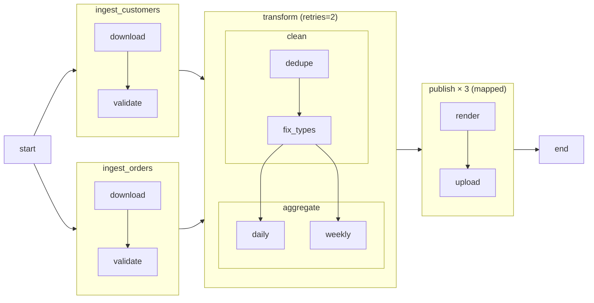

# Task groups

**What you'll learn:** how to organise a large DAG into collapsible groups with the `@task_group` decorator and the `TaskGroup` context manager, how group ids prefix task ids, how to reuse, nest and configure groups, and how to run a whole group once per item with `.expand()`.

> **Run it**
> - DAG id: `07_task_groups`
> - File: [../dags/07_task_groups.py](../dags/07_task_groups.py)
> - `schedule=None`. Unpause, **Trigger**, then open the **Graph** tab. Groups appear as boxes; click one to expand or collapse it. Hover over `ingest_customers` to see its tooltip.



(The arrow from `start` into the ingest groups is drawn to the group here; see [the gotcha below](#gotcha-a-group-function-that-returns-a-task) for where it really lands.)

---

## What a task group is

A **task group** is a named box around some tasks. It:
- **collapses** into one node in the Graph view, which keeps big DAGs readable;
- **prefixes task ids** with the group id: `download` inside `ingest_customers` becomes `ingest_customers.download`;
- can carry **`default_args`** for the tasks inside it;
- can be used in dependencies like a single task: `group_a >> group_b`.

A task group does **not** change how tasks run. There is no separate scheduling, no extra process, no group-level state. It is organisation only.

There are two ways to create one: the `@task_group` decorator and the `TaskGroup` context manager. Both are imported from `airflow.sdk`:

```python
from airflow.sdk import TaskGroup, dag, task, task_group
```

---

## 1. The `@task_group` decorator: a reusable group

```python
    @task_group(tooltip="Download + validate one source", ui_color="#fff4d6")
    def ingest(source: str):
        @task
        def download(src: str) -> str:
            print(f"Downloading {src}")
            return f"/tmp/{src}.json"

        @task
        def validate(path: str) -> str:
            print(f"Validating {path}")
            return path

        # No `return` here: the call then gives back the TaskGroup itself, so
        # `start >> group` connects to the group's FIRST task (download).
        # Returning validate(...) would make `start >> group` point at validate only.
        validate(download(source))
```

The decorated function is a **group factory**: each call creates a new group containing the tasks built inside the function. Its arguments (here `source`) are ordinary Python values or upstream outputs, and you pass them on to the tasks.

- `tooltip` — text shown when you hover over the collapsed group. If you leave it out, the function's docstring is used.
- `ui_color` — the group's fill colour in the Graph view (a hex code, CSS colour name, or a UI theme token like `blue.500`). `ui_fgcolor` sets the label colour.
- The **group id** defaults to the function name, `ingest`.

### Reusing a group with `.override(group_id=...)`

```python
    # Reuse the same group twice. group_id must be unique -> override() it.
    customers = ingest.override(group_id="ingest_customers")("customers")
    orders = ingest.override(group_id="ingest_orders")("orders")
```

Group ids must be unique in a DAG. `.override(group_id=...)` returns a copy of the factory with different settings (any `TaskGroup` argument can be overridden), and the trailing `("customers")` calls it. The result is two groups with tasks:

```
ingest_customers.download   ingest_customers.validate
ingest_orders.download      ingest_orders.validate
```

Without `.override()`, the decorator would avoid the clash for you by adding a suffix (`ingest`, `ingest__1`). That works, but meaningful ids are much easier to find in the UI and in logs.

### Gotcha: should a group function `return` something?

Notice that `ingest` does **not** end with `return validate(download(source))`. That's deliberate.

When a `@task_group` function **returns a task's output**, calling the group gives you that
output, not the group. With a `return`, `customers` would be a reference to
`ingest_customers.validate`, and this later line:

```python
    start >> [customers, orders] >> transform >> published >> end
```

would only create `start >> ingest_customers.validate`. The two `download` tasks would then
have **no upstream task** and could start before `start`. (An earlier version of this example
had exactly that bug; `tests/test_dag_structure.py::test_task_group_reuse_wires_from_start`
now guards against it.)

Without a `return`, the call returns the `TaskGroup` itself, and `start >> group` links `start`
to the group's first task(s). Parsing the DAG shows:

| Task | Upstream |
|---|---|
| `ingest_customers.download` | `start` |
| `ingest_customers.validate` | `ingest_customers.download` |

Return a value only when another task needs that output. Mapped groups (section 3) and the
capstone's `process_region` group do return a value, because downstream tasks consume it.

---

## 2. The `TaskGroup` context manager, nesting and group `default_args`

```python
    with TaskGroup(
        group_id="transform",
        tooltip="Clean then aggregate",
        default_args={"retries": 2},  # applies to every task inside this group
    ) as transform:
        with TaskGroup(group_id="clean") as clean:
            EmptyOperator(task_id="dedupe") >> EmptyOperator(task_id="fix_types")

        with TaskGroup(group_id="aggregate"):
            daily = EmptyOperator(task_id="daily")
            weekly = EmptyOperator(task_id="weekly")

        clean >> [daily, weekly]
```

This is the classic style: every task created inside the `with` block belongs to the group.

**Nesting.** Groups can contain groups. Prefixes stack, so the task ids are:

```
transform.clean.dedupe        transform.clean.fix_types
transform.aggregate.daily     transform.aggregate.weekly
```

**Group `default_args`.** `default_args={"retries": 2}` is applied to every task inside `transform`, including the nested groups. Group `default_args` override the DAG's `default_args`, and arguments set on a task override both. (Parse the DAG and you'll see `retries=2` on all four `transform.*` tasks and `0` elsewhere.)

**Groups in dependencies.** `clean >> [daily, weekly]` uses a whole group as the upstream side:
- `group >> x` connects the group's **last** tasks (those with nothing downstream inside the group) to `x` — here `fix_types → daily` and `fix_types → weekly`;
- `x >> group` connects `x` to the group's **first** tasks.

### `prefix_group_id`

`TaskGroup(group_id="clean", prefix_group_id=False)` keeps the children's ids unprefixed (`dedupe` instead of `transform.clean.dedupe`). The ids must then be unique across the DAG by themselves. Keep the default (`True`) unless you have a reason.

### Choosing a style

| | `@task_group` | `with TaskGroup(...)` |
|---|---|---|
| Reuse with different inputs | Yes — call the function again | Write a helper function that creates the `with` block |
| Pass upstream outputs in | Yes, as function arguments | Use the outputs inside the block |
| Can be mapped with `.expand()` | **Yes** | No |
| Typical use | TaskFlow DAGs, reusable pieces | Classic operators, one-off grouping |

Both accept the same settings: `group_id`, `tooltip`, `ui_color`, `ui_fgcolor`, `default_args`, `prefix_group_id`, `group_display_name`, `doc_md`.

---

## 3. Mapped task groups

```python
    @task_group
    def publish(destination: str):
        @task
        def render(dest: str) -> str:
            return f"report for {dest}"

        @task
        def upload(report: str, dest: str) -> None:
            print(f"Uploading '{report}' to {dest}")

        upload(render(destination), destination)

    published = publish.expand(destination=["s3", "email", "slack"])
```

`.expand()` works on decorated task groups the same way as on tasks ([10-dynamic-task-mapping.md](10-dynamic-task-mapping.md)). The group runs **once per item**: three instances of `publish`, so `publish.render` and `publish.upload` each get three mapped instances.

Inside each group instance, the tasks stay connected **by map index**: `upload[0]` waits only for `render[0]` (the `s3` one), not for all renders. So the `s3` path can finish while `slack` is still rendering. That's the main difference from mapping two tasks separately.

`publish` doesn't return anything, so `published` is the group itself, and `transform >> published >> end` links the group's first task (`render`) and last task (`upload`).

`.partial(...)` and `.expand_kwargs(...)` work on task groups too. Only `@task_group` groups can be mapped, not the `TaskGroup` context manager.

> **New in Airflow 3.4:** a `@task_group` can also be **repeated in a loop** with `.loop(max_iterations=..., until=...)`. See [23-task-loops.md](23-task-loops.md).

---

## Wiring it all together

```python
    # Groups are used in dependencies exactly like tasks.
    start >> [customers, orders] >> transform >> published >> end
```

Reading left to right (and remembering the gotcha above):

| Edge in code | Edges created |
|---|---|
| `start >> [customers, orders]` | `start → ingest_customers.validate`, `start → ingest_orders.validate` |
| `[customers, orders] >> transform` | both `validate` tasks `→ transform.clean.dedupe` |
| `transform >> published` | `transform.aggregate.daily` and `.weekly` `→ publish.render` |
| `published >> end` | `publish.upload → end` |

---

## Task groups vs SubDAGs

Airflow 1 and 2 had **SubDAGs** (`SubDagOperator`): a whole DAG embedded as one task. They were slow, deadlock-prone and confusing, were deprecated in Airflow 2, and are **removed in Airflow 3**. Task groups replace them for visual grouping. If you need real separation (own schedule, own runs), use separate DAGs connected with [`TriggerDagRunOperator`](07-operators-and-dependencies.md#triggering-another-dag-triggerdagrunoperator) or [Assets](13-assets-data-aware-scheduling.md).

Docs: [TaskGroups](https://airflow.apache.org/docs/apache-airflow/stable/core-concepts/dags.html#taskgroups).

---

## Common mistakes

- **Returning a task from a `@task_group` function** and then expecting `upstream >> group` to reach the group's first task (see the gotcha).
- **Duplicate group ids** when calling a group factory twice. Use `.override(group_id=...)` for readable ids.
- **Referring to a task by its short id** in `xcom_pull` or a branch. Inside a group the real id is `group.task` (e.g. `ti.xcom_pull(task_ids="ingest_customers.validate")`).
- **Expecting group `default_args` to beat task arguments.** The task's own argument always wins.
- **Trying to `.expand()` a `with TaskGroup(...)` block.** Only `@task_group` can be mapped.
- **Using groups as a security or isolation boundary.** They are visual only.

## Try it yourself

1. Remove `return` from `ingest` (keep the call `validate(download(source))`). Re-parse and check in the Graph view that `start` now points at both `download` tasks.
2. Add a third source with `ingest.override(group_id="ingest_products")("products")` and add it to the list after `start`.
3. Set `prefix_group_id=False` on the `aggregate` group and see how the task ids change in the Grid view.
4. Add `"slack_dm"` to the `publish.expand(...)` list and confirm four instances of each task inside `publish`.

---

**Next →** [12-sensors-and-deferrable.md](12-sensors-and-deferrable.md) · [Back to the index](README.md)
