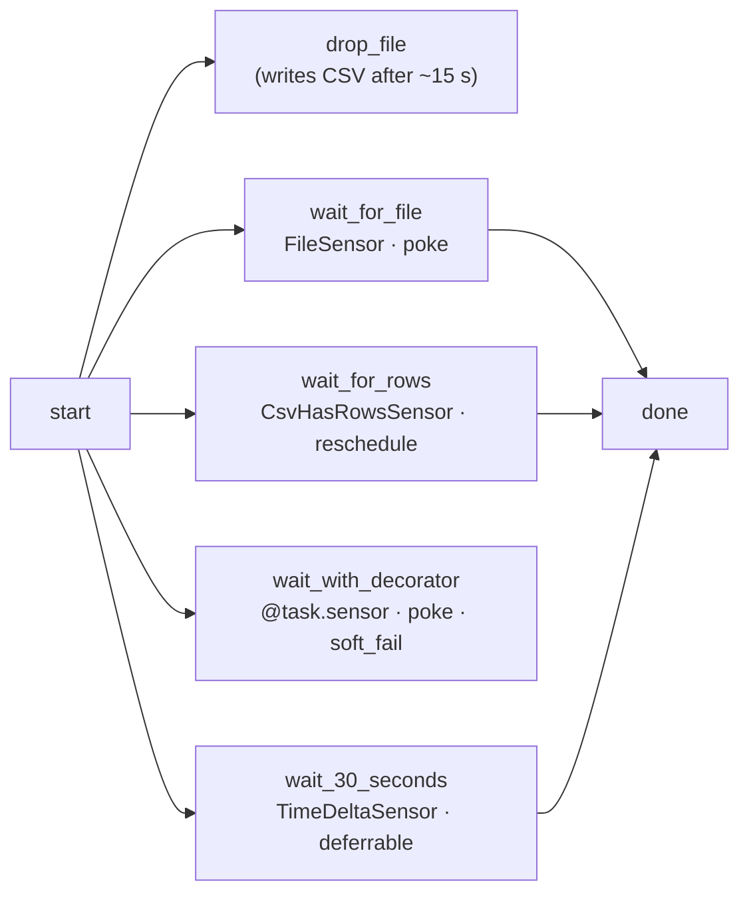
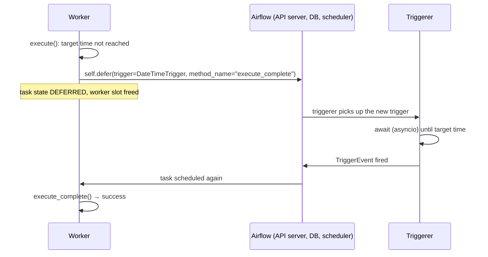

# Sensors and deferrable operators

**What you'll learn:** how sensors wait for something to happen, the difference between `poke`, `reschedule` and deferrable waiting, the sensor options that matter (`poke_interval`, `timeout`, `soft_fail` …), how to write a sensor as a decorated function or a class, and what the **triggerer** does.

> **Run it**
> - DAG id: `08_sensors_and_deferrable`
> - Files: [../dags/08_sensors_and_deferrable.py](../dags/08_sensors_and_deferrable.py) and the custom sensor [../plugins/tutorial_lib/sensors/csv_rows.py](../plugins/tutorial_lib/sensors/csv_rows.py)
> - `schedule=None`. Unpause and **Trigger** (keep the default logical date — the file name is built from it). The run takes about 30–40 seconds. Watch the Grid: sensors stay *running*, *up_for_reschedule* or *deferred* until the file appears.
> - Needs the `fs_default` connection, which this project defines as an environment variable (see below), and the triggerer service, which `docker compose up` starts.



`drop_file` and the four sensors all start right after `start`, **in parallel**. The sensors keep checking until `drop_file` has written the file. Note that `wait_with_decorator` is *not* connected to `done` — see [section 3](#3-a-sensor-as-a-function-tasksensor) for why that's sensible.

---

## What is a sensor?

A **sensor** is an operator whose job is to **wait** until a condition is true: a file exists, a row appears in a table, an API returns "ready", a time is reached, another DAG has finished. Then it succeeds and downstream tasks run.

Under the hood every sensor implements one method, `poke(context)`, that checks the condition once and returns `True`/`False`. Airflow calls it repeatedly, every `poke_interval` seconds, until it returns `True` or the `timeout` is reached.

---

## The file and the date in the file name

```python
from tutorial_lib.paths import DATA_DIR
from tutorial_lib.sensors.csv_rows import CsvHasRowsSensor

# One file per run so runs don't interfere. {{ run_id }} can contain ':' and '+',
# so we use the ts_nodash template (e.g. 20261111T120000).
INCOMING_FILE = str(DATA_DIR / "incoming" / "orders_{{ ts_nodash }}.csv")
```

- `DATA_DIR` comes from [plugins/tutorial_lib/paths.py](../plugins/tutorial_lib/paths.py): `/opt/airflow/data` in Docker (mounted from the project's `./data`), or `<project>/data` when you run locally with `scripts/local_env.sh` (it sets `TUTORIAL_DATA_DIR`). Airflow puts `plugins/` on the Python path, which is why `tutorial_lib` can be imported.
- `INCOMING_FILE` is a **template string**. Every run gets its own file, e.g. `orders_20261111T120000.csv`, so runs don't see each other's files.
- `{{ ts_nodash }}` comes from the run's logical date. If a run has **no** logical date (possible when triggering through the API), the template can't render and the sensors fail. Triggering from the UI is fine.

### The task that delivers the file

```python
    @task
    def drop_file(ts_nodash=None) -> str:
        """Simulates an upstream system delivering a file a little later."""
        time.sleep(15)
        path = DATA_DIR / "incoming" / f"orders_{ts_nodash}.csv"
        path.parent.mkdir(parents=True, exist_ok=True)
        with path.open("w", newline="") as f:
            writer = csv.writer(f)
            writer.writerow(["order_id", "amount"])
            writer.writerows([[1, 10.5], [2, 99.0], [3, 7.25]])
        print(f"Wrote {path}")
        return str(path)
```

It waits 15 seconds, then writes a CSV with a header and three data rows. `ts_nodash` is injected from the context, so it builds the same name as the template.

---

## Three ways to wait

| | `mode="poke"` (default) | `mode="reschedule"` | Deferrable (`deferrable=True`) |
|---|---|---|---|
| **Between checks** | Task keeps running and sleeps | Task exits, scheduler re-queues it after `poke_interval` | Task is suspended; an async **trigger** waits in the triggerer process |
| **Worker slot while waiting** | Held the whole time | Free between checks | Free the whole time |
| **Pool slot while waiting** | Held | Free between checks | Free by default |
| **State shown in UI** | *running* | *up_for_reschedule* between checks | *deferred* |
| **Overhead per check** | Very low | Start a new task process each time | One coroutine in the triggerer |
| **Reaction time** | Within `poke_interval` | Within `poke_interval` + scheduling delay | Usually immediate when the event happens |
| **Needs** | Nothing extra | Nothing extra | A running **triggerer**, and an operator that supports deferral |
| **Use when** | Short waits (seconds to a few minutes) | Long waits with a check every minute or more | Long waits, many sensors in parallel; preferred when available |

A worker has a limited number of slots. Ten sensors in poke mode waiting all night block ten slots that real tasks could have used. That is the problem `reschedule` and deferrable sensors solve.

---

## 1. `FileSensor` in poke mode

```python
    wait_for_file = FileSensor(
        task_id="wait_for_file",
        filepath=INCOMING_FILE,  # templated
        fs_conn_id="fs_default",
        poke_interval=5,  # check every 5 seconds
        timeout=timedelta(minutes=5),  # give up (fail) after 5 minutes
        mode="poke",
    )
```

- `filepath` is a template field, so `{{ ts_nodash }}` is filled in. Glob patterns like `*.csv` also work (`recursive=True` enables `**`).
- `fs_conn_id="fs_default"` names a **filesystem connection**. Its `path` extra is a base directory joined in front of `filepath`. This project defines it in [docker-compose.yaml](../docker-compose.yaml) and [scripts/local_env.sh](../scripts/local_env.sh):

  ```bash
  AIRFLOW_CONN_FS_DEFAULT='{"conn_type": "fs", "extra": {"path": "/"}}'
  ```

  The base path is `/`, and `filepath` is already absolute, so the final path is `filepath` itself. Connections set through `AIRFLOW_CONN_*` variables don't appear in the UI's connection list but work everywhere ([15-connections-and-hooks.md](15-connections-and-hooks.md)).
- Poke mode with a 5-second interval is right here: the wait is about 15 seconds.

Log output looks like `Poking for file /opt/airflow/data/incoming/orders_...csv` every 5 seconds, then `Found File ...`.

`FileSensor` also supports `deferrable=True` (it then waits with a `FileTrigger`).

---

## 2. A custom sensor class in reschedule mode

The project's sensor lives in [plugins/tutorial_lib/sensors/csv_rows.py](../plugins/tutorial_lib/sensors/csv_rows.py):

```python
from airflow.sdk import BaseSensorOperator, PokeReturnValue


class CsvHasRowsSensor(BaseSensorOperator):
    """Wait until a CSV file exists AND contains at least ``min_rows`` data rows."""

    template_fields: Sequence[str] = ("file_path",)

    def __init__(self, *, file_path: str, min_rows: int = 1, **kwargs) -> None:
        super().__init__(**kwargs)
        self.file_path = file_path
        self.min_rows = min_rows

    def poke(self, context) -> PokeReturnValue:
        path = Path(self.file_path)
        if not path.exists():
            self.log.info("Waiting for %s to appear...", path)
            return PokeReturnValue(is_done=False)
        data_rows = max(sum(1 for _ in path.open()) - 1, 0)  # minus header line
        self.log.info("%s has %s data rows (need %s)", path, data_rows, self.min_rows)
        return PokeReturnValue(is_done=data_rows >= self.min_rows, xcom_value=data_rows)
```

Writing a sensor class takes three steps:
1. **Subclass `BaseSensorOperator`** (from `airflow.sdk`).
2. **Accept your own arguments**, pass the rest (`**kwargs`: `task_id`, `poke_interval`, `mode` …) to `super().__init__`. Listing `file_path` in `template_fields` makes it templated.
3. **Implement `poke(context)`**. Return `True`/`False`, or a `PokeReturnValue(is_done=..., xcom_value=...)` to also push an XCom when done. Here the XCom is the number of data rows (`3`).

It checks more than `FileSensor`: the file must exist **and** have at least `min_rows` rows, so it can't fire on a half-written file. More on custom components in [17-custom-operators-hooks-plugins.md](17-custom-operators-hooks-plugins.md).

In the DAG:

```python
    wait_for_rows = CsvHasRowsSensor(
        task_id="wait_for_rows",
        file_path=INCOMING_FILE,
        min_rows=3,
        poke_interval=10,
        timeout=timedelta(minutes=5),
        mode="reschedule",
    )
```

`mode="reschedule"`: after each unsuccessful poke the task **exits** and is shown as *up_for_reschedule*. About 10 seconds later the scheduler queues it again and a worker runs a fresh `poke`. The worker slot is free in between. In real use pick a `poke_interval` of a minute or more for reschedule mode; each check restarts the task, so very short intervals add load. The 10 seconds here is only so the demo finishes quickly.

---

## 3. A sensor as a function: `@task.sensor`

```python
    @task.sensor(poke_interval=5, timeout=300, mode="poke", soft_fail=True)
    def wait_with_decorator(ts_nodash=None) -> PokeReturnValue:
        path = Path(DATA_DIR / "incoming" / f"orders_{ts_nodash}.csv")
        size = path.stat().st_size if path.exists() else 0
        # soft_fail=True: on timeout the task is SKIPPED instead of FAILED.
        return PokeReturnValue(is_done=size > 0, xcom_value={"bytes": size})
```

`@task.sensor` turns a function into a sensor: the function **is** the `poke`. It's called every `poke_interval` seconds until it returns something truthy (`True` or `PokeReturnValue(is_done=True, ...)`). All sensor arguments go into the decorator. When done, `{"bytes": <size>}` is pushed as its XCom.

`timeout=300` is in seconds; `timedelta` works too.

**`soft_fail=True`** changes what happens on timeout: the task becomes **skipped** instead of **failed**. Use it when "the thing didn't arrive" is an acceptable outcome.

That's also why it isn't connected to `done`: if it timed out and was skipped, `done` (default `all_success` rule) would be skipped too ([09](09-branching-and-trigger-rules.md)). As a leaf task, a skip doesn't affect the rest of the run.

---

## 4. A deferrable sensor: `TimeDeltaSensor(deferrable=True)`

```python
    wait_30_seconds = TimeDeltaSensor(
        task_id="wait_30_seconds",
        delta=timedelta(seconds=30),
        deferrable=True,
    )
```

`TimeDeltaSensor` waits until **`delta` after the run's data interval end** (or the run's `run_after` time if there is no data interval). For a run triggered now, that's about 30 seconds from the trigger.

With `deferrable=True`, here is what happens:



1. The task starts on a worker. `execute()` sees the target time isn't reached and calls `self.defer(...)` with a **trigger** (a small async object, here a `DateTimeTrigger`).
2. The task leaves the worker. Its state becomes **deferred** (purple in the UI). It holds **no** worker slot.
3. The **triggerer** runs the trigger's async `run()` method. One triggerer process can run many triggers at once — the default `[triggerer] capacity` is 1000 — because they are lightweight `asyncio` coroutines.
4. When the trigger fires an event, the task is scheduled again and resumes in `execute_complete()` on a worker, which succeeds.

### The triggerer component

The triggerer is a separate Airflow process (`airflow triggerer`). In this project it's the `airflow-triggerer` service in [docker-compose.yaml](../docker-compose.yaml); `airflow standalone` starts one too. **If no triggerer is running, deferred tasks stay deferred** until their timeout. See [02-architecture.md](02-architecture.md).

Many operators and sensors accept `deferrable=True`. To make it the default for all operators that support it, set `[operators] default_deferrable = True` (environment variable `AIRFLOW__OPERATORS__DEFAULT_DEFERRABLE=true`).

---

## Sensor options

All sensors inherit these from `BaseSensorOperator`:

| Option | Default | Meaning |
|---|---|---|
| `poke_interval` | 60 s | Time between checks (seconds or `timedelta`). |
| `timeout` | 7 days (`[sensors] default_timeout` = 604800 s) | Give up after this long since the **first** poke, including time spent rescheduled. Then the task fails with `AirflowSensorTimeout` and is **not retried**. Always set a realistic value. |
| `mode` | `"poke"` | `"poke"` or `"reschedule"`. |
| `soft_fail` | `False` | On timeout (or if `poke()` raises `AirflowFailException`), mark the task **skipped** instead of failed. Other exceptions from `poke()` still fail the task. |
| `exponential_backoff` | `False` | Wait progressively longer between pokes. |
| `max_wait` | none | Upper bound for the wait when using exponential backoff. |
| `silent_fail` | `False` | If `poke()` raises an unexpected error, log it and keep poking instead of failing. |
| `never_fail` | `False` | If `poke()` raises, mark the task skipped. Can't be combined with `soft_fail`. |

`timeout` vs `execution_timeout`: `timeout` counts total waiting time since the first poke; `execution_timeout` (a `BaseOperator` argument) counts only time the task is actually running. In poke mode they're the same; in reschedule mode they differ.

---

## Writing a deferrable operator (brief)

Any operator can defer. The pattern:

```python
from datetime import timedelta

from airflow.providers.standard.triggers.temporal import TimeDeltaTrigger
from airflow.sdk import BaseOperator


class WaitFiveMinutesOperator(BaseOperator):
    def execute(self, context):
        # Hand the wait to the triggerer and free the worker slot.
        self.defer(
            trigger=TimeDeltaTrigger(timedelta(minutes=5)),
            method_name="execute_complete",
        )

    def execute_complete(self, context, event=None):
        # Runs on a worker again after the trigger fires.
        self.log.info("Trigger fired with event %s", event)
```

- `self.defer(trigger=..., method_name=..., kwargs=None, timeout=None)` suspends the task. When the trigger fires, Airflow calls `method_name` on a **new** instance of the operator, so don't rely on attributes set during `execute()`; pass what you need through `kwargs` or the event.
- A custom trigger subclasses `BaseTrigger` (`airflow.triggers.base`), implements `serialize()` (returns its import path and constructor kwargs) and an `async def run()` that `yield`s a `TriggerEvent`. It must be importable by the triggerer, and all its I/O must be async — blocking calls freeze every trigger in that process.

Docs: [Deferrable Operators & Triggers](https://airflow.apache.org/docs/apache-airflow/stable/authoring-and-scheduling/deferring.html).

---

## Common built-in sensors

| Sensor | Package | Waits for |
|---|---|---|
| `FileSensor` | standard | a file or folder on a filesystem the worker can see |
| `PythonSensor` / `@task.sensor` | standard | your function to return truthy |
| `BashSensor` | standard | a bash command to exit 0 |
| `TimeDeltaSensor`, `WaitSensor` | standard | a delta after the data interval end / after the task starts |
| `TimeSensor`, `DateTimeSensor` | standard | a time of day / a specific datetime |
| `DayOfWeekSensor` | standard | a given weekday |
| `ExternalTaskSensor` | standard | a task (or whole DAG) in **another DAG** to finish for the matching logical date |
| `HttpSensor` | http (installed here) | an HTTP endpoint to respond (optionally check the body) |
| `SqlSensor` | common-sql (installed here) | a SQL query to return a truthy first cell |
| `S3KeySensor` | amazon (in the Docker image, not the local `.venv`) | an object to exist in S3 |

Before reaching for a sensor that waits for another DAG or a file written by another DAG, consider [Assets](13-assets-data-aware-scheduling.md): the producing DAG marks the asset as updated, and the consuming DAG starts automatically — no waiting task at all.

Docs: [Sensors](https://airflow.apache.org/docs/apache-airflow/stable/core-concepts/sensors.html).

---

## Common mistakes

- **Leaving `timeout` at its default.** A sensor waiting for something that never comes runs for 7 days. Set a realistic `timeout`.
- **Long waits in poke mode.** Many poke-mode sensors can block every worker slot, and nothing else runs. Use `reschedule` or `deferrable=True`.
- **Very short `poke_interval` in reschedule mode.** Each check restarts the task; use 60 s or more.
- **Deferrable task stuck in *deferred*.** Is the triggerer running? Check `docker compose ps`.
- **Paths the worker can't see.** `FileSensor` checks the filesystem of the worker running it. In Docker that means a path inside the container (`/opt/airflow/data/...`), not your laptop's path.
- **Expecting retries after a sensor timeout.** `AirflowSensorTimeout` fails the task immediately.

## Try it yourself

1. Change `drop_file`'s `time.sleep(15)` to `time.sleep(400)`. Which sensors fail after 5 minutes, and what state does `wait_with_decorator` end in?
2. Set `min_rows=5` on `wait_for_rows`. It never completes; watch it switch between *running* and *up_for_reschedule*, then fail at the timeout.
3. Change `wait_for_file` to `deferrable=True` and remove `mode="poke"`. Watch it go *deferred* instead of *running*.
4. Stop the triggerer (`docker compose stop airflow-triggerer`), trigger the DAG, and watch `wait_30_seconds` stay *deferred*. Start it again (`docker compose start airflow-triggerer`).

---

**Next →** [13-assets-data-aware-scheduling.md](13-assets-data-aware-scheduling.md) · [Back to the index](README.md)
