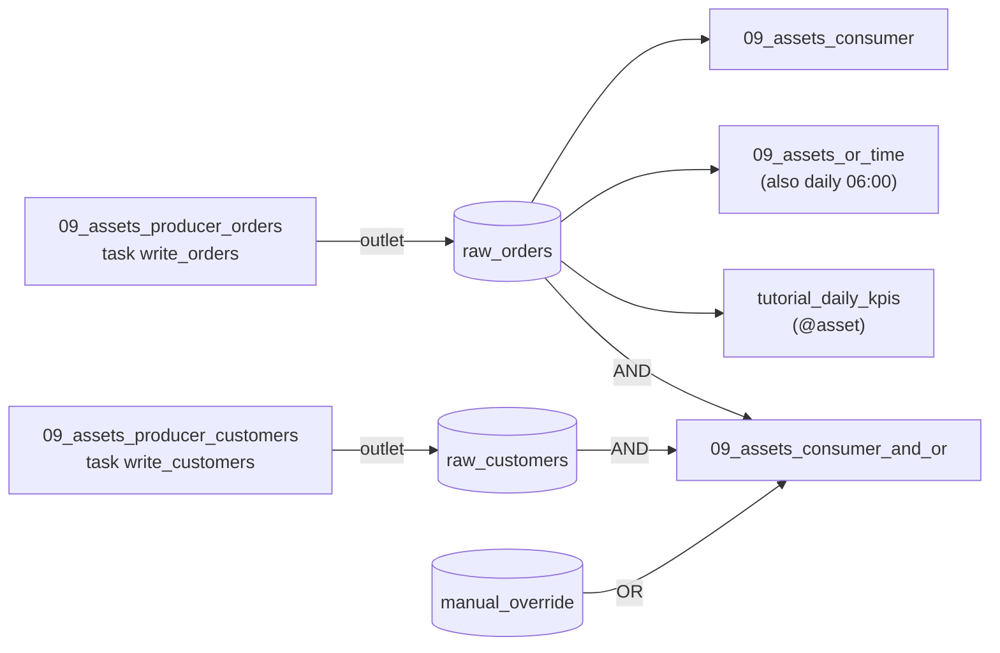

# Assets & data-aware scheduling

**What you'll learn:** how to start a DAG *because data changed* instead of at a fixed time. You
will define **assets**, produce **asset events**, attach extra information to them, and schedule
DAGs on one asset, on AND/OR combinations of assets, or on assets *and* a clock.
New terms are also explained in the [glossary](32-glossary.md).

> **Run it**
> - File: [`../dags/09_assets_data_aware_scheduling.py`](../dags/09_assets_data_aware_scheduling.py) — one file, **six** DAGs:
>   `09_assets_producer_orders`, `09_assets_producer_customers`, `09_assets_consumer`,
>   `09_assets_consumer_and_or`, `09_assets_or_time`, `tutorial_daily_kpis`.
> - New DAGs start **paused** in this project. Unpause **all six** first (a paused consumer ignores
>   events), then trigger
>   `09_assets_producer_orders` by hand and watch `09_assets_consumer`, `09_assets_or_time` and
>   `tutorial_daily_kpis` start on their own.
> - Then trigger `09_assets_producer_customers` and watch `09_assets_consumer_and_or` start.
> - Open **Assets** in the main navigation to see the lineage graph.

---

## 1. Why assets?

So far every DAG ran on a clock (`schedule="@daily"`) or by hand (`schedule=None`). A clock is a
guess: "the orders file is *usually* ready by 06:00". If the file is late, the report runs on old
data. If it is early, you wait for nothing.

An **asset** is a name for a piece of data — a table, a file, a model, an S3 prefix. A task that
*updates* the data says so by listing the asset in its `outlets`. When that task succeeds,
Airflow records an **asset event** ("`raw_orders` was updated at 10:03 by run X"). Any DAG whose
`schedule` mentions that asset is then started automatically. This is called **data-aware** (or
event-driven) scheduling.



> **Renamed in Airflow 3:** Airflow 2 called these **Datasets** (`from airflow.datasets import Dataset`,
> `schedule=[Dataset(...)]`). Airflow 3.0 renamed them to **Assets**, and the old `Dataset` alias is
> gone from `airflow.sdk` in 3.4. Old tutorials that say "dataset" mean "asset". See
> [Airflow 2 vs 3](31-airflow-2-vs-3.md).

Important: **Airflow never looks at the data itself.** It doesn't check that the file exists or
changed. An asset event means "a task that *said* it updates this asset finished successfully".

---

## 2. Defining an asset

The top of the file defines three assets:

```python
raw_orders = Asset(name="raw_orders", uri="file:///opt/airflow/data/assets/raw_orders.json")
raw_customers = Asset(name="raw_customers", uri="file:///opt/airflow/data/assets/raw_customers.json")
manual_override = Asset(name="manual_override")
```

`Asset` takes these arguments (checked against the installed 3.4.0):

| Argument | Meaning |
|----------|---------|
| `name` | The human-readable, unique name you see in the UI. |
| `uri` | Where the data lives, e.g. `s3://bucket/key`, `postgres://host/db/schema/table`, `file:///path`. It is **only an identifier** — Airflow never opens it. If you leave it out, it is the same as `name` (that's what happens for `manual_override`). |
| `group` | A label for grouping assets in the UI. Default: `"asset"`. |
| `extra` | A small JSON dict of static information about the asset (owner, format…). Not the same as an *event's* extra (section 3). |
| `watchers` | A list of `AssetWatcher`s for event-driven scheduling from outside systems (section 9). |

Two assets are "the same asset" when they have the same name and URI. In real projects you put
asset definitions in one shared module and import them into every DAG file, so producers and
consumers can't drift apart through a typo.

---

## 3. Producing asset events: `outlets`

```python
@dag(dag_id="09_assets_producer_orders", schedule=None, start_date=START, tags=["tutorial", "06-assets"])
def producer_orders():
    @task(outlets=[raw_orders])  # when this task SUCCEEDS, an asset event is created
    def write_orders(*, outlet_events=None):
        orders = [{"id": i, "amount": i * 10} for i in range(1, 6)]
        path = DATA_DIR / "assets" / "raw_orders.json"
        path.parent.mkdir(parents=True, exist_ok=True)
        path.write_text(json.dumps(orders))
        # Attach extra metadata to the asset event (visible in the UI and to consumers).
        outlet_events[raw_orders].extra = {"row_count": len(orders), "path": str(path)}

    write_orders()
```

- `outlets=[raw_orders]` declares "this task updates `raw_orders`". Any operator accepts `outlets`,
  not only `@task`.
- The event is created **only if the task succeeds**. A failed or skipped task creates no event.
- `outlet_events` is a value from the task **context** (see [TaskFlow](06-taskflow-api.md)). Asking
  for it as a keyword argument makes Airflow pass it in. `outlet_events[raw_orders].extra = {...}`
  attaches a JSON dict to *this particular event*. Consumers can read it (section 4) and the UI
  shows it on the asset's page.

The second producer shows another way to attach extras — yield a `Metadata` object:

```python
@task(outlets=[raw_customers])
def write_customers():
    ...
    # Alternative way to attach extras: yield Metadata(...)
    yield Metadata(raw_customers, {"row_count": len(customers)})
```

`Metadata(asset, extra)` does the same thing as setting `outlet_events[asset].extra`. Because the
function uses `yield`, it becomes a generator; Airflow collects the `Metadata` objects it yields.
Use whichever reads better — `outlet_events` is handy when you also return a value for XCom.

---

## 4. Consuming: `schedule=[asset]`

```python
@dag(
    dag_id="09_assets_consumer",
    schedule=[raw_orders],  # run every time raw_orders gets a new event
    start_date=START,
    tags=["tutorial", "06-assets"],
)
def consumer():
    @task
    def read_orders(*, triggering_asset_events=None):
        # Which events caused this run, and their extra info.
        for asset_ref, events in triggering_asset_events.items():
            for event in events:
                print(f"Triggered by {asset_ref} with extra={event.extra}")
        orders = json.loads((DATA_DIR / "assets" / "raw_orders.json").read_text())
        print(f"Total order amount: {sum(o['amount'] for o in orders)}")

    read_orders()
```

- `schedule=[raw_orders]` replaces a cron string. There is no clock: the DAG runs when
  `raw_orders` gets an event. The run's type is **asset triggered** (you'll see it in the UI).
- `triggering_asset_events` is another context value. It maps each asset to the list of events that
  caused *this* run. Each event has `extra`, `source_dag_id`, `source_run_id`, `source_task_id`,
  `source_map_index` and `timestamp`, so the consumer knows exactly what it is reacting to.
- After `write_orders` above, the log of `read_orders` shows the extra the producer attached:
  `row_count` 5 and the file path.

> **Asset-triggered runs have no logical date.** `logical_date` is `None` for these runs, so
> templates like `{{ ds }}` are not available in them. Use `{{ dag_run.run_after }}` or the
> event's `timestamp` instead. More in [Scheduling & timetables](18-scheduling-and-timetables.md).

### New in 3.4: one run per asset event

What if the producer runs three times before the consumer starts? In **Airflow 3.4** an
asset-triggered DAG creates **one run per asset event** by default — three events, three consumer
runs, each with a single event in `triggering_asset_events`. Before 3.4 the queued events were
*batched* into one run.

To get the old behaviour back, set `batch_asset_events=True`, either for one DAG or for the whole
installation:

```python
from airflow.sdk import AssetTriggeredTimetable

@dag(schedule=AssetTriggeredTimetable(assets=raw_orders, batch_asset_events=True), ...)
```

Pass a single asset or a condition (`a & b`, `a | b`) to `assets=` here — a plain Python list
fails to serialize with `AssetTriggeredTimetable` in 3.4.0 (unlike `schedule=[...]` and
`AssetOrTimeSchedule`, which convert the list for you).

```ini
# airflow.cfg (or env var AIRFLOW__SCHEDULER__BATCH_ASSET_EVENTS=True)
[scheduler]
batch_asset_events = True
```

`airflow config get-value scheduler batch_asset_events` prints `False` in this project. There is
one exception: conditions that combine assets with `&` (next section) **always** batch, because
"wait for A *and* B" needs at least two events. Passing `batch_asset_events=False` for them is
rejected.

---

## 5. AND / OR conditions

```python
@dag(
    dag_id="09_assets_consumer_and_or",
    # & = AND (wait until BOTH have new events), | = OR (any one is enough)
    schedule=((raw_orders & raw_customers) | manual_override),
    ...
)
```

Read it as: "run when **both** `raw_orders` and `raw_customers` have a new event since my last
run, **or** when `manual_override` has a new event."

| Expression | Runs when… |
|------------|------------|
| `[a]` or `a` | `a` has a new event |
| `[a, b]` | **both** `a` and `b` have new events (a list means AND) |
| `a & b` | same as `[a, b]` |
| `a \| b` | `a` **or** `b` has a new event |
| `(a & b) \| c` | both `a` and `b`, or `c` alone |

Try it: trigger only `09_assets_producer_orders` — `09_assets_consumer_and_or` does **not** start.
In the DAG's view you can see it waiting for `raw_customers`. Trigger
`09_assets_producer_customers` and it starts. If orders was updated three times meanwhile, all
three events arrive together in one run (AND conditions batch, see above).

Nothing in this project produces `manual_override`. You can create an event for it from the UI or
the REST API (section 8).

---

## 6. Assets **and** a clock: `AssetOrTimeSchedule` and `AssetAndTimeSchedule`

Sometimes you want both: "refresh the dashboard at 06:00 every day, **and** also whenever new
orders land".

```python
@dag(
    dag_id="09_assets_or_time",
    # Run at 06:00 every day AND also whenever raw_orders is updated.
    schedule=AssetOrTimeSchedule(
        timetable=CronTriggerTimetable("0 6 * * *", timezone="UTC"),
        assets=[raw_orders],
    ),
    ...
)
def asset_or_time():
    @task
    def refresh_dashboard(dag_run=None):
        print(f"Refreshing dashboard, run type = {dag_run.run_type}")
```

`AssetOrTimeSchedule` creates a run when **either** the timetable fires **or** the asset
condition is met. The task prints `dag_run.run_type`, so you can tell them apart: `scheduled` for
the 06:00 run and `asset_triggered` for a run caused by `write_orders`. (`CronTriggerTimetable`
is explained in [Scheduling & timetables](18-scheduling-and-timetables.md).)

**New in 3.4: `AssetAndTimeSchedule`** (also importable from `airflow.sdk`) is the stricter
version: the run happens on the clock, but **only if** the assets have new events. When the
06:00 slot comes and the assets aren't ready, the scheduler holds that run back and tries again
until they are. It never creates asset-triggered runs.

```python
from airflow.sdk import AssetAndTimeSchedule, CronTriggerTimetable

schedule=AssetAndTimeSchedule(
    timetable=CronTriggerTimetable("0 6 * * *", timezone="UTC"),
    assets=[raw_orders, raw_customers],
)
```

| Schedule | Runs at 06:00? | Runs when the asset updates? |
|----------|----------------|------------------------------|
| `"0 6 * * *"` | yes | no |
| `[raw_orders]` | no | yes |
| `AssetOrTimeSchedule(...)` | yes | yes — either one is enough |
| `AssetAndTimeSchedule(...)` | yes, but only once the assets have new events | no separate run |

---

## 7. The `@asset` decorator: an asset, a DAG and a task in one function

Many pipelines are "one task that builds one dataset". The `@asset` decorator writes that in
a few lines:

```python
@asset(schedule=[raw_orders], tags=["tutorial", "06-assets"])
def tutorial_daily_kpis(self, context, raw_orders):
    """`self` is the asset being produced; `raw_orders` is the upstream asset."""
    events = context["inlet_events"][raw_orders]
    latest = events[-1] if events else None
    print(f"Building KPIs ({self.name}) from latest raw_orders event: {latest}")
    return {"kpi": "orders_total", "status": "ok"}
```

One function creates three things (checked by parsing the file):

| Created | Name |
|---------|------|
| a DAG | `tutorial_daily_kpis` — the **function name** is the DAG id |
| one task in it | `tutorial_daily_kpis` |
| an asset that the task produces | `tutorial_daily_kpis` (name and URI = function name, unless you pass `name=`/`uri=`) |

The function's parameters have special meaning:

- `self` — the asset this function produces (so `self.name` is `"tutorial_daily_kpis"`).
- `context` — the task context, the same dict you get from `get_current_context()`.
- **Any other parameter name** refers to another asset *by name* and becomes an **inlet** (an
  input). Here `raw_orders` matches the asset `raw_orders`.

`context["inlet_events"][raw_orders]` returns the recorded events of that inlet asset, oldest
first, so `events[-1]` is the newest. (Compare `triggering_asset_events`, which only holds the
events that started *this* run.) The return value is pushed to XCom as usual.

Because `tutorial_daily_kpis` is itself an asset, other DAGs can use it in their `schedule` —
chains of `@asset` functions form a pipeline. `@asset.multi(...)` exists for one function that
produces several assets.

---

## 8. Seeing assets in the UI, and creating events by hand

Open **Assets** in the main navigation:

- The list shows every asset Airflow knows about, with its group and latest event.
- An asset's page shows its **events** (with their `extra`), the DAGs that produce it and the DAGs
  that consume it, and a **lineage graph** of producer → asset → consumer.
- The DAG's **Graph** view also draws the assets the DAG depends on and produces.
- From an asset's page you can create an asset event manually (useful for `manual_override`) or ask
  Airflow to *materialize* it, which triggers the DAG that produces it.

### Producing an event through the REST API

Outside systems can announce "this data changed" through the public REST API (more in
[CLI & REST API](26-cli-and-rest-api.md)). The endpoint is `POST /api/v2/assets/events`, and it
needs the asset's numeric **id**, which you can look up first:

```bash
# 1. Get a token (the FAB auth manager in docker-compose: airflow / airflow)
TOKEN=$(curl -s -X POST http://localhost:8080/auth/token \
  -H "Content-Type: application/json" \
  -d '{"username": "airflow", "password": "airflow"}' \
  | python3 -c 'import sys, json; print(json.load(sys.stdin)["access_token"])')

# 2. Find the id of the asset called manual_override
curl -s "http://localhost:8080/api/v2/assets?name_pattern=manual_override" \
  -H "Authorization: Bearer $TOKEN"

# 3. Create an event for it (replace 3 with the id you found)
curl -s -X POST http://localhost:8080/api/v2/assets/events \
  -H "Authorization: Bearer $TOKEN" -H "Content-Type: application/json" \
  -d '{"asset_id": 3, "extra": {"reason": "manual rerun"}}'
```

`09_assets_consumer_and_or` starts because of the OR branch. Airflow adds `"from_rest_api": true`
to the extra of events created this way. The related endpoint
`POST /api/v2/assets/{asset_id}/materialize` triggers the producing DAG instead.

---

## 9. Two more tools (brief)

### Asset aliases: when the asset isn't known until runtime

Sometimes a task only knows *at runtime* which asset it wrote (for example a file name that
contains the date). An **`AssetAlias`** is a stable name that stands in for those assets:

```python
from airflow.sdk import Asset, AssetAlias, task

@task(outlets=[AssetAlias("daily_exports")])
def export(*, outlet_events=None):
    outlet_events[AssetAlias("daily_exports")].add(Asset("s3://exports/2026-11-11.csv"))
```

Consumers can schedule on `AssetAlias("daily_exports")` and run whenever an asset is added through
it. You can also pass the alias to `Metadata(asset, extra, alias=...)`.

### Event-driven scheduling from outside: `AssetWatcher`

An asset can have **watchers**: a trigger running in the triggerer that listens to an outside
system and creates an asset event when a message arrives. The usual case is a message queue (SQS,
Kafka, Redis…), via `MessageQueueTrigger` from the `apache-airflow-providers-common-messaging`
package (not installed in this project):

```python
from airflow.providers.common.messaging.triggers.msg_queue import MessageQueueTrigger
from airflow.sdk import Asset, AssetWatcher

trigger = MessageQueueTrigger(scheme="kafka", topics=["orders"], ...)  # see the provider's docs
orders_queue = Asset("orders_queue", watchers=[AssetWatcher(name="orders_watcher", trigger=trigger)])

@dag(schedule=[orders_queue], ...)
```

The watcher's trigger must be an **event trigger** (a `BaseEventTrigger` subclass), and the
triggerer service must be running. See the official guide
[Event-driven scheduling](https://airflow.apache.org/docs/apache-airflow/stable/authoring-and-scheduling/event-scheduling.html).

---

## Common mistakes

- **Expecting Airflow to check the data.** An event only means "the producing task succeeded". If
  the task wrote an empty file, consumers still run. Validate inside the producer.
- **Defining the "same" asset twice with different names or URIs** in two files. Producer and
  consumer then talk about two different assets and nothing triggers. Share one definition module.
- **Forgetting to unpause the consumer.** Airflow only queues an event for consumer DAGs that are
  **unpaused** at that moment. An event that arrives while the consumer is paused does not start a
  run later — unpause the consumer first, then trigger the producer.
- **Using `{{ ds }}` or `logical_date` in an asset-triggered DAG.** They are `None`/missing there;
  use `dag_run.run_after` or the event's `timestamp`.
- **Being surprised by many runs after upgrading to 3.4.** Each event now gets its own run; set
  `batch_asset_events=True` if one run per batch is what you want.
- **Importing `Dataset`** from old tutorials. It's `Asset` from `airflow.sdk` in Airflow 3.

## Try it yourself

1. Trigger `09_assets_producer_orders` three times quickly. How many runs of `09_assets_consumer`
   do you get? Change its schedule to
   `AssetTriggeredTimetable(assets=raw_orders, batch_asset_events=True)` and repeat. How many
   events does `triggering_asset_events` hold now?
2. Make `write_orders` raise an exception on purpose. Does the consumer start? Look at the asset's
   events list in the UI.
3. Add a second `@asset` called `tutorial_weekly_report` with a parameter named
   `tutorial_daily_kpis`, so it is scheduled on the first one. Check the lineage graph.
4. Change `09_assets_or_time` to `AssetAndTimeSchedule` with
   `CronTriggerTimetable("*/5 * * * *", timezone="UTC")`. What happens every 5 minutes when you
   *don't* run the producer, and what happens after you do?

---

**Next →** [Params, Variables & templating](14-params-variables-templating.md) · [Back to the index](README.md)
