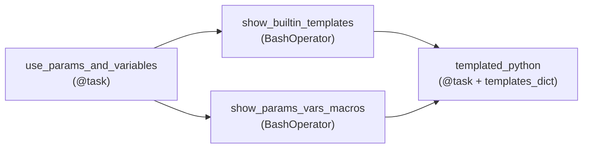

# Params, Variables & Jinja templating

**What you'll learn:** three ways to keep values *out* of your task code. **Params** are typed
inputs for one run (with a form in the UI). **Variables** are global settings stored in Airflow.
**Jinja templates** (`{{ ... }}`) fill in values such as the run's date when the task runs.
New terms are also explained in the [glossary](32-glossary.md).

> **Run it**
> - DAG id: `10_params_variables_templating` — file [`../dags/10_params_variables_templating.py`](../dags/10_params_variables_templating.py)
> - Unpause it, click **Trigger**, change some fields in the form, and trigger. Keep a **logical
>   date** on the run (see the warning in section 5).
> - Open each task's log, then its **Rendered Template** tab, to see what every `{{ }}` became.
> - The Variables `environment` and `tutorial_settings` are already set through environment
>   variables in `docker-compose.yaml` (and in `scripts/local_env.sh` for the local setup).

---

## 1. The DAG at a glance



| Task | Shows |
|------|-------|
| `use_params_and_variables` | reading `params` and `Variable.get(...)` in Python |
| `show_builtin_templates` | built-in template variables: `run_id`, `ds`, `data_interval_start`… |
| `show_params_vars_macros` | `params`, `var`, `macros`, a Jinja filter, a custom macro and a plugin macro inside a template |
| `templated_python` | templating a value for a TaskFlow task with `templates_dict` |

| Mechanism | Scope | Set by | Typical use |
|-----------|-------|--------|-------------|
| **Param** | one DAG run | the person/system that triggers the run (defaults in code) | "which customer / date / mode for this run?" |
| **Variable** | the whole Airflow installation | admins: UI, CLI, env vars, secrets backend | environment name, feature flags, small shared config |
| **Template** | one task field | Airflow at runtime | dates of the run, file names, SQL with the run's date |

---

## 2. Params: typed inputs for a run

A **Param** describes one input of the DAG: its default value and a
[JSON Schema](https://json-schema.org/) that says what values are allowed. The DAG defines eight:

```python
params={
    # Each Param becomes a field in the trigger form.
    "customer_name": Param("Ada Lovelace", type="string", minLength=2, title="Customer name"),
    "report_type": Param(
        "daily",
        type="string",
        enum=["daily", "weekly", "monthly"],
        description="Which report to build",
    ),
    "max_rows": Param(100, type="integer", minimum=1, maximum=10_000),
    "dry_run": Param(True, type="boolean", description="If true, nothing is written"),
    # Defaults must be static: never compute them with today()/now() at parse time.
    "report_date": Param("2026-01-01", type="string", format="date", title="Report date"),
    "regions": Param(["north", "south"], type="array", description="One region per line"),
    "options": Param({"compress": True, "format": "csv"}, type="object"),
    "comment": Param(None, type=["null", "string"], description="Optional free text"),
},
```

The first argument is the **default**. Every other keyword is JSON Schema, plus a few keywords the
trigger form uses:

| Param in the DAG | Schema keywords | What the trigger form shows |
|------------------|-----------------|-----------------------------|
| `customer_name` | `type="string"`, `minLength=2` | a text box with the label "Customer name" (`title`) |
| `report_type` | `enum=[...]` | a drop-down with the three values; `description` appears as help text |
| `max_rows` | `type="integer"`, `minimum`, `maximum` | a number field |
| `dry_run` | `type="boolean"` | an on/off switch |
| `report_date` | `format="date"` | a date picker; the value is a string like `"2026-01-01"` |
| `regions` | `type="array"` | a multi-line text box, one item per line |
| `options` | `type="object"` | a JSON editor |
| `comment` | `type=["null", "string"]` | an optional text box; empty means `None` |

Other useful keywords: `maxLength`, `pattern` (a regex), `exclusiveMinimum`, `examples`,
`values_display` (nicer labels for `enum` values), `description_md` (Markdown help text) and
`section` (groups fields under a heading). The official
[Params page](https://airflow.apache.org/docs/apache-airflow/stable/core-concepts/params.html)
lists them all.

**Required vs optional.** A Param whose type doesn't allow `null` must have a valid value. Allow
`"null"` in the type, like `comment`, to make a field optional.

### Validation

Airflow checks every value against its schema **before** the run starts — in the form, through
the CLI and through the REST API. A bad value rejects the trigger instead of failing a task later.
For example, the installed 3.4.0 reports for `max_rows = 50000`:

```text
ParamValidationError: Invalid input for param max_rows: 50000 is greater than the maximum of 10000
```

and for `report_date = "x"`: `'x' is not a 'date'`.

### Reading Params in tasks

```python
@task
def use_params_and_variables(params=None) -> dict:
    ...
    print(f"Building a {params['report_type']} report for {params['customer_name']}")
    print(f"Regions: {params['regions']}, options: {params['options']}, dry_run: {params['dry_run']}")
```

- In a TaskFlow task, add a `params` argument (default `None`) and Airflow passes the dict in.
- In a template, write `{{ params.customer_name }}` (see `show_params_vars_macros`).
- The values keep their JSON types: `max_rows` is an `int`, `regions` a `list`, `options` a `dict`.

> **Defaults must be static.** The comment on `report_date` matters: never write
> `Param(str(date.today()))`. The DAG file is parsed again every ~30 seconds, so the "default" would
> change all the time and the DAG would get a new version over and over. Use a fixed default, or
> leave it `None` and compute the value inside the task.

### Passing values with `conf`

A trigger can carry a JSON dict called **conf**. Keys in `conf` that match a Param override its
default (`[core] dag_run_conf_overrides_params` is `True` by default). From the CLI:

```bash
airflow dags trigger 10_params_variables_templating \
  --logical-date 2026-11-11 \
  --conf '{"report_type": "weekly", "max_rows": 500, "regions": ["east"]}'
```

- `--conf` / `-c` takes a JSON string; `--logical-date` / `-l` and `--run-id` / `-r` are optional
  (checked with `airflow dags trigger --help`). Pass `--logical-date` for this DAG — see section 5.
- In Docker, run it inside a container: `make cli`, then the command above.
- If the DAG is paused, the run is created but stays **queued** until you unpause it.
- The UI trigger dialog also lets you edit the raw conf JSON, and the REST API takes the same dict
  in the `conf` field of `POST /api/v2/dags/{dag_id}/dagRuns`
  (see [CLI & REST API](26-cli-and-rest-api.md)).

Extra conf keys that are *not* Params are still available as `dag_run.conf` in the task, but
nothing validates them. Prefer Params.

---

## 3. Variables: global settings

A **Variable** is a key/value pair stored by Airflow and readable by every DAG — think "settings
that change per environment" (dev/prod), not "data".

### Where Variables come from

| Way | Example | Shown in the UI list? |
|-----|---------|-----------------------|
| UI | **Admin ▸ Variables ▸ +**: key, value, description | yes |
| CLI | `airflow variables set environment dev` | yes |
| CLI, JSON value | `airflow variables set -j tutorial_settings '{"team": "x"}'` | yes |
| CLI, many at once | `airflow variables import vars.json` (a JSON object `{"key": value, ...}`); `airflow variables export out.json` | yes |
| Environment variable | `AIRFLOW_VAR_ENVIRONMENT='docker-local'` | **no** — but `Variable.get` finds it |
| Secrets backend | Vault, AWS Secrets Manager… (see [Connections & hooks](15-connections-and-hooks.md)) | no |

This project uses the environment-variable way, in `docker-compose.yaml`:

```yaml
AIRFLOW_VAR_ENVIRONMENT: 'docker-local'
AIRFLOW_VAR_TUTORIAL_SETTINGS: '{"team": "data-platform", "row_limit": 100, "notify": false}'
```

The name after `AIRFLOW_VAR_` becomes the key, lower-cased: `environment` and
`tutorial_settings`. That's why **Admin ▸ Variables** looks empty, yet the tasks can read them.
Airflow looks in the secrets backend first, then environment variables, then the metadata
database.

### Reading Variables in Python

```python
# Variable.get reads at RUNTIME. Always give a default for optional ones.
environment = Variable.get("environment", default="unknown")
settings = Variable.get("tutorial_settings", default={}, deserialize_json=True)
```

- `Variable` comes from `airflow.sdk`.
- `default=` is returned if the key doesn't exist. Without it, a missing key raises an error and
  fails the task.
- `deserialize_json=True` turns the stored JSON string into a Python `dict`/`list`. Without it
  you get the raw string.
- `Variable.set(key, value, serialize_json=True)` writes one (rarely needed in tasks).

### Never read Variables at the top level of a DAG file

```python
# BAD — runs on every parse (~every 30 s), outside any task
TEAM = Variable.get("tutorial_settings", deserialize_json=True)["team"]

@dag(...)
def my_dag(): ...
```

Code at the top level of a DAG file runs **every time the dag-processor parses the file**, not
when the task runs. Each read is a round trip to the secrets backend or database, which slows down
parsing for every DAG. Read Variables inside tasks (like `use_params_and_variables` does) or in
templates (`{{ var.value.environment }}`), which are rendered only when the task runs.

### Secrets masking

If a Variable's **key** contains a sensitive word, Airflow hides its **value** as `***` in task
logs and in the UI. The built-in list (from the installed 3.4.0) includes `password`, `passwd`,
`passphrase`, `secret`, `token`, `access_token`, `api_key`, `apikey`, `access_key`,
`private_key`, `authorization`, `bearer`, `connection_string`, `dsn`, `service_account`,
`keyfile_dict` and `webhook_url`. For example, `stripe_api_key` and `db_password` are masked;
`environment` is not. For a JSON Variable read with `deserialize_json=True`, the keys *inside*
the JSON object decide: in `{"user": "x", "password": "y"}` only `y` is masked.

Add your own words with `[core] sensitive_var_conn_names` (comma-separated). Masking replaces
values in logs, but don't print secrets on purpose — store them in a
[Connection](15-connections-and-hooks.md) or a secrets backend.

---

## 4. Jinja templating

**Jinja** is a template language: text with `{{ ... }}` placeholders. Many operator arguments are
**templated fields** — Airflow renders them with Jinja right before the task runs, using the task's
**context** (the run's dates, ids, params…).

```python
show_builtin_templates = BashOperator(
    task_id="show_builtin_templates",
    bash_command=(
        "echo 'run_id         = {{ run_id }}' && "
        "echo 'logical date   = {{ logical_date }}' && "
        "echo 'ds / ds_nodash = {{ ds }} / {{ ds_nodash }}' && "
        "echo 'interval       = {{ data_interval_start }} -> {{ data_interval_end }}' && "
        "echo 'dag / task     = {{ dag.dag_id }} / {{ task.task_id }}' && "
        "echo 'try number     = {{ ti.try_number }}'"
    ),
)
```

### Which arguments are templated?

Only the ones listed in the operator's **`template_fields`**. For example (checked in the venv):

| Operator | `template_fields` | `template_ext` (file endings loaded as templates) |
|----------|-------------------|---------------------------------------------------|
| `BashOperator` | `bash_command`, `env`, `cwd` | `.sh`, `.bash` |
| `PythonOperator` / `@task` | `templates_dict`, `op_args`, `op_kwargs` | — |
| `SQLExecuteQueryOperator` | `sql`, `parameters`, `conn_id`, `database`, `hook_params` | `.sql`, `.json` |

The API reference of each operator lists its templated fields. A `{{ }}` in a field that is *not*
templated stays as literal text. Custom operators declare their own `template_fields` — see
[Custom operators, hooks & plugins](17-custom-operators-hooks-plugins.md).

### The Rendered Template tab

Open a task instance in the UI and choose its **Rendered Template** tab: it shows every templated
field *after* rendering. This is the fastest way to debug a template. `airflow tasks render
<dag_id> <task_id> <logical_date_or_run_id>` shows the same from the CLI.

### Template variables you can use

These keys are in the Airflow 3.4 task context (from `airflow.sdk.definitions.context.Context`):

| Variable | Example value / meaning |
|----------|-------------------------|
| `{{ ds }}` | logical date as `2026-11-11` |
| `{{ ds_nodash }}` | `20261111` |
| `{{ ts }}` | logical date as ISO 8601, `2026-11-11T00:00:00+00:00` |
| `{{ ts_nodash }}` | `20261111T000000` |
| `{{ ts_nodash_with_tz }}` | `20261111T000000+0000` |
| `{{ logical_date }}` | the logical date as a pendulum `DateTime` object |
| `{{ data_interval_start }}` / `{{ data_interval_end }}` | the run's data interval (`DateTime`) |
| `{{ prev_data_interval_start_success }}` / `{{ prev_data_interval_end_success }}` | data interval of the previous **successful** run |
| `{{ prev_start_date_success }}` / `{{ prev_end_date_success }}` | when the previous successful run started / ended |
| `{{ run_id }}` | e.g. `manual__2026-11-11T10:00:00+00:00` |
| `{{ dag_run }}` | the DagRun: `dag_run.conf`, `dag_run.run_type`, `dag_run.run_after`… |
| `{{ dag }}` / `{{ task }}` | the DAG and task objects (`dag.dag_id`, `task.task_id`, `task.owner`…) |
| `{{ ti }}` / `{{ task_instance }}` | the running task instance: `ti.try_number`, `ti.map_index`, `ti.xcom_pull(...)` |
| `{{ task_instance_key_str }}` | `dagid__taskid__20261111` |
| `{{ try_number }}` | current try, starting at 1 |
| `{{ params }}` | the run's Params: `params.customer_name` |
| `{{ var.value.<key> }}` / `{{ var.json.<key> }}` | a Variable as text / parsed JSON |
| `{{ conn.<conn_id> }}` | a Connection: `conn.demo_postgres.host`, `conn.demo_postgres.login` |
| `{{ macros }}` | helper functions (next section) |
| `{{ outlets }}`, `{{ inlets }}`, `{{ outlet_events }}`, `{{ inlet_events }}`, `{{ triggering_asset_events }}` | asset information (see [Assets](13-assets-data-aware-scheduling.md)) |
| `{{ expanded_ti_count }}` | number of mapped copies of this task (see [Dynamic task mapping](10-dynamic-task-mapping.md)) |
| `{{ test_mode }}` | `True` when run with `airflow tasks test` |
| `{{ templates_dict }}` | only in `PythonOperator`/`@task` (section 7) |

> **Removed in Airflow 3:** `execution_date`, `next_ds`, `prev_ds`, `tomorrow_ds`,
> `yesterday_ds`, `next_execution_date`, `prev_execution_date` and similar keys are gone. Use
> `logical_date`, `data_interval_start`/`data_interval_end` or the `macros.ds_add` helper instead.
> See [Airflow 2 vs 3](31-airflow-2-vs-3.md).

---

## 5. When the run has no logical date

In Airflow 3 a run **may have no logical date**: asset-triggered runs never do, and a manual
trigger without a logical date doesn't either. Then `logical_date`, `ds`, `ds_nodash`, `ts`,
`ts_nodash`, `ts_nodash_with_tz`, `data_interval_start`, `data_interval_end` and the
`prev_data_interval_*_success` keys are **not in the context at all** (checked in the 3.4.0 task
runner).

Airflow renders templates with `StrictUndefined`, so `{{ ds }}` then fails the task with an
"undefined" error instead of printing an empty string. This DAG uses `ds` in
`show_builtin_templates`, `show_params_vars_macros` and `templated_python`, so:

- **CLI:** `airflow dags trigger` sets **no** logical date unless you pass `--logical-date`.
  Always pass it for this DAG (it must not be before the DAG's `start_date`, 1 Jan 2026).
- **UI / REST API:** make sure the run gets a logical date (the trigger dialog's logical date field;
  `"logical_date"` in the REST body).
- In your own DAGs, use `{{ dag_run.run_after }}` when you only need "when did this run start",
  because it always exists.

---

## 6. Params, Variables, macros and filters inside templates

```python
show_params_vars_macros = BashOperator(
    task_id="show_params_vars_macros",
    bash_command=(
        "echo 'customer       = {{ params.customer_name }}' && "
        "echo 'environment    = {{ var.value.environment }}' && "
        "echo 'team (json var)= {{ var.json.tutorial_settings.team }}' && "
        "echo 'missing var    = {{ var.value.get(\"does_not_exist\", \"fallback\") }}' && "
        "echo 'ds + 7 days    = {{ macros.ds_add(ds, 7) }}' && "
        "echo 'formatted      = {{ macros.ds_format(ds, \"%Y-%m-%d\", \"%d %b %Y\") }}' && "
        "echo 'uppercase      = {{ params.report_type | upper }}' && "
        "echo 'custom macro   = {{ days_between(\"2026-01-01\", ds) }} days since new year at {{ company }}' && "
        "echo 'plugin macro   = {{ macros.tutorial_plugin.env_banner(var.value.environment) }}'"
    ),
)
```

Line by line:

| Template | Explanation |
|----------|-------------|
| `{{ params.customer_name }}` | a Param |
| `{{ var.value.environment }}` | Variable `environment` as text → `docker-local` in Docker, `local` with `make standalone` |
| `{{ var.json.tutorial_settings.team }}` | Variable parsed as JSON, then the `team` key → `data-platform` |
| `{{ var.value.get("does_not_exist", "fallback") }}` | `.get(key, default)` avoids failing on a missing Variable |
| `{{ macros.ds_add(ds, 7) }}` | adds 7 days to a `YYYY-MM-DD` string (negative numbers subtract) |
| `{{ macros.ds_format(ds, "%Y-%m-%d", "%d %b %Y") }}` | re-formats a date string, e.g. `11 Nov 2026` |
| `{{ params.report_type \| upper }}` | `\| upper` is a Jinja **filter** (built into Jinja) |
| `{{ days_between("2026-01-01", ds) }}`, `{{ company }}` | **user-defined macros** from the DAG (below) |
| `{{ macros.tutorial_plugin.env_banner(...) }}` | a **plugin macro** (below) |

### Built-in macros

`macros` contains (from `airflow.sdk.execution_time.macros` in 3.4.0):

| Macro | Use |
|-------|-----|
| `macros.ds_add(ds, days)` | add/subtract days from a `YYYY-MM-DD` string |
| `macros.ds_format(ds, input_format, output_format)` | change a date string's format |
| `macros.ds_format_locale(...)` | same, with a locale (e.g. month names in German) |
| `macros.datetime_diff_for_humans(dt, since=None)` | "3 days ago"-style text |
| `macros.datetime`, `macros.timedelta` | Python's `datetime` classes: `{{ (logical_date - macros.timedelta(days=1)).strftime('%Y-%m') }}` |
| `macros.dateutil` | the `dateutil` package (`macros.dateutil.relativedelta.relativedelta(months=1)`) |
| `macros.time`, `macros.uuid`, `macros.random`, `macros.json`, `macros.yaml` | Python's modules of the same name (`macros.uuid.uuid4()`) |

### Your own macros and filters

```python
def days_between(start: str, end: str) -> int:
    """A custom macro usable as {{ days_between(a, b) }}."""
    return (pendulum.parse(end) - pendulum.parse(start)).days

@dag(
    ...
    user_defined_macros={"days_between": days_between, "company": "Acme Corp"},
)
```

- **`user_defined_macros`** adds names to the template namespace of **this DAG**: a function
  (`days_between`) or a plain value (`company`). They're used *without* the `macros.` prefix.
- **`user_defined_filters`** adds Jinja filters, used with `|`:
  `user_defined_filters={"hello": lambda x: f"hello {x}"}` → `{{ "ada" | hello }}` → `hello ada`.
- **Plugin macros** are available to **every DAG** under `macros.<plugin name>.<function>`. This
  project's plugin ([`../plugins/tutorial_plugin.py`](../plugins/tutorial_plugin.py)) registers
  two:

```python
def env_banner(environment: str) -> str:
    """Example macro: {{ macros.tutorial_plugin.env_banner(var.value.environment) }}"""
    return f"*** running in {environment.upper()} ***"

class TutorialPlugin(AirflowPlugin):
    name = "tutorial_plugin"
    macros = [to_upper, env_banner]
```

So the last line of the task prints `*** running in DOCKER-LOCAL ***`. Plugins are explained in
[Custom operators, hooks & plugins](17-custom-operators-hooks-plugins.md).

---

## 7. Templates in TaskFlow tasks: `templates_dict`

A `@task` function's *arguments* are not Jinja-rendered strings in the usual way — you normally
receive context values as arguments instead (`params=None`, `ds=None`). When you want a templated
string, use `templates_dict`:

```python
@task(templates_dict={"target_table": "reports_{{ params.report_type }}_{{ ds_nodash }}"})
def templated_python(templates_dict=None, ds=None):
    print(f"Would write to table {templates_dict['target_table']} for {ds}")
```

`templates_dict` is a templated field of `PythonOperator` (which `@task` uses), so each value is
rendered before the function runs. The log shows e.g.
`Would write to table reports_daily_20261111 for 2026-11-11`. The second argument, `ds=None`, shows
the other way: name a context key as an argument and Airflow passes its value.

---

## 8. Template files and `template_searchpath`

Long SQL or shell scripts are easier to keep in their own files. If a templated field's value is a
string **ending in one of the operator's `template_ext`** (`.sql` for SQL operators, `.sh` for
`BashOperator`), Airflow loads that file and renders its **contents** as the template.

Airflow looks for the file in the DAG file's folder and in the folders listed in the DAG's
`template_searchpath`. [`../dags/11_connections_and_hooks.py`](../dags/11_connections_and_hooks.py)
does this:

```python
template_searchpath=[str(SQL_DIR)],   # dags/include/sql
...
sql="create_weather_table.sql",
```

Details in [Connections & hooks](15-connections-and-hooks.md). One warning: use Jinja for
*structure* (table names, dates) but pass *values* from users as query **parameters**, not
`{{ params.x }}` pasted into SQL — otherwise you risk SQL injection.
[`../dags/include/sql/build_sales_summary.sql`](../dags/include/sql/build_sales_summary.sql) shows
the safe way: `%(batch_id)s` filled by the database driver.

> A `BashOperator` command that *ends* in `.sh` is treated as a file name. To run a script
> without templating it, put a space after the name: `bash_command="/path/run.sh "`.

---

## 9. `render_template_as_native_obj`

By default every template renders to a **string**. `{{ [1, 2] + [3] }}` becomes the text
`"[1, 2, 3]"`. With `@dag(render_template_as_native_obj=True)`, Airflow uses Jinja's
`NativeEnvironment` and the result is a real Python list `[1, 2, 3]` (checked in the venv). Use it
when a templated value must stay a `dict`, `list` or `int` — for example `op_kwargs` of a
`PythonOperator` built from `{{ dag_run.conf }}`. It applies to every task in the DAG.

---

## Common mistakes

- **Computing Param defaults at parse time** (`Param(str(date.today()))`). Use static defaults.
- **`Variable.get` at the top level** of a DAG file — slow parsing and constant backend calls.
- **Expecting `{{ }}` to work in any argument.** Only `template_fields` are rendered; check the
  operator's list, or use `templates_dict` in TaskFlow.
- **Using `{{ ds }}` in a run without a logical date** (CLI trigger without `--logical-date`,
  asset-triggered runs): the task fails with an undefined-variable error.
- **Looking for env-var Variables in Admin ▸ Variables.** `AIRFLOW_VAR_*` values work but are not
  listed.
- **Building SQL with `{{ params.x }}`** from user input. Use query parameters for values.

## Try it yourself

1. Add a Param `"priority": Param("normal", type="string", enum=["low", "normal", "high"])` and
   print it in `use_params_and_variables`. Check that the trigger form shows a drop-down.
2. Trigger from the CLI with `--conf '{"max_rows": 0}'` (and `--logical-date`). What error do you
   get, and does a run appear?
3. Create a Variable `api_token` with value `abc123` in **Admin ▸ Variables**, print
   `Variable.get("api_token")` in a task, and look at the log. Then try a key without a
   sensitive word.
4. Add `user_defined_filters={"shout": lambda s: s.upper() + "!"}` to the DAG and use
   `{{ params.customer_name | shout }}` in `show_params_vars_macros`. Confirm it on the Rendered
   Template tab.

---

**Next →** [Connections & hooks](15-connections-and-hooks.md) · [Back to the index](README.md)
