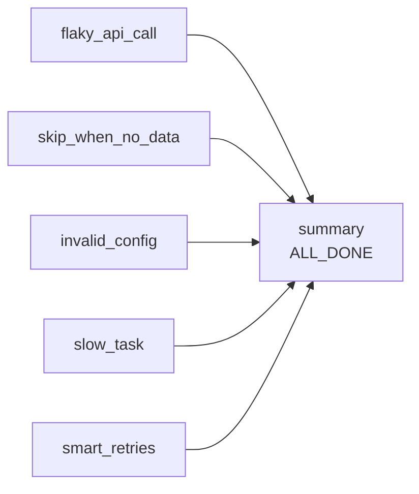
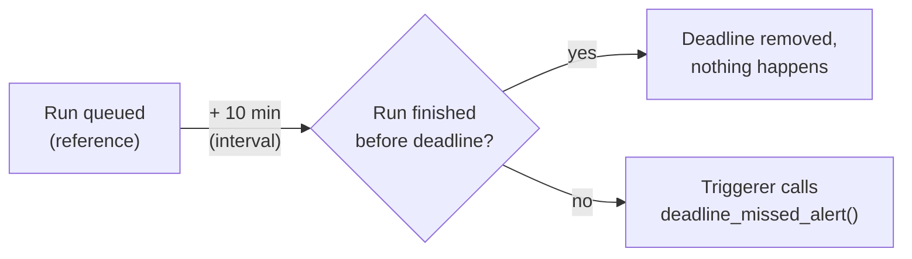

# Error handling, retries & alerts

**What you'll learn:** how to make tasks survive temporary failures (retries, backoff, retry
policies), how to stop work that runs too long (timeouts, deadlines), and how to find out when
something goes wrong (callbacks, notifiers, e-mail).

> **Run it**
> - DAG id: `12_error_handling_and_alerts` — file [`../dags/12_error_handling_and_alerts.py`](../dags/12_error_handling_and_alerts.py)
> - Callbacks: [`../plugins/tutorial_lib/callbacks.py`](../plugins/tutorial_lib/callbacks.py) ·
>   Notifier: [`../plugins/tutorial_lib/notifiers.py`](../plugins/tutorial_lib/notifiers.py)
> - Unpause the DAG and trigger it. Then trigger again with **config**: set `fail_hard` to `true`
>   and/or `sleep_seconds` to `15` to see the other failure paths.
> - The callbacks only **log** (no Slack/e-mail needed). Look for lines starting with `ALERT:` in task
>   logs, and in the dag-processor / triggerer logs for DAG-level and deadline callbacks
>   (`docker compose logs airflow-dag-processor`, `docker compose logs airflow-triggerer`).

---

## 1. The tasks in this DAG

| Task | What happens |
|------|--------------|
| `flaky_api_call` | fails on try 1 and 2, succeeds on try 3 → shows **retries** and retry callbacks |
| `skip_when_no_data` | raises `AirflowSkipException` → **skipped** |
| `invalid_config` | with `fail_hard=true`, raises `AirflowFailException` → **failed immediately, no retries** |
| `slow_task` | has `execution_timeout=10s`; set `sleep_seconds` > 10 to see a **timeout** |
| `smart_retries` | a **retry policy** decides per exception type whether to retry |
| `summary` | `trigger_rule=ALL_DONE` → always runs at the end |



```python
[flaky_api_call(), skip_when_no_data(), invalid_config(), slow_task(), smart_retries()] >> summary()
```

---

## 2. Retries and backoff

Most failures in data pipelines are **temporary**: a network blip, a database restarting, an API
rate limit. Retrying a few minutes later usually fixes them. The DAG sets retry behaviour for every
task through `default_args`:

```python
default_args = {
    "owner": "tutorial",
    "retries": 3,
    "retry_delay": timedelta(seconds=5),
    "retry_exponential_backoff": 2.0,  # wait 5s, 10s, 20s… (multiplier)
    "max_retry_delay": timedelta(minutes=1),  # …but never more than 1 minute
    "execution_timeout": timedelta(minutes=10),  # kill any task running longer than this
    "on_failure_callback": task_failure_alert,
    "on_retry_callback": task_retry_alert,
}
```

| Setting | Meaning | Airflow default |
|---------|---------|-----------------|
| `retries` | How many **extra** tries after the first one. `retries=3` → up to 4 tries. | `0` (`[core] default_task_retries`) |
| `retry_delay` | Wait time before a retry. | 5 minutes (`[core] default_task_retry_delay` = 300 s) |
| `retry_exponential_backoff` | Multiplier for the delay on each retry. `0` = constant delay. | `0` |
| `max_retry_delay` | Upper limit for the (growing) delay. | none |

A **task-level** argument always wins over `default_args`. For example `slow_task` sets `retries=0`,
so it never retries.

### How the backoff is calculated

Since Airflow 3.2 `retry_exponential_backoff` is a **number** (a multiplier). The old `True` still
works and means `2.0`. The base wait before retry *n* is:

```
retry_delay × multiplier ^ (n − 1)          capped at max_retry_delay
```

Airflow then adds some deterministic **jitter** (a value between the base and almost twice the base,
derived from a hash of DAG/task/try) so that many failing tasks don't all retry at the same second.
For this DAG (5 s, ×2.0, max 1 min):

| Retry | Base wait | Actual wait (with jitter) |
|-------|-----------|---------------------------|
| 1st | 5 s | 5–9 s |
| 2nd | 10 s | 10–19 s |
| 3rd | 20 s | 20–39 s |
| 4th (if there were one) | 40 s | capped at 60 s |

### What you see in the UI

For `flaky_api_call`:

```python
@task(on_success_callback=task_success_log)
def flaky_api_call(ti=None) -> str:
    # try_number starts at 1 and increases on every retry.
    if ti.try_number < 3:
        raise ConnectionError(f"Simulated network glitch on try {ti.try_number}")
    return "Got data on try 3"
```

1. Try 1 raises `ConnectionError` → state **up_for_retry** (yellow) → `task_retry_alert` runs.
2. After the delay the task runs again: try 2 fails the same way.
3. Try 3 returns → **success** → `task_success_log` runs.

In the task's detail panel you can switch between tries with the try selector and read each log
separately. `ti.try_number` is how your code can tell which try it is on.

> **Make retries safe.** A retried task runs your whole function again. Write tasks so that running
> twice gives the same result (*idempotent*): use `CREATE TABLE IF NOT EXISTS`, `INSERT … ON CONFLICT`,
> overwrite files instead of appending. See [chapter 28](28-best-practices.md).

---

## 3. Exceptions that change the rules

Normally *any* exception → retry (if retries are left) → finally **failed**. Airflow has special
exceptions to say "don't bother retrying" or "nothing to do":

```python
from airflow.sdk.exceptions import AirflowFailException, AirflowSkipException
```

| What the task does | Resulting state | Retries? | Callback fired | Typical use |
|--------------------|-----------------|----------|----------------|-------------|
| Returns normally | `success` | – | `on_success_callback` | |
| Raises any normal exception (`ValueError`, `ConnectionError`…) | `up_for_retry`, finally `failed` | ✅ yes | `on_retry_callback`, then `on_failure_callback` | Temporary problems |
| Raises `AirflowSkipException` | `skipped` | ❌ no | `on_skipped_callback` | "No new data today" |
| Raises `AirflowFailException` | `failed` | ❌ no, fails at once | `on_failure_callback` | Bad config, wrong credentials — retrying can't help |
| Runs longer than `execution_timeout` | `up_for_retry` / `failed` (`AirflowTaskTimeout`) | ✅ yes | as for a normal exception | Hanging calls |
| Sensor exceeds its `timeout` (`AirflowSensorTimeout`) | `failed` | ❌ no | `on_failure_callback` | See [chapter 12](12-sensors-and-deferrable.md) |

From the DAG:

```python
@task
def skip_when_no_data() -> None:
    new_rows = 0
    if new_rows == 0:
        raise AirflowSkipException("No new rows today, skipping.")

@task(
    # Notifier: templated, reusable callback (see tutorial_lib/notifiers.py)
    on_failure_callback=LogNotifier("{{ ti.task_id }} in {{ dag.dag_id }} failed hard!", level="error"),
)
def invalid_config(params=None) -> None:
    if params["fail_hard"]:
        raise AirflowFailException("Config is invalid. Retrying will not help -> failing now.")
    print("Config OK")
```

Trigger with `fail_hard = true`: `invalid_config` goes red on try 1 even though `default_args` has
`retries=3`. A skipped task also skips downstream tasks that use the default `all_success` trigger
rule — `summary` still runs here because it uses `ALL_DONE` (see
[chapter 9](09-branching-and-trigger-rules.md)).

---

## 4. Retry policies: decide per exception

`retries` treats every exception the same. A **retry policy** looks at *which* exception was raised
and decides what to do. It's set with the `retry_policy` argument on any task or operator:

```python
class TemporaryNetworkError(Exception):
    """Pretend 'the network blipped' — worth retrying quickly."""

class BadCredentialsError(Exception):
    """Pretend 'the password is wrong' — retrying won't help."""

# A retry policy looks at the actual exception and decides what to do.
SMART_RETRY_POLICY = ExceptionRetryPolicy(
    rules=[
        RetryRule(exception=TemporaryNetworkError, action=RetryAction.RETRY, retry_delay=timedelta(seconds=5)),
        RetryRule(exception=BadCredentialsError, action=RetryAction.FAIL, reason="Credentials are wrong"),
    ]
)

@task(retries=3, retry_policy=SMART_RETRY_POLICY)
def smart_retries(ti=None) -> str:
    if ti.try_number == 1:
        raise TemporaryNetworkError("blip")  # policy: retry after 5s
    return "Recovered after a temporary network error"
```

How `ExceptionRetryPolicy` works:

- Rules are checked **in order; the first match wins**. By default a rule also matches subclasses
  (`match_subclasses=True`).
- `exception` can be a class, a dotted import path string (`"requests.exceptions.HTTPError"`), or a
  list of either.
- If no rule matches, the policy's `default` action applies (`RetryAction.DEFAULT`).
- A rule's `retry_delay` replaces the task's normal (backoff) delay for that retry.
- A policy can fail *earlier* than `retries` allows, but never retry *more* often than `retries`.

The `RetryAction` values (from `airflow.sdk`):

| Action | Effect |
|--------|--------|
| `RetryAction.RETRY` | Retry (optionally with the rule's `retry_delay`), still limited by `retries`. |
| `RetryAction.FAIL` | Fail now and skip remaining retries; the `reason` is recorded. |
| `RetryAction.DEFAULT` | No opinion — use the task's normal `retries` / `retry_delay` logic. |
| `RetryAction.RESCHEDULE` | Run again later **without using up a retry** (state `up_for_reschedule`, try number unchanged, `on_retry_callback` not called). For "the other system isn't ready yet" (cluster full, quota reached). Needs a bound: `max_reschedules` and/or `reschedule_timeout` on the rule. |

`RetryRule(...)` arguments: `exception`, `action`, `retry_delay`, `reason`, `match_subclasses`,
`max_reschedules`, `reschedule_timeout`.

To combine several policies use **`ChainRetryPolicy`** (also in `airflow.sdk`): it asks each policy in
order, and the first answer that isn't `DEFAULT` wins:

```python
from airflow.sdk import ChainRetryPolicy

retry_policy = ChainRetryPolicy([
    ExceptionRetryPolicy(rules=[RetryRule(exception=PermissionError, action=RetryAction.FAIL)]),
    ExceptionRetryPolicy(rules=[RetryRule(exception=ConnectionError, retry_delay=timedelta(seconds=30))]),
])
```

For fully custom logic, subclass `RetryPolicy` and implement `evaluate()`, returning a
`RetryDecision`.

---

## 5. Timeouts

```python
@task(execution_timeout=timedelta(seconds=10), retries=0)
def slow_task(params=None) -> None:
    print(f"Sleeping {params['sleep_seconds']}s (timeout is 10s)")
    time.sleep(params["sleep_seconds"])
```

| Setting | Level | What happens when exceeded |
|---------|-------|----------------------------|
| `execution_timeout` | task | The task is stopped with `AirflowTaskTimeout`; counts as a normal failure, so retries apply. Here `retries=0` → failed. Every other task gets 10 minutes from `default_args`. |
| `dagrun_timeout` | DAG | The scheduler marks the whole run **failed**, unfinished tasks become **skipped**, and the DAG's `on_failure_callback` runs with reason `timed_out`. Here: 30 minutes. |
| Sensor `timeout` | sensor | `AirflowSensorTimeout`, no retry. See [chapter 12](12-sensors-and-deferrable.md). |

Always set an `execution_timeout`. Without it, a task stuck on a network call can hold a worker slot
(and a pool slot) forever.

---

## 6. Callbacks: run code when something happens

A **callback** (see [glossary](32-glossary.md)) is a plain function Airflow calls on a state change.
The callbacks here live in [`../plugins/tutorial_lib/callbacks.py`](../plugins/tutorial_lib/callbacks.py)
so many DAGs can share them.

| Callback | Level | Fires when |
|----------|-------|------------|
| `on_execute_callback` | task | right before the task starts |
| `on_success_callback` | task / DAG | task succeeded / DAG run succeeded |
| `on_failure_callback` | task / DAG | task failed **after all retries** / DAG run failed |
| `on_retry_callback` | task | a try failed and the task will be retried |
| `on_skipped_callback` | task | the task raised `AirflowSkipException` (not when skipped by branching or trigger rules) |

Every callback receives one argument, the **context** — the same dictionary you get from
`get_current_context()` in a task:

```python
def task_failure_alert(context) -> None:
    ti = context["ti"]
    exception = context.get("exception")
    log.error(
        "ALERT: task %s in DAG %s failed on try %s. Error: %r",
        ti.task_id, ti.dag_id, ti.try_number, exception,
    )

def dag_failure_alert(context) -> None:
    """DAG-level callbacks get a context too; `dag_run` tells you which run failed."""
    dag_run = context.get("dag_run")
    log.error("ALERT: DAG run %s failed. Reason: %s", dag_run, context.get("reason"))
```

Useful context keys: `ti` (task instance: `task_id`, `dag_id`, `try_number`, `log_url`…), `dag_run`,
`dag`, `params`, `exception` (failure callbacks), `reason` (DAG-level: e.g. `task_failure`,
`timed_out`, `success`).

How they're attached in this DAG:

```python
# task level, for every task, via default_args
"on_failure_callback": task_failure_alert,
"on_retry_callback": task_retry_alert,

# task level, one task
@task(on_success_callback=task_success_log)
def flaky_api_call(...): ...

# DAG level, in @dag(...)
on_success_callback=dag_success_log,
on_failure_callback=dag_failure_alert,
```

You can also pass a **list** of callbacks to run several.

### Where callbacks run (Airflow 3)

| Callback | Runs in | Where to find its log output |
|----------|---------|------------------------------|
| Task callbacks | the worker, right after the task | the task's log in the UI |
| DAG callbacks | the **dag-processor** | dag-processor logs |
| Deadline `AsyncCallback` | the **triggerer** | triggerer logs |

Callbacks should be quick and must never raise — an error in a callback is logged but does not
change the task's state.

> ⚠️ **Why is my DAG run green although a task failed?** A DAG run's final state depends only on its
> **leaf tasks** (tasks with nothing downstream). In this DAG the only leaf is `summary`, which uses
> `ALL_DONE` and therefore succeeds even when `invalid_config` or `slow_task` failed. So the run is
> marked **success**, `dag_success_log` runs, and `dag_failure_alert` does **not** — in this DAG it can
> only fire through `dagrun_timeout`. Rely on **task-level** failure callbacks for per-task alerts, or
> make sure a failing branch ends in a leaf.

---

## 7. Notifiers: reusable, templated callbacks

A **notifier** is a callback packaged as a class, with Jinja templating built in. Providers ship
ready-made ones; you pass an *instance* wherever a callback is accepted.

The project's own [`LogNotifier`](../plugins/tutorial_lib/notifiers.py) writes to the log so it works
offline:

```python
from airflow.sdk import BaseNotifier

class LogNotifier(BaseNotifier):
    # Fields listed here are rendered with Jinja before notify() is called.
    template_fields = ("message",)

    def __init__(self, message: str, level: str = "warning") -> None:
        super().__init__()
        self.message = message
        self.level = level

    def notify(self, context) -> None:
        getattr(self.log, self.level)("[LogNotifier] %s", self.message)
```

Used on `invalid_config`:

```python
on_failure_callback=LogNotifier("{{ ti.task_id }} in {{ dag.dag_id }} failed hard!", level="error"),
```

When the callback fires, `{{ ti.task_id }}` and `{{ dag.dag_id }}` are rendered → the log shows
`[LogNotifier] invalid_config in 12_error_handling_and_alerts failed hard!`.

Real notifiers from providers (install the provider and create its connection):

```python
# pip install apache-airflow-providers-slack
from airflow.providers.slack.notifications.slack import SlackNotifier

on_failure_callback=SlackNotifier(
    slack_conn_id="slack_api_default",
    text="Task {{ ti.task_id }} failed in {{ dag.dag_id }}",
    channel="#data-alerts",
)

# The smtp provider is included in the image
from airflow.providers.smtp.notifications.smtp import SmtpNotifier

on_failure_callback=SmtpNotifier(
    to="team@example.com",
    subject="Airflow: {{ ti.task_id }} failed",
)
```

Other providers offer notifiers for Microsoft Teams, PagerDuty, Opsgenie, Discord, Apprise and more.
Writing your own is shown in [chapter 17](17-custom-operators-hooks-plugins.md).

### E-mail alerts (old style)

Operators still accept `email=[...]`, `email_on_failure` and `email_on_retry`, but in Airflow 3.4
setting them prints a deprecation warning ("please migrate to SmtpNotifier"). Either way, e-mail only
works after you configure an SMTP server (the `[smtp]` section of the config, e.g.
`AIRFLOW__SMTP__SMTP_HOST`, `..._SMTP_PORT`, `..._SMTP_MAIL_FROM`, or an `smtp_default` connection).
The defaults point at `localhost:25`, which doesn't exist in this project.

---

## 8. Deadline alerts (the replacement for SLAs)

Airflow 2 had **SLAs** (`sla=` on tasks, `sla_miss_callback` on the DAG). They were **removed in
Airflow 3**; the parameters are ignored/deprecated. Since Airflow 3.1 the replacement is a
**DeadlineAlert**: "if this DAG run isn't finished by *reference time + interval*, call this
function".

```python
deadline=DeadlineAlert(
    reference=DeadlineReference.DAGRUN_QUEUED_AT,
    interval=timedelta(minutes=10),
    callback=AsyncCallback(deadline_missed_alert),
    name="finish_within_10_minutes",
),
```



Available **references** (`DeadlineReference.*` in 3.4.0):

| Reference | Deadline = | Use for |
|-----------|-----------|---------|
| `DAGRUN_QUEUED_AT` | when the run was queued + interval | "must finish within X of starting" |
| `DAGRUN_LOGICAL_DATE` | the run's logical date + interval | "the 02:00 run must be done by 06:00" (not for runs without a logical date) |
| `FIXED_DATETIME(dt)` | a fixed moment + interval | one-off cut-offs |
| `AVERAGE_RUNTIME(max_runs=10, min_runs=None)` | average duration of recent runs + interval | "alert if much slower than usual" |

You can also register your own reference class (`BaseDeadlineReference`,
`DeadlineReference.register_custom_reference`).

The **callback** must be wrapped:

- `AsyncCallback(func)` — runs `func` in the **triggerer**. `func` must be an `async def` function at
  the top level of an importable module (that's why `deadline_missed_alert` lives in
  `tutorial_lib/callbacks.py`, not in the DAG file).
- `SyncCallback(func)` — runs a normal function through the executor.

Both accept `kwargs={...}` that are passed to your function, together with a `context` containing the
`dag_run` (as a dict) and the `deadline` (id and time):

```python
async def deadline_missed_alert(context: dict, **kwargs) -> None:
    log.warning("DEADLINE MISSED for dag_run=%s extra=%s", context.get("dag_run"), kwargs)
```

Unlike `dagrun_timeout`, a missed deadline does **not** stop or fail the run — it only alerts.

> **Known issue in Airflow 3.4.0 — `dags test` with a deadline.** If you run this DAG with
> `airflow dags test 12_error_handling_and_alerts` (or `dag.test()`), the run itself works:
> `flaky_api_call` fails twice, succeeds on try 3, the callbacks fire and the run ends in state
> `success`. **After** that, a traceback ending in
> `AttributeError: 'dict' object has no attribute 'hex'` is printed. The in-process test mode
> hands the in-memory `DeadlineAlert` objects to code that expects the IDs of stored deadline
> alerts. Runs started by the scheduler use the serialized DAG and don't go through this code,
> so they are not affected. You can ignore the traceback, or remove `deadline=` while you test
> locally. The same note is at the top of the DAG file.

---

## 9. Two more DAG-level safety switches

| Parameter | What it does |
|-----------|--------------|
| `max_consecutive_failed_dag_runs=N` | (Experimental) after N failed runs in a row the scheduler **pauses** the DAG, so a broken DAG doesn't fail every hour all night. Global default: `[core] max_consecutive_failed_dag_runs_per_dag` = `0` (off). |
| `fail_fast=True` | As soon as one task fails, the remaining running tasks are stopped and the run fails. Only allowed if every task uses the default `all_success` trigger rule — so this DAG (with `summary` on `ALL_DONE`) could not use it. |

---

## Common mistakes

- **Retrying non-idempotent tasks**: a retry that appends data again creates duplicates.
- **Retrying errors that can never succeed** (bad password, missing column). Raise
  `AirflowFailException` or use a retry policy with `RetryAction.FAIL`.
- **No `execution_timeout`**: one hanging HTTP call can block a worker slot for days.
- **Expecting a DAG-level failure callback when the leaf task succeeds** (see the warning in
  section 6). The run's state comes from its leaf tasks.
- **Defining an `AsyncCallback` function inside the DAG file or as a normal `def`**: it must be an
  `async def` in an importable module, and the triggerer must be running.
- **Using `sla=`** from Airflow 2 tutorials — SLAs are gone; use `DeadlineAlert`.
- **Thinking the run failed because `airflow dags test` printed a `'dict' object has no attribute
  'hex'` traceback** — in 3.4.0 that's a test-mode bug with `deadline=` (see section 8). Check the
  final run state instead.

## Try it yourself

1. Trigger the DAG with `sleep_seconds = 15`. Watch `slow_task` fail with a timeout, and find the
   `ALERT:` line from `task_failure_alert` in its log.
2. Change `smart_retries` to raise `BadCredentialsError` on try 1. It should fail immediately with the
   reason "Credentials are wrong", even though `retries=3`.
3. Change the deadline `interval` to `timedelta(seconds=20)` and trigger with `sleep_seconds = 30`
   (raise `slow_task`'s `execution_timeout` to 60 s first). Look for `DEADLINE MISSED` in the
   triggerer logs.
4. Remove `summary` from the dependency line (so the five tasks are leaves) and trigger with
   `fail_hard = true`. The DAG run now turns red and `dag_failure_alert` fires.

---

**Next →** [17 · Custom operators, hooks, sensors & plugins](17-custom-operators-hooks-plugins.md) ·
[Back to the index](README.md)
