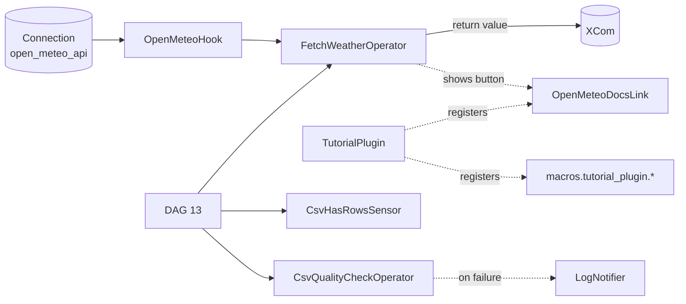
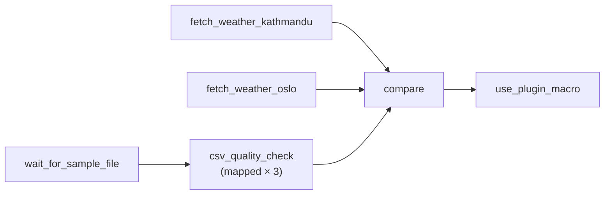

# 17 · Custom Operators, Hooks, Sensors and Plugins

**What you'll learn:** how to write your own hook, operator, sensor, notifier and operator extra link,
where that code should live, when you actually need an Airflow **plugin**, and how to unit-test it all.
Every example is real code from this project's `plugins/` folder.

> **Run it**
>
> - DAG id: `13_custom_operators_hooks_sensors` — file [`dags/13_custom_operators_hooks_sensors.py`](../dags/13_custom_operators_hooks_sensors.py)
> - Components: [`plugins/tutorial_lib/`](../plugins/tutorial_lib/) and [`plugins/tutorial_plugin.py`](../plugins/tutorial_plugin.py)
> - Tests: [`tests/test_custom_components.py`](../tests/test_custom_components.py) — run with `make test`
>
> Unpause the DAG in the UI (new DAGs start paused in this project), then click **Trigger**.
> No internet? The weather tasks still succeed — the hook falls back to fake data.

---

## 1. Why build your own components?

Airflow ships hundreds of operators and hooks in **provider packages** (Postgres, AWS, Slack, …).
Sooner or later you will need to talk to a system nobody has written an operator for — an internal API,
a special file format, a company-specific check. You *could* put that logic inside a `@task` function in
every DAG, but once two or three DAGs need it, a reusable class is cleaner:

- the DAG file stays short and readable (it only describes the *workflow*);
- the logic is written once and unit-tested once;
- credentials come from a [Connection](32-glossary.md) instead of being copy-pasted.

Here are the five building blocks this chapter covers and how they fit together:

| Component | Base class (`from airflow.sdk import …`) | Job | This project's example |
|-----------|-------------------------------------------|-----|------------------------|
| **Hook** | `BaseHook` | Knows *how to talk* to one external system. Reads a Connection, exposes friendly methods. | `OpenMeteoHook` |
| **Operator** | `BaseOperator` | A *task template*: does one unit of work when the task runs. Often uses a hook. | `FetchWeatherOperator`, `CsvQualityCheckOperator` |
| **Sensor** | `BaseSensorOperator` | An operator that *waits* until a condition is true. | `CsvHasRowsSensor` |
| **Notifier** | `BaseNotifier` | A reusable, templated *callback* (alerts). | `LogNotifier` |
| **Operator extra link** | `BaseOperatorLink` | A button on the task in the UI that opens an external URL. | `OpenMeteoDocsLink` |
| **Plugin** | `AirflowPlugin` (`from airflow.plugins_manager import AirflowPlugin`) | Registers things *Airflow itself* must know about (macros, links, UI pages, timetables, …). | `TutorialPlugin` |



---

## 2. Where to put the code

### The `plugins/` folder is on the import path

Airflow adds three folders to Python's import path (`sys.path`) in every component — scheduler,
dag-processor, workers, api-server: **`dags/`**, **`plugins/`** and **`config/`**. That means anything
inside `plugins/` can be imported with a normal `import` from any DAG file. This project uses it like a
small library:

```text
plugins/
├── tutorial_plugin.py          ← the only real "Airflow plugin" (AirflowPlugin subclass)
└── tutorial_lib/               ← an ordinary Python package
    ├── __init__.py
    ├── paths.py                ← DATA_DIR, SQL_DIR, SAMPLE_DATA_DIR
    ├── callbacks.py            ← callback functions (chapter 16)
    ├── notifiers.py            ← LogNotifier
    ├── hooks/open_meteo.py     ← OpenMeteoHook
    ├── operators/weather.py    ← FetchWeatherOperator + OpenMeteoDocsLink
    ├── operators/csv_quality.py← CsvQualityCheckOperator
    └── sensors/csv_rows.py     ← CsvHasRowsSensor
```

The DAG imports them like any other package — note there is **no** `plugins.` prefix:

```python
from tutorial_lib.notifiers import LogNotifier
from tutorial_lib.operators.csv_quality import CsvQualityCheckOperator
from tutorial_lib.operators.weather import FetchWeatherOperator
from tutorial_lib.paths import SAMPLE_DATA_DIR
from tutorial_lib.sensors.csv_rows import CsvHasRowsSensor
```

In Docker, `./plugins` is mounted to `/opt/airflow/plugins` (see `docker-compose.yaml`). Locally,
`scripts/local_env.sh` sets `AIRFLOW__CORE__PLUGINS_FOLDER` to the project's `plugins/` folder.
For tests, `pyproject.toml` adds the same folders to pytest's path:

```toml
[tool.pytest.ini_options]
# Make `tutorial_lib` (plugins/) importable in tests, exactly like inside Airflow.
pythonpath = ["plugins", "dags"]
```

### Options compared

| Where | Good for | Downsides |
|-------|----------|-----------|
| Inside the DAG file | One-off helper used by one DAG | Not reusable; slows parsing if heavy |
| `plugins/<your_package>/` (this project) | Learning, small teams, one repo | Every Airflow component needs a copy of the folder; no versioning |
| A **pip-installable package** (e.g. `my_company_airflow`) installed into the Airflow image | Bigger teams, many repos, CI with its own tests and versions | You must build and publish the package and rebuild the image to change it |

For a growing team the pip-installable package is the recommended route: it has its own version number,
its own tests and can be shared across several Airflow deployments. You can still keep a small
`plugins/` folder for the `AirflowPlugin` class itself (or ship the plugin inside the package — see
[section 11](#11-publishing-as-a-package-or-provider-brief)).

> Don't put reusable code in a folder whose name clashes with an installed package (`airflow`, `plugins`,
> `operators`, `test`…). A unique top-level name like `tutorial_lib` avoids confusing import errors.

---

## 3. Writing a hook — `OpenMeteoHook`

A **hook** wraps one external system. Its two responsibilities are: *find the credentials* (from an
Airflow Connection, never from code) and *offer convenient methods*. Read
[chapter 15](15-connections-and-hooks.md) first if Connections are new to you.

From [`plugins/tutorial_lib/hooks/open_meteo.py`](../plugins/tutorial_lib/hooks/open_meteo.py):

```python
from airflow.sdk import BaseHook


class OpenMeteoHook(BaseHook):
    # These four class attributes tell Airflow how this hook relates to connections.
    conn_name_attr = "open_meteo_conn_id"
    default_conn_name = "open_meteo_api"
    conn_type = "http"
    hook_name = "Open-Meteo"

    def __init__(self, open_meteo_conn_id: str = default_conn_name, timeout: int = 10) -> None:
        super().__init__()
        self.open_meteo_conn_id = open_meteo_conn_id
        self.timeout = timeout

    def get_base_url(self) -> str:
        conn = self.get_connection(self.open_meteo_conn_id)
        host = conn.host or "https://api.open-meteo.com"
        if "://" not in host:
            host = f"{conn.schema or 'https'}://{host}"
        return host.rstrip("/")
```

What each part does:

| Part | Meaning |
|------|---------|
| `conn_name_attr` | The name of the constructor argument that holds the connection id (`open_meteo_conn_id`). The convention is `<system>_conn_id`. |
| `default_conn_name` | The connection id used when the caller passes nothing (`open_meteo_api`, defined as an env var in `docker-compose.yaml` and `scripts/local_env.sh`). |
| `conn_type` / `hook_name` | The connection type and a human-readable name. They show up in the UI's connection-type dropdown only when the hook is shipped in a provider package (section 10). |
| `__init__` | Stores the connection id. **Does not connect yet** — that happens lazily, when a method is called. |
| `self.get_connection(...)` | Looks up the Connection (environment variables, secrets backend, then the metadata database via the API server) and returns an object with `host`, `login`, `password`, `schema`, `port`, `extra`. |

The main method uses `requests` and adds an offline fallback so the tutorial works without internet:

```python
    def get_current_weather(
        self, latitude: float, longitude: float, offline_fallback: bool = True
    ) -> dict[str, Any]:
        """Return {"temperature": °C, "windspeed": km/h, "source": "api"|"fallback"}."""
        url = f"{self.get_base_url()}/v1/forecast"
        params = {"latitude": latitude, "longitude": longitude, "current_weather": "true"}
        try:
            response = requests.get(url, params=params, timeout=self.timeout)
            response.raise_for_status()
            current = response.json()["current_weather"]
            return {"temperature": current["temperature"], "windspeed": current["windspeed"], "source": "api"}
        except (requests.RequestException, KeyError) as err:
            if not offline_fallback:
                raise
            self.log.warning("Open-Meteo not reachable (%s). Using fallback data.", err)
            rng = random.Random(f"{latitude},{longitude}")  # same city -> same numbers
            ...
```

Things worth copying into your own hooks:

- **Always set a `timeout`** on network calls, otherwise a hung server can block a worker slot forever.
- **`self.log`** is a ready-made logger; its output appears in the task log.
- Return **plain Python data** (dicts, lists, numbers) so operators can push it to [XCom](08-xcom.md).
- The fallback is a tutorial convenience. In production you usually want the error to propagate so
  the task fails and [retries](16-error-handling-retries-alerts.md).

> Before writing a hook, check whether a provider already has one. For a generic HTTP API the
> `HttpHook` from `apache-airflow-providers-http` might be enough (see chapter 15).

---

## 4. Writing an operator — `FetchWeatherOperator`

An **operator** is a class; each task in a DAG is an *instance* of it. The anatomy is always the same
(quoted from the docstring in [`operators/weather.py`](../plugins/tutorial_lib/operators/weather.py)):

- subclass `BaseOperator`
- `template_fields` – attributes rendered with Jinja (`{{ ds }}` etc.) before `execute()`
- `__init__` – store arguments only
- `execute(context)` – the real work, runs on a worker. The return value is pushed to XCom.

```python
from airflow.sdk import BaseOperator, BaseOperatorLink
from tutorial_lib.hooks.open_meteo import OpenMeteoHook


class FetchWeatherOperator(BaseOperator):
    template_fields: Sequence[str] = ("city",)
    ui_color = "#d6eaff"  # colour of the task box in the Graph view
    operator_extra_links = (OpenMeteoDocsLink(),)

    def __init__(
        self,
        *,
        city: str,
        latitude: float,
        longitude: float,
        open_meteo_conn_id: str = OpenMeteoHook.default_conn_name,
        **kwargs,
    ) -> None:
        super().__init__(**kwargs)
        self.city = city
        self.latitude = latitude
        self.longitude = longitude
        self.open_meteo_conn_id = open_meteo_conn_id

    def execute(self, context) -> dict:
        hook = OpenMeteoHook(open_meteo_conn_id=self.open_meteo_conn_id)
        weather = hook.get_current_weather(self.latitude, self.longitude)
        self.log.info("Weather in %s: %s", self.city, weather)
        return {"city": self.city, **weather}
```

### `__init__` versus `execute`

This is the single most important rule for custom operators:

| | `__init__` | `execute(context)` |
|---|---|---|
| **When it runs** | Every time the DAG file is **parsed** by the dag-processor (roughly every 30 s), and again on the worker | Only when the task **actually runs**, on a worker |
| **What belongs here** | Storing arguments on `self`, cheap validation | Network calls, database queries, reading files, heavy computation |
| **Has `context`?** | No | Yes — `ti`, `dag_run`, `logical_date`, `params`, … |
| **Templates rendered?** | No — you still see `"{{ ds }}"` | Yes — `self.city` is already `"Kathmandu (2026-…)"` |

If you call an API in `__init__`, you call it thousands of times a day — once per parse, for every task
built from that operator — and you slow down every DAG in the folder. Create hooks and open connections
inside `execute()` only.

Other details in the code:

- **`*` (keyword-only arguments).** Forces callers to write `city="Oslo"` rather than relying on
  position. All built-in operators do this.
- **`**kwargs` → `super().__init__(**kwargs)`.** Passes the standard arguments (`task_id`, `retries`,
  `pool`, `on_failure_callback`, …) to `BaseOperator`. Forgetting it breaks those arguments.
- **`template_fields = ("city",)`.** Before `execute()` runs, Airflow renders every attribute listed
  here with Jinja. That is why the DAG can pass `city="Kathmandu ({{ ds }})"`. The attribute name must
  match the `self.<name>` you assign in `__init__`. See [chapter 14](14-params-variables-templating.md)
  for templating, and check the **Rendered Template** tab of a task instance to see the result.
- **`ui_color`.** Background colour of the task box in the Graph view (there is also `ui_fgcolor` for
  the text colour).
- **Return value → XCom.** Whatever `execute()` returns is stored as the task's `return_value` XCom, so
  keep it small and JSON-serialisable.

### A second operator — `CsvQualityCheckOperator`

[`operators/csv_quality.py`](../plugins/tutorial_lib/operators/csv_quality.py) is pure Python (no external
service), which makes it ideal for unit tests. Two techniques stand out:

```python
class CsvQualityCheckOperator(BaseOperator):
    template_fields: Sequence[str] = ("file_path",)
    ui_color = "#e8f7e4"
    ...
    def execute(self, context) -> dict:
        path = Path(self.file_path)
        if not path.exists():
            # AirflowFailException = fail immediately, do NOT retry (retrying won't create the file).
            raise AirflowFailException(f"File not found: {path}")
        ...
        summary = {"file": str(path), "rows": len(rows), "columns": header, "problems": problems}
        if problems:
            raise AirflowFailException(f"Quality check failed for {path.name}: {'; '.join(problems)}")
        self.log.info("Quality check passed: %s", summary)
        return summary
```

1. **It signals failure with an exception.** Raising any exception fails the task; raising
   `AirflowFailException` (from `airflow.sdk.exceptions`) fails it **without retries**, which is right
   when retrying cannot help (bad data, missing file). The full comparison is in
   [chapter 16](16-error-handling-retries-alerts.md).
2. **It collects all problems first**, then fails once with a readable message — friendlier than
   stopping at the first problem.

---

## 5. Writing a sensor — `CsvHasRowsSensor`

A **sensor** is an operator that waits. Instead of `execute()`, you implement `poke()`; the base class
calls it every `poke_interval` seconds until it reports "done" or `timeout` is reached
(more in [chapter 12](12-sensors-and-deferrable.md)).

From [`sensors/csv_rows.py`](../plugins/tutorial_lib/sensors/csv_rows.py):

```python
from airflow.sdk import BaseSensorOperator, PokeReturnValue


class CsvHasRowsSensor(BaseSensorOperator):
    """Wait until a CSV file exists AND contains at least ``min_rows`` data rows."""

    template_fields: Sequence[str] = ("file_path",)

    def __init__(self, *, file_path: str, min_rows: int = 1, **kwargs) -> None:
        super().__init__(**kwargs)
        self.file_path = file_path
        self.min_rows = min_rows

    def poke(self, context) -> PokeReturnValue:
        path = Path(self.file_path)
        if not path.exists():
            self.log.info("Waiting for %s to appear...", path)
            return PokeReturnValue(is_done=False)
        data_rows = max(sum(1 for _ in path.open()) - 1, 0)  # minus header line
        self.log.info("%s has %s data rows (need %s)", path, data_rows, self.min_rows)
        return PokeReturnValue(is_done=data_rows >= self.min_rows, xcom_value=data_rows)
```

- `poke()` may return a plain `bool`, or a `PokeReturnValue`. The latter also hands a value to
  downstream tasks through XCom (`xcom_value`) once the sensor succeeds — here, the row count.
- Because it subclasses `BaseSensorOperator`, it gets `poke_interval`, `timeout`, `mode`
  (`"poke"` or `"reschedule"`), `soft_fail` and `exponential_backoff` for free.
- `poke()` must be **quick and side-effect free**: it may run many times.
- For long waits, a **deferrable** sensor (one that hands the waiting to the triggerer) is more efficient.
  Writing one means also writing a trigger class — see chapter 12.

In the DAG the sample file already exists, so the sensor succeeds on its first poke:

```python
    wait_for_sample = CsvHasRowsSensor(
        task_id="wait_for_sample_file",
        file_path=str(SAMPLE_DATA_DIR / "sales_north.csv"),
        min_rows=5,
        poke_interval=5,
        timeout=60,
    )
```

---

## 6. Writing a notifier — `LogNotifier`

A **notifier** is a reusable, templated callback. You pass an *instance* wherever a callback is
accepted (`on_failure_callback`, `on_success_callback`, …). Providers ship real ones such as
`SlackNotifier` and `SmtpNotifier`; this project's notifier only writes to the log so it works offline.

From [`plugins/tutorial_lib/notifiers.py`](../plugins/tutorial_lib/notifiers.py):

```python
from airflow.sdk import BaseNotifier


class LogNotifier(BaseNotifier):
    # Fields listed here are rendered with Jinja before notify() is called.
    template_fields = ("message",)

    def __init__(self, message: str, level: str = "warning") -> None:
        super().__init__()
        self.message = message
        self.level = level

    def notify(self, context) -> None:
        getattr(self.log, self.level)("[LogNotifier] %s", self.message)
```

Same pattern as an operator: store arguments in `__init__`, list templated attributes in
`template_fields`, and do the work in `notify(context)`. Used in the DAG:

```python
on_failure_callback=LogNotifier("Quality check failed for {{ ti.map_index }}"),
```

When a mapped quality check fails, the message is rendered with that task instance's `map_index`.
Callbacks and alerting are covered in [chapter 16](16-error-handling-retries-alerts.md).

---

## 7. Operator extra links — `OpenMeteoDocsLink`

An **operator extra link** adds a button to a task instance in the UI — handy for "open this job in
the cloud console" or "view the docs". It is a class with a `name` (button label) and a `get_link()`
method:

```python
class OpenMeteoDocsLink(BaseOperatorLink):
    """Adds an "Open-Meteo Docs" button on the task in the UI (registered in tutorial_plugin.py)."""

    name = "Open-Meteo Docs"

    def get_link(self, operator, *, ti_key) -> str:
        return "https://open-meteo.com/en/docs"
```

and it is attached to the operator with `operator_extra_links = (OpenMeteoDocsLink(),)`.

How it works in Airflow 3: the API server does not run your DAG code, so the link cannot be computed
there. Instead, when the task finishes, the **worker** calls `get_link()` and stores the URL as an XCom
with key `_link_<ClassName>` (here `_link_OpenMeteoDocsLink`). The UI reads that XCom and shows the
button. Consequences:

- the button only appears for task instances that have **run** (succeeded or failed);
- `get_link()` gets `ti_key` (DAG id, task id, run id, map index), so you can build a different URL per
  run — for example from a job id the task pushed to XCom.

The project also registers the link in `TutorialPlugin.operator_extra_links`, as the official docs
recommend. Registration in a plugin is *required* when you want to add a link to operators you didn't
write (set the link's `operators = [SomeOperator]` class attribute) or to every operator
(`global_operator_extra_links`).

**Try it:** trigger the DAG, open the `fetch_weather_kathmandu` task instance, and look for the
**Open-Meteo Docs** button.

---

## 8. Plugins — when do you need one?

Most custom code does **not** need a plugin: operators, hooks, sensors and notifiers are ordinary
classes you import. A plugin is needed only when **Airflow itself** (the scheduler, the API server, the
template engine) must discover something without your DAG importing it.

These are the attributes of `AirflowPlugin` in Airflow 3.4 (listed from the installed package) and the
ones you are most likely to use:

| Attribute | What it registers | Example |
|-----------|-------------------|---------|
| `name` | Required. The plugin's name (also the macro namespace). | `"tutorial_plugin"` |
| `macros` | Functions usable in Jinja as `{{ macros.<plugin name>.<function>() }}` | `to_upper`, `env_banner` |
| `operator_extra_links` / `global_operator_extra_links` | Task buttons for specific operators / all operators | `OpenMeteoDocsLink()` |
| `listeners` | Objects that react to events (DAG run started, task succeeded/failed, …) | auditing, metrics |
| `timetables` | Custom schedule classes (see [chapter 18](18-scheduling-and-timetables.md)) | "business days only" |
| `fastapi_apps` / `fastapi_root_middlewares` | Extra REST endpoints / middleware on the API server | internal admin API |
| `react_apps` / `external_views` | Extra pages or iframes in the new React UI | team dashboard |
| `priority_weight_strategies` | Custom `weight_rule` classes ([chapter 19](19-pools-priority-concurrency.md)) | |
| `deadline_references` | Custom reference points for `DeadlineAlert` | |
| `flask_blueprints`, `appbuilder_views`, `appbuilder_menu_items`, `admin_views`, `menu_links` | Legacy Flask-based UI extensions (need the FAB provider) | Airflow 2 plugins |

Other attributes present in 3.4 (`ui_actions`, `ui_translations`, `partition_mappers`, `windows`,
`hook_lineage_readers`, `team_name`, `source`) are for advanced use; see the
[plugins documentation](https://airflow.apache.org/docs/apache-airflow/stable/administration-and-deployment/plugins.html).

### This project's plugin

[`plugins/tutorial_plugin.py`](../plugins/tutorial_plugin.py):

```python
from airflow.plugins_manager import AirflowPlugin
from tutorial_lib.operators.weather import OpenMeteoDocsLink


def to_upper(value: str) -> str:
    """Example macro: {{ macros.tutorial_plugin.to_upper('hello') }} -> HELLO"""
    return str(value).upper()


def env_banner(environment: str) -> str:
    """Example macro: {{ macros.tutorial_plugin.env_banner(var.value.environment) }}"""
    return f"*** running in {environment.upper()} ***"


class TutorialPlugin(AirflowPlugin):
    name = "tutorial_plugin"
    macros = [to_upper, env_banner]
    operator_extra_links = [OpenMeteoDocsLink()]
```

The macros become available under the plugin's `name`. The DAG uses one in a `BashOperator`:

```python
    use_plugin_macro = BashOperator(
        task_id="use_plugin_macro",
        bash_command="echo '{{ macros.tutorial_plugin.to_upper(\"custom plugins are loaded\") }}'",
    )
```

The task log shows `CUSTOM PLUGINS ARE LOADED`.

### Checking that a plugin is loaded

Run `airflow plugins` (inside Docker: `make cli`, then `airflow plugins`; locally:
`source scripts/local_env.sh && airflow plugins`). With this project it prints:

```text
name            | macros                                              | operator_extra_links                                      | source
================+=====================================================+===========================================================+===================================
tutorial_plugin | tutorial_plugin.to_upper,tutorial_plugin.env_banner | <tutorial_lib.operators.weather.OpenMeteoDocsLink object> | $PLUGINS_FOLDER/tutorial_plugin.py
```

Use `airflow plugins -o json` for machine-readable output. In the UI, go to **Admin → Plugins**.
If your plugin is missing, the most common cause is an import error in the plugin file — check the
component logs (`make logs`) for the traceback.

> **Plugins are loaded once per process.** By default Airflow loads plugins lazily (`[core]
> lazy_load_plugins = True`) and does not reload them. After changing a plugin class (new macro,
> new link), restart the Airflow services (`make down && make up`) so every component picks it up.

---

## 9. Putting it together — the example DAG

The DAG `13_custom_operators_hooks_sensors` uses every component above:



**Two weather tasks from one operator.** `city` is a template field, so `{{ ds }}` is rendered:

```python
    kathmandu = FetchWeatherOperator(
        task_id="fetch_weather_kathmandu",
        city="Kathmandu ({{ ds }})",
        latitude=27.71,
        longitude=85.32,
    )
    oslo = FetchWeatherOperator(task_id="fetch_weather_oslo", city="Oslo", latitude=59.91, longitude=10.75)
```

> `{{ ds }}` needs a logical date. Runs triggered from the UI's **Trigger** form get one by default, but
> a run created with no logical date (possible via the REST API in Airflow 3) has no `ds`, and rendering
> would fail.

**A mapped custom operator.** Custom operators get `.partial()` and `.expand()` for free, exactly like
built-in ones ([chapter 10](10-dynamic-task-mapping.md)). One task instance is created per region file:

```python
REGIONS = ["north", "south", "west"]
...
    quality = CsvQualityCheckOperator.partial(
        task_id="csv_quality_check",
        required_columns=["order_id", "order_date", "region", "product", "quantity", "unit_price"],
        not_null_columns=["order_id", "product"],
        min_rows=5,
        on_failure_callback=LogNotifier("Quality check failed for {{ ti.map_index }}"),
    ).expand(file_path=[str(SAMPLE_DATA_DIR / f"sales_{region}.csv") for region in REGIONS])
```

Arguments in `.partial()` are the same for every copy; the argument in `.expand()` varies.

**Combining classic operators with TaskFlow.** `.output` turns a classic operator into a reference to
its XCom return value. For a mapped operator it is the *list* of all copies' return values:

```python
    @task
    def compare(weather_a: dict, weather_b: dict, quality_results: list[dict]) -> None:
        warmer = max([weather_a, weather_b], key=lambda w: w["temperature"])
        print(f"Warmer city right now: {warmer['city']} ({warmer['temperature']} °C)")
        for result in quality_results:
            print(f"{result['file']}: {result['rows']} rows OK")

    wait_for_sample >> quality
    compare(kathmandu.output, oslo.output, quality.output) >> use_plugin_macro
```

Passing `.output` values into `compare(...)` also creates the dependencies
`fetch_weather_* >> compare` and `csv_quality_check >> compare` automatically.

---

## 10. Unit testing custom components

Custom components are normal Python classes, so you can test them **without running Airflow**: create
the object and call `execute()` / `poke()` / a hook method directly. See
[`tests/test_custom_components.py`](../tests/test_custom_components.py) and [chapter 27](27-testing-dags.md).

**Operator — call `execute()` with an empty context:**

```python
def test_quality_check_passes_on_sample_file():
    op = CsvQualityCheckOperator(
        task_id="qc",
        file_path=str(SAMPLE_DATA_DIR / "sales_north.csv"),
        required_columns=COLUMNS,
        min_rows=5,
        not_null_columns=["order_id"],
    )
    result = op.execute(context={})
    assert result["rows"] == 12
    assert result["problems"] == []
```

Failure cases use pytest's `tmp_path` to write a broken CSV and `pytest.raises(AirflowFailException, match=...)`.

**Sensor — call `poke()` repeatedly while changing the world:**

```python
    assert sensor.poke(context={}).is_done is False  # file doesn't exist yet
    csv_file.write_text("id\n1\n")
    assert sensor.poke(context={}).is_done is False  # only 1 row
    csv_file.write_text("id\n1\n2\n")
    result = sensor.poke(context={})
    assert result.is_done is True
    assert result.xcom_value == 2
```

**Hook — fake the connection with an env var, fake the network with `mock`:**

```python
@pytest.fixture
def open_meteo_connection(monkeypatch):
    # Connections can be supplied as env vars — perfect for tests.
    monkeypatch.setenv("AIRFLOW_CONN_OPEN_METEO_API", '{"conn_type": "http", "host": "https://example.test"}')


def test_hook_parses_api_response(open_meteo_connection):
    fake_response = mock.Mock()
    fake_response.json.return_value = {"current_weather": {"temperature": 21.5, "windspeed": 7.0}}
    fake_response.raise_for_status.return_value = None
    with mock.patch("tutorial_lib.hooks.open_meteo.requests.get", return_value=fake_response) as get:
        result = OpenMeteoHook().get_current_weather(1.0, 2.0)
    assert result == {"temperature": 21.5, "windspeed": 7.0, "source": "api"}
    assert get.call_args.args[0] == "https://example.test/v1/forecast"
```

Note the patch target: `tutorial_lib.hooks.open_meteo.requests.get` — you patch the name **where it is
used**, not where it is defined. Other tests check the deterministic offline fallback and that the error
is re-raised when `offline_fallback=False`.

**Plugin macros** are plain functions, so they are tested by importing `tutorial_plugin` and calling them.

Run the suite with `make test` (needs `make venv` first). All 9 tests in this file run in a few seconds
and need no database or Docker.

> Templates are **not** rendered when you call `execute()` directly — `self.file_path` keeps any
> `{{ … }}` text. Test templating separately (for example with `airflow tasks test` or the Rendered
> Template tab), and keep unit-test inputs free of Jinja.

---

## 11. Publishing as a package or provider (brief)

When your components outgrow `plugins/`, move them into their own Python package
(`my_company_airflow/` with a `pyproject.toml`), publish it to your internal package index and add it
to the Airflow image's requirements. DAG imports change from `tutorial_lib.…` to `my_company_airflow.…`.

Two optional **entry points** in the package's `pyproject.toml` let Airflow discover it automatically:

```toml
# Register an AirflowPlugin without copying a file into plugins/
[project.entry-points."airflow.plugins"]
my_plugin = "my_company_airflow.plugin:MyCompanyPlugin"

# Turn the package into a provider: custom connection types in the UI, hooks listed in Admin → Providers
[project.entry-points."apache_airflow_provider"]
provider_info = "my_company_airflow.provider_info:get_provider_info"
```

`get_provider_info()` returns a dictionary describing the package (name, description, versions) and,
for example, `connection-types` that map a `conn_type` to your hook class. That is what makes a hook's
`conn_type` and `hook_name` appear in the connection form, and what enables the hook's optional
`get_connection_form_widgets()` / `get_ui_field_behaviour()` customisations. See
[Writing your own provider](https://airflow.apache.org/docs/apache-airflow-providers/howto/create-custom-providers.html).

---

## Common mistakes

- **Doing I/O in `__init__`.** API calls, DB queries or file reads in the constructor run on every parse
  and slow down the whole DAG folder. Do them in `execute()`.
- **Forgetting `super().__init__(**kwargs)`.** Then `task_id`, `retries`, `pool` and the other standard
  arguments are lost or raise confusing errors.
- **A `template_fields` entry that doesn't match an attribute name.** `template_fields = ("path",)` with
  `self.file_path = ...` means nothing is rendered (or an error is raised). The names must match exactly.
- **Returning large or non-serialisable objects from `execute()`.** The return value goes to XCom;
  return small dicts/lists, not DataFrames or open connections.
- **Writing a plugin when an import would do.** Operators, hooks and sensors don't need `AirflowPlugin`.
  Only macros, links, listeners, timetables and UI/API extensions do.
- **Changing a plugin and not restarting.** Plugins are loaded once per process; restart the services.

## Try it yourself

1. Add a third city to the DAG with another `FetchWeatherOperator` (pick any latitude/longitude) and pass
   its `.output` to `compare`. Change `compare` to accept a list of cities.
2. Make `latitude` and `longitude` template fields of `FetchWeatherOperator`, then set them from
   `{{ params... }}` (add `params` to the `@dag`, see chapter 14). Remember: rendered values are strings
   unless you convert them.
3. Add a macro `days_ago_label(n)` to `TutorialPlugin`, use it in `use_plugin_macro`, restart Airflow and
   confirm it appears in `airflow plugins`.
4. Write a test for `CsvQualityCheckOperator` with `min_rows=100` on `sales_north.csv` and assert the
   error message contains `only 12 rows`.

---

**Next →** [18 · Scheduling and Timetables](18-scheduling-and-timetables.md) · [Back to the index](README.md)
