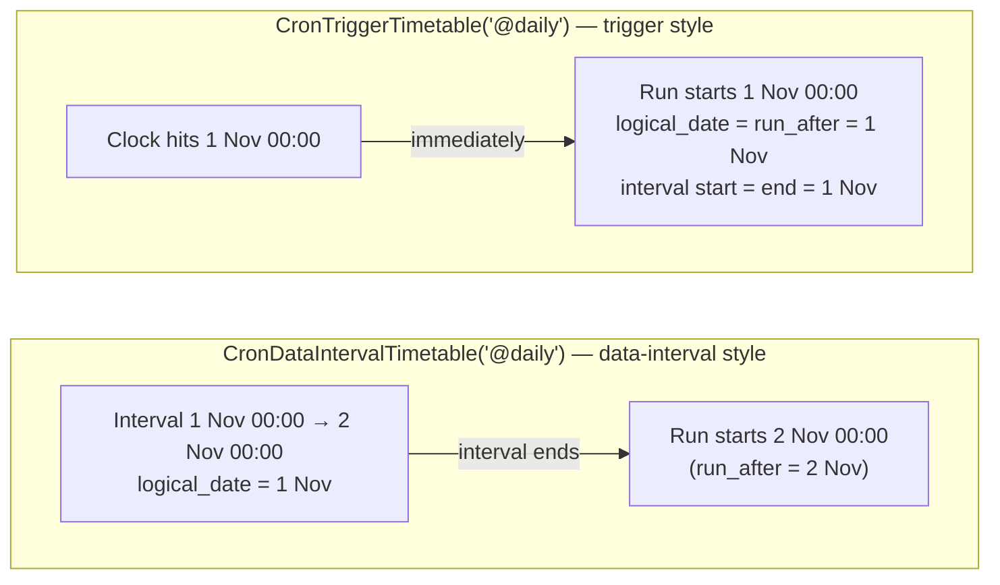

# Scheduling & timetables

**What you'll learn:** every way to tell Airflow *when* a DAG should run — presets, cron strings,
`timedelta`, timetable classes, `@once` and `@continuous` — plus `start_date`, `end_date`, `catchup`,
backfills, time zones, and the three timestamps every run carries (`run_after`, `logical_date`,
`data_interval`).

> **Run it**
> - File: [`../dags/14_scheduling_and_timetables.py`](../dags/14_scheduling_and_timetables.py) — one file that creates **nine** DAGs:
>   `14_schedule_cron_preset`, `14_schedule_cron_expression`, `14_schedule_timedelta`,
>   `14_schedule_trigger_timetable`, `14_schedule_catchup_backfill`, `14_schedule_multiple_crons`,
>   `14_schedule_delta_trigger`, `14_schedule_once`, `14_schedule_continuous`.
> - New DAGs start **paused** in this project. Unpause one at a time and compare the logs of its
>   `show_timing` task.
> - ⚠️ `14_schedule_continuous` starts a new run as soon as the previous one ends, forever. Pause it
>   again after watching a few runs.

---

## 1. How the example file is built

Every DAG in the file has a single task, `show_timing`, that prints the timing fields of its run:

```python
@task
def show_timing(dag_run=None, logical_date=None, data_interval_start=None, data_interval_end=None):
    print(f"run_id              : {dag_run.run_id}")
    print(f"run_type            : {dag_run.run_type}   (scheduled / manual / backfill / asset_triggered)")
    print(f"run_after           : {dag_run.run_after}  (earliest time the run may start)")
    print(f"logical_date        : {logical_date}")
    print(f"data_interval_start : {data_interval_start}")
    print(f"data_interval_end   : {data_interval_end}")
```

Airflow fills those keyword arguments from the task's runtime *context* because their names match
context keys (see [TaskFlow](06-taskflow-api.md)).

The nine DAGs come from a dictionary that maps `dag_id → (schedule, extra DAG kwargs)`, and a loop
creates one `DAG` per entry:

```python
START = pendulum.datetime(2026, 1, 1, tz="UTC")

for dag_id, (schedule, extra_kwargs) in SCHEDULES.items():
    kwargs = {"start_date": START, "catchup": False, **extra_kwargs}
    with DAG(
        dag_id=dag_id,
        schedule=schedule,
        tags=["tutorial", "11-scheduling"],
        doc_md=__doc__,
        **kwargs,
    ):
        show_timing()
```

`**extra_kwargs` comes last, so an entry can override the defaults (`14_schedule_catchup_backfill`
overrides `start_date` and `catchup`). Generating several DAGs from one file like this is covered in
depth in [Dynamic DAG generation](21-dynamic-dag-generation.md).

## 2. The `schedule` argument at a glance

`schedule` accepts several kinds of values. Airflow converts each of them into a **timetable** — an
object that answers "when is the next run, and what period does it cover?" (see
[glossary](32-glossary.md)).

| You write | Example from the file | Timetable Airflow 3.4 creates | Meaning |
|-----------|----------------------|-------------------------------|---------|
| `None` | (used by most other chapters) | `NullTimetable` | Never scheduled; runs only when triggered from the UI, CLI or REST API. |
| A preset string | `"@daily"` | `CronTriggerTimetable` | Shortcut for a common cron expression. |
| A cron string | `"30 6 * * 1-5"` | `CronTriggerTimetable` | Run at those clock times. |
| A `timedelta` | `timedelta(hours=4)` | `DeltaTriggerTimetable` | Run every fixed amount of time. |
| A timetable object | `CronTriggerTimetable(...)`, `MultipleCronTriggerTimetable(...)` … | itself | Full control (time zone, extra options). |
| `"@once"` | `14_schedule_once` | `OnceTimetable` | Exactly one scheduled run. |
| `"@continuous"` | `14_schedule_continuous` | `ContinuousTimetable` | Next run starts as soon as the last one finishes. |
| A list of assets / asset expression | — | asset-triggered timetable | Run when data is updated — see [chapter 13](13-assets-data-aware-scheduling.md). |

The "Timetable" column was checked against the installed Airflow 3.4.0 by building each DAG and
printing `dag.timetable`.

> Airflow 2 used `schedule_interval=` and `timetable=`. Both are gone in Airflow 3: there is only
> `schedule=`. See [Airflow 2 vs 3](31-airflow-2-vs-3.md).

### Presets

| Preset | Cron equivalent | Runs at |
|--------|-----------------|---------|
| `@hourly` | `0 * * * *` | minute 0 of every hour |
| `@daily` | `0 0 * * *` | midnight every day |
| `@weekly` | `0 0 * * 0` | midnight between Saturday and **Sunday** |
| `@monthly` | `0 0 1 * *` | midnight on the 1st of each month |
| `@quarterly` | `0 0 1 */3 *` | midnight on 1 Jan, 1 Apr, 1 Jul, 1 Oct |
| `@yearly` | `0 0 1 1 *` | midnight on 1 January |
| `@once` | — | one run, then never again |
| `@continuous` | — | back-to-back runs |

"Midnight" means midnight **in the timetable's time zone** — UTC unless you say otherwise (section 8).

### Cron strings

A cron expression has five fields separated by spaces:

```text
┌──────── minute        (0-59)
│ ┌────── hour          (0-23)
│ │ ┌──── day of month  (1-31)
│ │ │ ┌── month         (1-12)
│ │ │ │ ┌ day of week   (0-6, 0 = Sunday; 1-5 = Monday–Friday)
│ │ │ │ │
30 6 * * 1-5      → 06:30 every Monday to Friday   (14_schedule_cron_expression)
```

`*` means "every", `1-5` is a range, `*/15` means "every 15", `0,30` is a list. Paste any expression
into [crontab.guru](https://crontab.guru/) to read it back in plain English before you commit it. The
UI also shows a human-readable description of the schedule on the DAG page.

### `timedelta`

```python
"14_schedule_timedelta": (timedelta(hours=4), {}),
```

A `timedelta` means "every 4 hours, counted from `start_date`". It is an **absolute** duration, so
it does not care about clock time or daylight-saving changes — use cron when you mean "at 06:00".

## 3. `start_date` and `end_date`

`start_date` is the earliest moment the scheduler is allowed to create a scheduled run. `end_date`
(optional) is the last one. Rules of thumb:

- **Make it static.** `pendulum.datetime(2026, 1, 1, tz="UTC")` is good. `datetime.now()` is bad: the
  file is re-parsed every 30 seconds, so the start date would keep moving and the DAG might never run.
- **Make it time-zone aware.** A naive `datetime(2026, 1, 1)` is interpreted in `[core]
  default_timezone` (UTC here). Being explicit avoids surprises. The project uses
  [pendulum](https://pendulum.eustace.io/), which Airflow ships with.
- **It does not mean "first run happens at start_date".** Where the first run lands depends on the
  timetable and on `catchup` (next sections).
- A `start_date` in the future means "nothing until then".

`14_schedule_catchup_backfill` uses both:

```python
"start_date": pendulum.datetime(2026, 11, 1, tz="UTC"),
"end_date": pendulum.datetime(2026, 11, 7, tz="UTC"),
```

## 4. Three timestamps on every run

Each DAG run (see [core concepts](04-core-concepts.md)) carries these values. They answer different
questions:

| Field | Question it answers |
|-------|---------------------|
| `run_after` | "From what moment may this run start?" The scheduler won't start it earlier. Always set. |
| `logical_date` | "Which date is this run *about*?" Used for `{{ ds }}`, run ids and ordering. Can be `None` for manual or asset-triggered runs unless you supply one. |
| `data_interval_start` / `data_interval_end` | "Which period of data should this run process?" |

How they relate depends on which **family** of timetable you use.

## 5. Data-interval timetables vs trigger timetables

This is the single most confusing scheduling topic, so here it is with a picture. Both DAGs below
say "daily at midnight UTC" and have a `start_date` of 1 Nov 2026.



The numbers below were produced by asking the installed Airflow 3.4.0 for the first runs of each
timetable with `start_date = 2026-11-01`:

| Timetable | `logical_date` | `data_interval` | `run_after` (actual start) |
|-----------|----------------|-----------------|-----------------------------|
| `CronDataIntervalTimetable("@daily")` | 2026-11-01 00:00 | 11-01 00:00 → **11-02** 00:00 | **2026-11-02** 00:00 |
| `CronTriggerTimetable("@daily")` | 2026-11-01 00:00 | 11-01 00:00 → 11-01 00:00 (zero length) | 2026-11-01 00:00 |

A timeline for the data-interval style, which is the one that surprises people:

```text
        1 Nov 00:00                 2 Nov 00:00                 3 Nov 00:00
             |---- data interval of run A ----|---- data interval of run B ----|
             ^                                ^                                ^
     logical_date of A                 run A starts                     run B starts
                                       (run_after of A)
```

The run *labelled* 1 Nov starts on 2 Nov, because only then is the whole day of data complete.

| | Data-interval timetables | Trigger timetables |
|--|--------------------------|--------------------|
| Classes | `CronDataIntervalTimetable`, `DeltaDataIntervalTimetable` | `CronTriggerTimetable`, `DeltaTriggerTimetable`, `MultipleCronTriggerTimetable` |
| Run starts | at the **end** of the interval | **at** the cron/delta tick |
| `logical_date` | start of the interval | the tick (= `run_after`) |
| `data_interval` | the period that just ended | zero length by default (start = end) |
| Good for | "process yesterday's data" pipelines, idempotent daily partitions | "do something at 09:00" jobs, reports, alerts |

`CronTriggerTimetable` can also carry a data interval if you want one, through its `interval`
argument, for example `CronTriggerTimetable("0 0 * * *", timezone="UTC", interval=timedelta(days=1))`
gives each run the 24 hours *before* its trigger time.

### Airflow 3 default: cron strings become trigger timetables

In Airflow 2, `schedule="@daily"` meant a data-interval timetable. In Airflow 3 a plain cron string or
preset becomes a **`CronTriggerTimetable`**, and a `timedelta` becomes a **`DeltaTriggerTimetable`**.
Two config options control this, and both default to `False`:

```bash
source scripts/local_env.sh
airflow config get-value scheduler create_cron_data_intervals    # → False
airflow config get-value scheduler create_delta_data_intervals   # → False
```

If you want the old behaviour for one DAG, pass the class explicitly, as
`14_schedule_catchup_backfill` does:

```python
CronDataIntervalTimetable("@daily", timezone="UTC")
```

Setting `AIRFLOW__SCHEDULER__CREATE_CRON_DATA_INTERVALS=True` changes it for every DAG — handy
when migrating a big Airflow 2 project, but explicit classes are easier for readers to understand.

## 6. `catchup` and backfill

### `catchup`

Suppose a DAG has `start_date` 1 January, a daily schedule, and you unpause it on 11 November.

- **`catchup=False`** (the default in Airflow 3, `[scheduler] catchup_by_default = False`): the
  scheduler creates **one** run for the most recent schedule slot and then follows the schedule from
  there. All the older slots are skipped.
- **`catchup=True`**: the scheduler creates a run for **every** missed slot between `start_date` and
  now (or `end_date`), oldest first.

The project's loop sets `catchup=False` for every DAG, and `14_schedule_catchup_backfill` turns it on:

```python
"14_schedule_catchup_backfill": (
    # Data-interval timetables: the run for 2026-11-01 covers [11-01, 11-02) and
    # starts AFTER that interval ends. catchup=True creates a run for every missed
    # interval between start_date and now (bounded here by end_date -> 7 runs, Nov 1-7).
    CronDataIntervalTimetable("@daily", timezone="UTC"),
    {
        "start_date": pendulum.datetime(2026, 11, 1, tz="UTC"),
        "end_date": pendulum.datetime(2026, 11, 7, tz="UTC"),
        "catchup": True,
        "max_active_runs": 2,  # process at most 2 days in parallel
    },
),
```

When you unpause it, the Grid view fills with the missed days, at most two running at a time because
of `max_active_runs=2`. Asking Airflow 3.4.0's scheduling logic for this exact DAG returns **seven**
runs, with logical dates 1 Nov to 7 Nov. The last one covers 7 Nov 00:00 → 8 Nov 00:00: `end_date` is
compared with the *start* of each interval, so 7 Nov is still allowed.

### Backfill

A **backfill** is a run (or many runs) you create on purpose for past dates — for example, to
reprocess last month after fixing a bug. In Airflow 3 backfills are handled by the scheduler, so it
works for any DAG that has a schedule, whatever its `catchup` setting.

**From the UI:** open the DAG, click **Trigger**, and choose the backfill option. Pick a date range,
what to do with runs that already exist, and how many may run at once.

**From the CLI** (flags verified with `airflow backfill create --help` on 3.4.0):

```bash
source scripts/local_env.sh      # or: make cli   (inside Docker)
airflow backfill create \
    --dag-id 14_schedule_cron_preset \
    --from-date 2026-10-01 \
    --to-date 2026-10-07 \
    --max-active-runs 2 \
    --dry-run                     # print what would be created; drop it to really create the backfill
```

| Flag | Meaning |
|------|---------|
| `--dag-id` (required) | The DAG to backfill. |
| `--from-date` / `--to-date` (required) | Window, both ends **inclusive**. |
| `--reprocess-behavior {none,failed,completed}` | Which runs to create: `none` = only missing runs (default), `failed` = missing + failed, `completed` = all of them. |
| `--max-active-runs` | Parallel runs for this backfill. |
| `--run-backwards` | Newest date first (not allowed with `depends_on_past` tasks). |
| `--dag-run-conf` | JSON `conf` passed to every run. |
| `--dry-run` | Show the plan, create nothing. |

The CLI only *creates* the backfill; the scheduler must be running to execute it. Backfill runs show
`run_type = backfill` in the `show_timing` log.

> `airflow dags backfill` from Airflow 2 no longer exists — it is `airflow backfill create` now.

## 7. The other timetables in the file

### `CronTriggerTimetable` with a time zone

```python
"14_schedule_trigger_timetable": (
    # Trigger timetables: run AT the cron time; no "data interval" (start == end).
    CronTriggerTimetable("0 9 * * *", timezone="Asia/Kathmandu"),
    {},
),
```

09:00 in Kathmandu (UTC+05:45) is **03:15 UTC**, and that is what you will see as `logical_date` in the
log. Useful extra argument: `run_immediately` (default `False`) — when there are no earlier runs and
`catchup=False`, decides whether the first run uses the most recent past tick or waits for the next
one.

### `MultipleCronTriggerTimetable` — several clock times

```python
"14_schedule_multiple_crons": (
    MultipleCronTriggerTimetable("0 8 * * 1-5", "30 17 * * 1-5", timezone="UTC"),
    {},
),
```

One cron string cannot express "08:00 **and** 17:30" (the minutes differ). This class takes any number
of cron strings and runs at each of their ticks: Mon 08:00, Mon 17:30, Tue 08:00, …

### `DeltaTriggerTimetable` — every N minutes

```python
"14_schedule_delta_trigger": (DeltaTriggerTimetable(timedelta(minutes=30)), {}),
```

Runs at 00:00, 00:30, 01:00, … counted from `start_date`. It is what `timedelta(minutes=30)` would turn
into anyway; the class form lets you add an `interval=` if you want a data interval. Its data-interval
cousin is `DeltaDataIntervalTimetable`.

### `@once`

```python
"14_schedule_once": ("@once", {}),
```

The scheduler creates a single run (as soon as `start_date` has passed) and never another. Good for
one-off migrations or for DAGs you trigger by hand afterwards.

### `@continuous`

```python
"14_schedule_continuous": ("@continuous", {"max_active_runs": 1}),  # max_active_runs=1 is required
```

As soon as a run finishes, the next one is created. Airflow refuses anything else: building this DAG
with a higher `max_active_runs` raises `ValueError: Invalid max_active_runs: ContinuousTimetable
requires max_active_runs <= 1`. Use it for "keep polling" style DAGs, and remember it never stops on
its own.

### `EventsTimetable` — a fixed list of dates (known bug in 3.4.0)

`EventsTimetable` (importable from `airflow.sdk`) is the normal way to run on an explicit list of
dates, such as an earnings calendar:

```python
from airflow.sdk import EventsTimetable

schedule = EventsTimetable(
    event_dates=[
        pendulum.datetime(2026, 12, 1, 9, tz="UTC"),
        pendulum.datetime(2027, 3, 1, 9, tz="UTC"),
    ],
    description="Quarterly close",
)
```

**In Airflow 3.4.0 a DAG using it cannot be serialized**: the DAG processor fails with
`SerializationError: Failed to serialize DAG '...': '_summary'` (a `KeyError`), so the DAG never
appears in the UI. That is why the example file only mentions it in a comment. Until a fixed release,
use `schedule=None` and trigger the DAG from outside (API / CLI) on those dates, or a
`MultipleCronTriggerTimetable` if the dates follow a pattern.

### Custom timetables (brief)

If none of the built-ins fit (for example "every working day except public holidays"), you can write
your own by subclassing `airflow.timetables.base.Timetable`, implementing `next_dagrun_info()` and
`infer_manual_data_interval()`, and registering it in an `AirflowPlugin` under `timetables = [...]`
so the scheduler can deserialize it. See [Custom operators, hooks & plugins](17-custom-operators-hooks-plugins.md)
and the official guide
[Customizing DAG scheduling with timetables](https://airflow.apache.org/docs/apache-airflow/stable/howto/timetable.html).

## 8. Time zones and daylight saving time

- Airflow stores every date in **UTC**. `[core] default_timezone` is `utc` in this project.
- Give a timetable a `timezone=` (or a time-zone-aware `start_date`) when you care about local
  clock time. Cron times are then evaluated in that zone.
- **DST is handled for cron timetables.** Checked on 3.4.0 with `CronTriggerTimetable(...,
  timezone="Europe/Berlin")` around 28 March 2027, when clocks jump from 02:00 to 03:00:

  | Cron | Before the change | On / after the change |
  |------|-------------------|-----------------------|
  | `0 9 * * *` | 09:00 local = 08:00 UTC | 09:00 local = 07:00 UTC (still 09:00 for humans) |
  | `30 2 * * *` | 02:30 local | on 28 Mar 02:30 doesn't exist → that day's run happens at 03:30 local |

- **`timedelta` schedules ignore DST** — they add fixed hours to UTC.
- The UI displays times in the time zone you choose in the user settings menu; the log of
  `show_timing` prints UTC.

## 9. `max_active_runs`

`max_active_runs` caps how many runs of one DAG may be *running* at the same time (default 16, from
`[core] max_active_runs_per_dag`). Extra runs wait in the `queued` state. The file uses it twice:

- `14_schedule_catchup_backfill`: `max_active_runs=2` so catching up seven days doesn't start seven
  runs at once.
- `14_schedule_continuous`: must be `1`.

More concurrency knobs are in [Pools, priority & concurrency](19-pools-priority-concurrency.md).

## 10. Inspecting schedules

- **UI:** the DAG list shows the schedule and the **next run** for each DAG.
- **CLI:** `airflow dags next-execution 14_schedule_cron_expression -n 5 --field run_after` lists the
  next five start times (the DAG must already be parsed into the database).
- **Logs:** trigger the same DAG manually and compare with a scheduled run — manual runs show
  `run_type = manual`.

## Common mistakes

- Expecting a daily `CronDataIntervalTimetable` run labelled "today" to start today — it starts
  *tomorrow*, when today's interval is complete.
- Upgrading from Airflow 2 and not noticing that `"@daily"` is now trigger-style: `data_interval_start`
  equals `data_interval_end`, so queries like `WHERE ts >= start AND ts < end` return nothing.
- Using `datetime.now()` (or `days_ago`, removed in Airflow 3) as `start_date`.
- Turning on `catchup=True` with an old `start_date` and getting hundreds of runs. Set a recent
  `start_date` or a small `max_active_runs` first.
- Forgetting that `14_schedule_continuous` (or any `@continuous` DAG) runs forever while unpaused.
- Writing `schedule_interval=` — Airflow 3 raises `TypeError: ... unexpected keyword argument
  'schedule_interval'`; the argument is `schedule=`.

## Try it yourself

1. Change `14_schedule_cron_expression` to run at 18:45 on weekends only. Check your expression on
   crontab.guru first. (Answer: `"45 18 * * 0,6"`.)
2. Add an entry `"14_schedule_hourly_kathmandu": (CronTriggerTimetable("0 * * * *", timezone="Asia/Kathmandu"), {})`
   to `SCHEDULES`. Why do its UTC times end in `:15`?
3. Run a dry-run backfill of `14_schedule_cron_preset` for the first week of October, then compare
   with `--reprocess-behavior completed`.
4. Change `14_schedule_catchup_backfill` to a `CronTriggerTimetable("@daily", timezone="UTC")`, unpause
   it, and compare `logical_date`, `data_interval_*` and `run_after` in the logs with the original.

---

**Next →** [Pools, priority & concurrency](19-pools-priority-concurrency.md) · [Back to the index](README.md)
