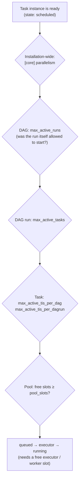

# Pools, priority & concurrency

**What you'll learn:** all the knobs that decide *how many* tasks run at once and *which* waiting
task goes first — `parallelism`, `max_active_tasks`, `max_active_runs`, pools and `pool_slots`,
`max_active_tis_per_dag(run)`, and `priority_weight` with its `weight_rule`.

> **Run it**
> - DAG id: `15_pools_priority_concurrency` — file [`../dags/15_pools_priority_concurrency.py`](../dags/15_pools_priority_concurrency.py)
> - Pools: [`../config/pools.json`](../config/pools.json) (imported automatically by `airflow-init` in
>   Docker, and by `scripts/run_local.sh` without Docker).
> - Unpause the DAG, click **Trigger**, and keep two tabs open: the DAG's **Grid** view and
>   **Admin ▸ Pools**. The run takes about half a minute.

---

## 1. Why limit concurrency at all?

More parallelism sounds better, but real systems push back:

- An external API allows only 2 requests at a time and returns `429 Too Many Requests` beyond that.
- A database slows down for everyone when ten heavy queries hit it together.
- Your machine (or worker) has a limited number of CPUs and memory.
- A file can't be written by two processes at once.

Airflow's answer is a set of **layered limits**. A task instance only starts when **every** layer
has room for it.

## 2. The layers



When several task instances compete for the same free room, the one with the highest
**priority weight** goes first (section 6).

| Layer | Where you set it | Default (Airflow 3.4.0) | What it limits |
|-------|------------------|-------------------------|----------------|
| `[core] parallelism` | `airflow.cfg` / `AIRFLOW__CORE__PARALLELISM` | **32** | Running task instances **per scheduler**, across all DAGs. |
| Executor / worker slots | executor config (e.g. Celery `worker_concurrency`) | LocalExecutor uses `parallelism` worker processes | How many tasks a worker machine actually executes. |
| `max_active_runs` | `@dag(max_active_runs=...)`, default from `[core] max_active_runs_per_dag` | **16** | Running DAG runs of one DAG. Extra runs wait as `queued`. |
| `max_active_tasks` | `@dag(max_active_tasks=...)`, default from `[core] max_active_tasks_per_dag` | **16** | Running task instances **per DAG run** (it was per DAG in Airflow 2). |
| `max_active_tis_per_dag` | `@task(max_active_tis_per_dag=...)` | `None` (no limit) | Running instances of **this task** across *all* runs of the DAG. |
| `max_active_tis_per_dagrun` | `@task(max_active_tis_per_dagrun=...)` | `None` | Running instances of this task inside *one* run (handy for mapped tasks). |
| Pool | `@task(pool="...")` | `default_pool` with **128** slots (`[core] default_pool_task_slot_count`) | Shared slots across all DAGs that use the pool. |
| `pool_slots` | `@task(pool_slots=...)` | 1 | How many slots *one* instance occupies. |

All defaults were read from the installed Airflow with `airflow config get-value core <key>` and from
the `BaseOperator` / `DAG` signatures.

> **Airflow 3 change:** `max_active_tasks` is counted **per DAG run**. The DAG's own docstring in 3.4.0
> says: "in Airflow 2 this was a global limit on the Dag, since Airflow 3 it is per run". Use
> `max_active_runs` × `max_active_tasks` to reason about the DAG-wide maximum.

## 3. Pools

A **pool** (see [glossary](32-glossary.md)) is a named bucket of slots shared by every task that
names it, in any DAG. A running (or queued) task holds its slots until it finishes. If no slot is
free, the task waits in the `scheduled` state.

Every task without `pool=` goes to `default_pool` (128 slots). `default_pool` cannot be deleted.

### This project's pools

[`config/pools.json`](../config/pools.json):

```json
{
  "api_pool": {
    "slots": 2,
    "description": "Limits how many tasks may call the (pretend) external API at the same time",
    "include_deferred": false
  },
  "database_pool": {
    "slots": 4,
    "description": "Limits concurrent heavy queries against the demo database",
    "include_deferred": false
  }
}
```

`api_pool` is also used by the API task in [Connections & hooks](15-connections-and-hooks.md).

### Creating pools — three ways

**1. UI:** **Admin ▸ Pools** → add a pool, give it a name, slots, description and the
"include deferred" flag. The same page shows running / queued / scheduled / open slots live.

**2. CLI** (verified with `airflow pools --help` on 3.4.0):

```bash
source scripts/local_env.sh            # or: make cli   (inside Docker)
airflow pools set api_pool 2 "Limits concurrent API calls"          # create or update
airflow pools set slow_pool 1 "One at a time" --include-deferred
airflow pools list
airflow pools get api_pool
airflow pools export /tmp/pools.json
airflow pools delete slow_pool
```

**3. Import a JSON file** — what this project does at start-up:

```bash
airflow pools import config/pools.json
```

`docker-compose.yaml` runs it in the `airflow-init` container:

```yaml
echo "Creating tutorial pools from config/pools.json"
_AIRFLOW_DB_MIGRATE=false _AIRFLOW_WWW_USER_CREATE=false /entrypoint airflow pools import /opt/airflow/config/pools.json
```

You can also manage pools through the REST API at `/api/v2/pools` (see
[CLI & REST API](26-cli-and-rest-api.md)). Keeping pools in a JSON file under version control,
like here, means every environment gets the same pools.

### `include_deferred`

A *deferred* task (see [sensors & deferrable operators](12-sensors-and-deferrable.md)) is
parked in the triggerer and uses no worker. With `include_deferred: false` (this project's setting),
a deferred task **gives its pool slot back** while it waits. Set it to `true` when the pool protects
something the deferred task still holds — for example, a remote job it started and is now waiting on.

## 4. Walking through the DAG

```python
@dag(
    dag_id="15_pools_priority_concurrency",
    schedule=None,
    start_date=pendulum.datetime(2026, 1, 1, tz="UTC"),
    max_active_runs=1,  # only one run of this DAG at a time
    max_active_tasks=6,  # at most 6 running tasks across the whole run
    tags=["tutorial", "12-scaling"],
    doc_md=__doc__,
)
def pools_priority_concurrency():
```

There are four independent tasks (no `>>` between them). Three are mapped with `.expand()`
([dynamic task mapping](10-dynamic-task-mapping.md)), so one run has **13** task instances:

```python
call_api.expand(endpoint=[f"/v1/items?page={i}" for i in range(1, 7)])  # 6 instances
urgent_report()                                                          # 1 instance
heavy_query.expand(table=["orders", "customers", "products"])            # 3 instances
write_to_single_file.expand(part=[1, 2, 3])                              # 3 instances
```

### `call_api` — a pool with 2 slots

```python
@task(pool="api_pool", priority_weight=1)
def call_api(endpoint: str) -> str:
    print(f"Calling {endpoint}")
    time.sleep(8)
    return endpoint
```

Six instances want `api_pool`, which has 2 slots — and `urgent_report` wants the same pool. So at most
two of these seven are ever running. In the Grid view you'll see the rest waiting in `scheduled`
(no colour change to running) and moving forward two at a time.

### `urgent_report` — jumping the queue

```python
@task(
    pool="api_pool",
    priority_weight=100,  # higher = scheduled first when slots are scarce
    weight_rule=WeightRule.ABSOLUTE,  # use exactly this weight (don't add upstream/downstream)
)
def urgent_report() -> None:
    print("I was scheduled before the normal API calls")
    time.sleep(3)
```

When a slot in `api_pool` is free, the scheduler hands it to the waiting task with the highest
priority weight: 100 beats 1, so `urgent_report` takes one of the first two slots even though six
`call_api` instances were waiting too.

### `heavy_query` — one task using several slots

```python
@task(pool="database_pool", pool_slots=2)  # takes 2 of the 4 slots
def heavy_query(table: str) -> None:
    print(f"Running a heavy query on {table}")
    time.sleep(6)
```

`database_pool` has 4 slots and each instance takes 2, so two of the three tables run together and the
third waits. Use `pool_slots` when some tasks are "bigger" than others but should share one pool.

### `write_to_single_file` — a per-task limit

```python
@task(max_active_tis_per_dag=1)  # never two of these at once, even across runs
def write_to_single_file(part: int) -> None:
    print(f"Appending part {part} to a file that doesn't like concurrent writers")
    time.sleep(2)
```

No pool is needed for "this one task must not run in parallel with itself": `max_active_tis_per_dag=1`
runs parts 1, 2, 3 one after another. `max_active_tis_per_dag` counts across *all* runs of the DAG;
`max_active_tis_per_dagrun=1` would allow one per run instead.

### `max_active_tasks=6` and `max_active_runs=1`

Count the most that can run at once from the other limits: 2 (`api_pool`) + 2 (`heavy_query`) + 1
(`write_to_single_file`) = **5**. So in this DAG `max_active_tasks=6` is a safety net that never
actually binds — lower it to 3 in the exercises to see it bite. `max_active_runs=1` means a second
trigger waits as `queued` until the first run finishes.

### What the first seconds look like

```text
t=0s   running: urgent_report, call_api[?], heavy_query[?], heavy_query[?], write_to_single_file[?]
       waiting: 5 × call_api (pool full), 1 × heavy_query (pool full), 2 × write_to_single_file (task limit)
t≈3s   urgent_report done → next call_api takes its api_pool slot
...
```

Which map index starts first among equal-priority tasks isn't something to rely on. The scheduler
sorts candidates by priority weight (highest first), then by the run's logical date (older runs
first).

## 5. Watching it

- **Grid view:** the coloured squares show which instances run in parallel. Click a mapped task to see
  its map indexes.
- **Admin ▸ Pools:** running / queued / scheduled slot counts for `api_pool` and `database_pool` change
  as the run progresses.
- **Scheduler log:** messages such as `Not executing ... since it requires 2 slots but there are 1 open
  slots in the pool database_pool` explain why a task is waiting. In Docker, `make logs` follows the
  scheduler log.

## 6. Priority weight and weight rules

When there are more ready task instances than free room, the scheduler picks those with the highest
**effective priority weight** first. Priority only matters when something is scarce; with free slots
everything starts anyway.

Each task has a `priority_weight` (default **1**) and a `weight_rule` that decides how the *effective*
weight is calculated. The three rules (`list(WeightRule)` in 3.4.0):

| `weight_rule` | Effective weight = | Effect |
|---------------|--------------------|--------|
| `downstream` (default) | own weight **+** weights of all tasks downstream of it | Tasks early in a long chain go first — tends to start many DAG runs' first tasks. |
| `upstream` | own weight **+** weights of all tasks upstream of it | Tasks late in the chain go first — finishes started DAG runs before beginning new ones. |
| `absolute` | own weight only | Exactly what you wrote; easiest to reason about. |

The math on a small chain (from Airflow's `priority_strategy` module: own weight plus the sum over
*all* relatives in that direction, not only direct neighbours):

```text
extract (weight 1)  >>  transform (weight 5)  >>  load (weight 1)
```

| Task | `downstream` | `upstream` | `absolute` |
|------|--------------|------------|------------|
| `extract` | 1 + 5 + 1 = **7** | 1 | 1 |
| `transform` | 5 + 1 = **6** | 5 + 1 = **6** | 5 |
| `load` | 1 | 1 + 1 + 5 = **7** | 1 |

In `15_pools_priority_concurrency` no task has upstream or downstream tasks, so every rule gives the
same result there; `WeightRule.ABSOLUTE` on `urgent_report` documents the intent ("100, no matter what
the graph becomes").

Import the enum with `from airflow.sdk import WeightRule`, or pass the strings `"downstream"`,
`"upstream"`, `"absolute"`. The default rule is `[core] default_task_weight_rule = downstream`. Custom
rules are possible through a plugin's `priority_weight_strategies`.

Priority is **global**: it competes across DAGs too, inside each pool. A high-priority task in DAG A
gets the next free `default_pool` slot before a low-priority task in DAG B.

## 7. Choosing the right knob

| Goal | Use |
|------|-----|
| "At most N calls to this API from all DAGs together" | A pool with N slots |
| "This big task counts as 3 small ones" | `pool_slots=3` |
| "Never two copies of this task at once" | `max_active_tis_per_dag=1` |
| "Don't map out 500 instances in parallel in one run" | `max_active_tis_per_dagrun` or `max_active_tasks` |
| "Process backfill days one or two at a time" | `max_active_runs` (see [scheduling](18-scheduling-and-timetables.md)) |
| "This report must start before routine work" | `priority_weight` (+ `weight_rule="absolute"`) |
| "The whole machine is overloaded" | `[core] parallelism` / worker concurrency (see [executors](29-executors-and-production.md)) |

## Common mistakes

- Referencing a pool that doesn't exist. The task never starts and the scheduler logs `Tasks using
  non-existent pool 'x' will not be scheduled`. Without Docker, check that `airflow pools import
  config/pools.json` ran (`airflow pools list`).
- Setting `pool_slots` larger than the pool's total slots — the task waits forever (scheduler log:
  `Requested pool slots (...) are greater than total pool slots`).
- Expecting `priority_weight` to speed things up when nothing is scarce. It only changes the *order*.
- Assuming `max_active_tasks` is DAG-wide as in Airflow 2. In Airflow 3 it is per DAG run.
- Raising `max_active_tasks` to 100 while `[core] parallelism` is still 32 — the lowest layer wins.
- Using a sensor in `poke` mode inside a small pool: it holds the slot while it sleeps. Use
  `mode="reschedule"` or a deferrable sensor.

## Try it yourself

1. Change `max_active_tasks=6` to `3`, trigger, and compare the Grid view with the previous run.
2. Run `airflow pools set api_pool 6 "wider"` and trigger again. How long does `call_api` take now?
   Put it back with `airflow pools import config/pools.json`.
3. Change `write_to_single_file` to `max_active_tis_per_dagrun=1`, then trigger the DAG twice with
   `max_active_runs=2`. How many copies run at once?
4. Make `heavy_query` use `pool_slots=5` and find the warning in the scheduler log. Then revert.

---

**Next →** [Setup & teardown tasks](20-setup-teardown.md) · [Back to the index](README.md)
