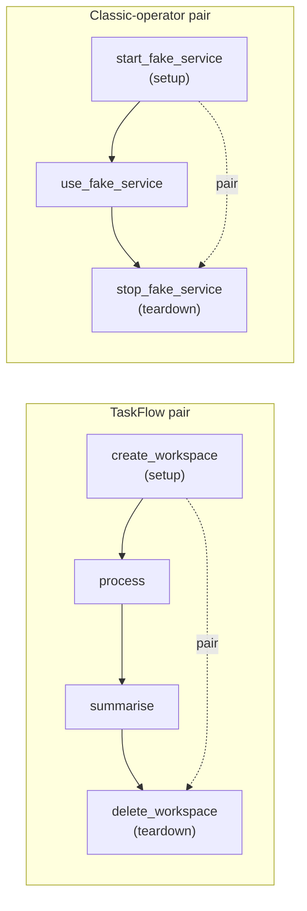

# Setup & teardown tasks

**What you'll learn:** how to create a temporary resource, use it, and *always* clean it up
afterwards, even when the work in the middle fails, using `@setup`, `@teardown` and
`.as_teardown()`.

> **Run it**
> - DAG id: `16_setup_teardown`
> - File: [`../dags/16_setup_teardown.py`](../dags/16_setup_teardown.py)
> - Unpause it, then **Trigger**. Trigger it a second time with the param
>   `fail_processing = true` to watch the teardown run after a failure.

---

## Why setup and teardown exist

Many pipelines follow the same three-step shape:

1. **Create** something temporary: a folder, a scratch table, a cloud cluster, a VM.
2. **Use** it for the real work.
3. **Delete** it so you don't leak disk space or cloud costs.

You could write step 3 as an ordinary task with `trigger_rule="all_done"` (you saw this in
[chapter 09](09-branching-and-trigger-rules.md)). That works, but Airflow cannot tell that the
cleanup task *belongs to* the create task. Setup/teardown tasks make that relationship explicit,
and Airflow then gives you extra behaviour for free:

| Behaviour | Plain `all_done` cleanup task | Teardown task |
|---|---|---|
| Runs after the work, even if the work failed | Yes | Yes |
| Skipped/not run when the resource was never created | No, it runs anyway | Yes: if no paired setup succeeded it does not run |
| Ignored when deciding the DAG run's final state | No: a cleanup failure (or success) affects the run | Yes, by default |
| Clearing a work task also re-runs its setup and teardown | No | Yes |
| Shown as a pair in the Graph view | No | Yes |

**New terms**

- **Setup task**: a task that prepares a resource. Marked with `@setup` or `.as_setup()`.
- **Teardown task**: a task that removes that resource. Marked with `@teardown` or `.as_teardown()`.
- **Work tasks**: the tasks in between that use the resource.
- **Scope**: the set of work tasks between a setup and its teardown (see below).

See also the [glossary](32-glossary.md) and the official guide:
<https://airflow.apache.org/docs/apache-airflow/stable/howto/setup-and-teardown.html>.

---

## The example DAG

The file contains two independent pairs: one written with TaskFlow decorators, one with classic
operators.



### `@setup`: create the resource

```python
@setup
def create_workspace(ts_nodash=None) -> str:
    workspace = DATA_DIR / "workspaces" / ts_nodash
    workspace.mkdir(parents=True, exist_ok=True)
    print(f"Created {workspace}")
    return str(workspace)
```

`@setup` turns the function into a TaskFlow task (like `@task`) and marks it as a setup task.
It creates a folder under `data/workspaces/` named after the run's timestamp (`ts_nodash` is a
template variable injected because it appears in the signature, see
[chapter 14](14-params-variables-templating.md)) and returns the path, which goes to XCom.

### The work tasks

```python
@task(retries=0)
def process(workspace: str, params=None) -> str:
    if params["fail_processing"]:
        raise RuntimeError("Processing failed (on purpose)")
    output = f"{workspace}/result.txt"
    with open(output, "w") as f:
        f.write("42\n")
    return output

@task
def summarise(output: str) -> None:
    with open(output) as f:
        print(f"Result: {f.read().strip()}")
```

`process` writes a file into the workspace. The DAG-level param `fail_processing`
(`Param(False, type="boolean")`) lets you make it fail on purpose. `retries=0` makes it fail
straight away instead of retrying.

### `@teardown`: always clean up

```python
@teardown
def delete_workspace(workspace: str) -> None:
    shutil.rmtree(workspace, ignore_errors=True)
    print(f"Deleted {workspace}")
```

### Wiring: pairing by passing the setup's output

```python
workspace = create_workspace()
result = process(workspace)
summarise(result) >> delete_workspace(workspace)
# Passing `workspace` (the setup's output) into the teardown links them as a pair.
```

This is the key line. `delete_workspace(workspace)` receives the **output of the setup task**.
Because a teardown's argument comes from a setup task, Airflow records the two as a
**setup/teardown pair**. You don't need any extra call.

`summarise(result) >> delete_workspace(...)` makes the teardown wait for the last work task.

### Classic operators: `.as_teardown(setups=...)`

```python
start_service = BashOperator(task_id="start_fake_service", bash_command="echo 'service started'")
use_service = BashOperator(task_id="use_fake_service", bash_command="echo 'using service'")
stop_service = BashOperator(task_id="stop_fake_service", bash_command="echo 'service stopped'")
start_service >> use_service >> stop_service.as_teardown(setups=start_service)
```

Classic operators have no decorator, so you mark them with methods:

- `stop_service.as_teardown(setups=start_service)` marks `stop_fake_service` as a teardown **and**
  marks `start_fake_service` as a setup **and** adds the dependency `start_fake_service >> stop_fake_service`.
- `.as_setup()` also exists if you only want to mark a task as a setup.

The full signature in Airflow 3.4 (from `airflow/sdk/definitions/_internal/abstractoperator.py`):

```python
def as_teardown(self, *, setups=None, on_failure_fail_dagrun=None): ...
```

`setups` can be one task or a list of tasks.

### What Airflow actually builds

Parsing the file and printing each task gives:

| task_id | is_setup | is_teardown | trigger_rule | upstream |
|---|---|---|---|---|
| `create_workspace` | True | False | `all_success` | – |
| `process` | False | False | `all_success` | `create_workspace` |
| `summarise` | False | False | `all_success` | `process` |
| `delete_workspace` | False | True | `all_done_setup_success` | `create_workspace`, `summarise` |
| `start_fake_service` | True | False | `all_success` | – |
| `use_fake_service` | False | False | `all_success` | `start_fake_service` |
| `stop_fake_service` | False | True | `all_done_setup_success` | `start_fake_service`, `use_fake_service` |

Two things to notice:

1. Teardowns get the special trigger rule **`all_done_setup_success`**: "run when every upstream
   task has finished (whatever its state), as long as at least one of my setups succeeded."
2. The teardown is directly downstream of its setup. That edge is the "pair" link.

The project's structure test checks these flags:

```python
def test_setup_teardown_pairing(dagbag):
    dag = dagbag.get_dag("16_setup_teardown")
    assert dag.get_task("create_workspace").is_setup
    assert dag.get_task("delete_workspace").is_teardown
    assert dag.get_task("stop_fake_service").is_teardown
```

---

## Scope: which tasks are "inside" a pair

The **scope** of a setup/teardown pair is every task that is downstream of the setup *and*
upstream of the teardown. Here the scope of `create_workspace`/`delete_workspace` is
`process` and `summarise`.

Scope matters for two things:

- The teardown waits for every task in its scope to finish.
- When you clear a task in the scope, Airflow also clears its setup and teardown (next section).

If a task sits after the teardown (for example `delete_workspace >> notify`), it is *outside*
the scope. Keep work that needs the resource *before* the teardown.

---

## What happens when the work fails

Trigger the DAG with `fail_processing = true`:

| Task | State | Why |
|---|---|---|
| `create_workspace` | success | Folder created |
| `process` | **failed** | Raised `RuntimeError` |
| `summarise` | upstream_failed | Its upstream failed |
| `delete_workspace` | **success** | `all_done_setup_success`: everything upstream is done and the setup succeeded |
| DAG run | **failed** | See below |

The teardown **still ran**, so the folder is deleted. The DAG run is still marked
**failed**. A teardown's success does not hide the failure of the work.

How Airflow decides this: to compute the final DAG run state, Airflow looks at the "leaf" tasks
(tasks with nothing downstream). Teardown tasks are **ignored** for this. So the effective leaf is
`summarise` (upstream_failed), and the run fails. In the success case `summarise` succeeds, so
the run succeeds.

### `on_failure_fail_dagrun`: should a failing teardown fail the run?

Because teardowns are ignored by default, a teardown that *itself* fails (for example, the
cluster could not be deleted) does **not** fail the DAG run. That keeps your run "green" even
though something may be leaking.

If cleanup failures matter to you, opt in:

```python
@teardown(on_failure_fail_dagrun=True)
def delete_workspace(workspace: str) -> None: ...

# or, for classic operators
stop_service.as_teardown(setups=start_service, on_failure_fail_dagrun=True)
```

With `on_failure_fail_dagrun=True` the teardown counts as a leaf again, so if it fails, the DAG
run fails.

### What if the setup fails?

If `create_workspace` fails, there is nothing to clean up. The teardown's trigger rule sees that
no setup succeeded and marks the teardown **upstream_failed** instead of running it. (If all its
setups were *skipped*, the teardown is skipped.)

---

## Clearing tasks re-runs the setup

Suppose `process` failed because of a bug in your code, and you have deployed a fix. You open the
run, click `process` and choose **Clear** (with **Downstream** selected so `summarise` runs
again too). The workspace folder was already deleted by the teardown, so re-running `process`
on its own would fail with "no such directory".

Airflow handles this for you: when you clear a task that is inside a setup/teardown scope,
Airflow **also clears its setup and teardown**. The re-run is:

```text
create_workspace → process → summarise → delete_workspace
```

The resource is created again, used, and removed again.

> **Note:** clearing re-uses the run's original params. A run triggered with
> `fail_processing = true` fails again when cleared, because the param is still `true`. That is
> expected: clearing is for retrying after a *code or environment* fix.

---

## How it looks in the UI

- In the **Graph** view, setup and teardown tasks are drawn with a small marker so you can tell
  them apart from normal tasks, and the setup→teardown edge is drawn differently from normal
  dependency arrows (the DAG docstring calls it a "dotted line"). Exact icons can change between
  UI versions, so hover a task to see its details.
- In the **Grid** view, after a failed run with `fail_processing = true`, you'll see
  `process` red, `summarise` orange (upstream_failed) and `delete_workspace` green.
- Open the `delete_workspace` log to see `Deleted .../data/workspaces/<timestamp>`.

See [chapter 25](25-ui-tour.md) for a full UI tour.

---

## Other ways to write setup/teardown

You'll meet these in other code bases. They are equivalent to what the example does.

**Context manager.** Tasks created inside the `with` block become the scope:

```python
with delete_workspace(workspace).as_teardown(setups=workspace):
    process(workspace)
```

**Several setups for one teardown:**

```python
teardown_task.as_teardown(setups=[create_bucket, create_cluster])
```

Keep to the style in the example file while learning: it is the easiest to read.

---

## When to use what

| Situation | Use |
|---|---|
| You create a resource and must delete it no matter what | Setup + teardown |
| You want a "notify me at the end whatever happened" task | Plain task with `trigger_rule="all_done"` |
| You want to run something only when something failed | Plain task with `trigger_rule="one_failed"` |
| The cleanup failing should fail the run | Teardown with `on_failure_fail_dagrun=True` |

---

## Common mistakes

- **Forgetting to pair the teardown.** `@teardown` on its own marks the task, but if it neither
  receives the setup's output nor gets `setups=...`, Airflow doesn't know which setup it belongs
  to, and clearing won't re-run the setup.
- **Expecting the teardown to make the run green.** A successful teardown never turns a failed
  run into a successful one. That is by design.
- **Assuming a failing teardown fails the run.** It doesn't, unless you set
  `on_failure_fail_dagrun=True`.
- **Putting work after the teardown.** Anything downstream of the teardown runs after the
  resource is gone.
- **Non-idempotent setups.** Clearing re-runs the setup. Write it so running it twice is safe
  (the example uses `mkdir(..., exist_ok=True)`).
- **Marking a task group as setup/teardown.** Only tasks can be setups or teardowns; Airflow
  raises an error for task groups.

## Try it yourself

1. Trigger the DAG with `fail_processing = true`. Confirm in the Grid view that
   `delete_workspace` succeeded and the run failed. Check that `data/workspaces/` has no folder
   left for that run.
2. Change the teardown to `@teardown(on_failure_fail_dagrun=True)` and add
   `raise RuntimeError("cleanup failed")` at the end of `delete_workspace`. Trigger with
   `fail_processing = false`. What is the run state now? Remove the flag and try again.
3. Take a *successful* run and clear `process` with **Downstream** selected. Watch
   `create_workspace` and `delete_workspace` run again even though you didn't select them.
   Then clear only `summarise` (Downstream off) and look at its log: the setup re-creates an
   *empty* workspace, so `result.txt` is missing. What does that teach you about which tasks to
   clear together?
4. Rewrite the classic pair using the context-manager form shown above.

---

**Next →** [Dynamic DAG generation](21-dynamic-dag-generation.md) · [Back to the index](README.md)
