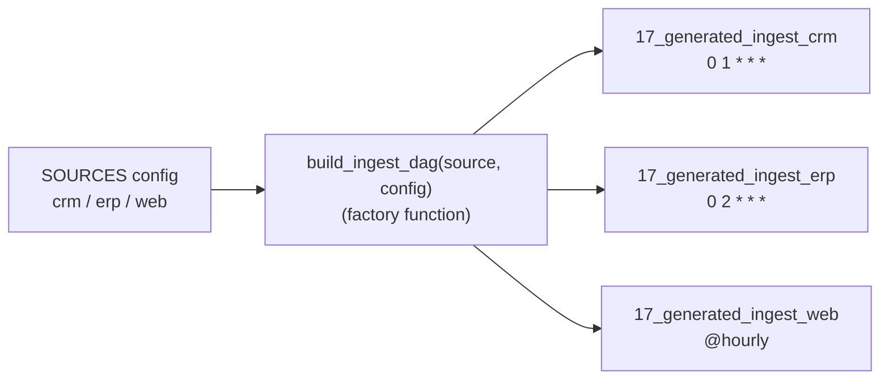

# Dynamic DAG generation

**What you'll learn:** how one Python file can create many similar DAGs from a configuration, the
rules that keep this fast and safe, and when to use **dynamic task mapping** instead.
New terms are also explained in the [glossary](32-glossary.md).

> **Run it**
> - File: [`../dags/17_dynamic_dag_generation.py`](../dags/17_dynamic_dag_generation.py) — one file,
>   **three** DAGs: `17_generated_ingest_crm`, `17_generated_ingest_erp`, `17_generated_ingest_web`.
> - In the DAG list, search for `17_generated` or filter by the tag `source:crm` / `source:erp` /
>   `source:web`.
> - New DAGs start **paused**. Unpause one and trigger it; compare the `extract` and `load` logs of
>   the three DAGs. Note that `17_generated_ingest_web` is `@hourly`, so it keeps running every hour
>   while unpaused.

---

## 1. The idea

Imagine you ingest data from 30 source systems. Each needs the same steps (extract each table, then
load), but with its own schedule, owner and table list. Writing 30 nearly identical DAG files is
boring and error-prone; a fix has to be made 30 times.

Instead, describe the differences as **data** (a config) and write the DAG **once**, as a function
that takes the config and returns a DAG. A loop calls the function for every entry.



This pattern is called a **DAG factory**.

---

## 2. Walking through the file

### The configuration

```python
# In real projects this often comes from a YAML/JSON file next to the DAG.
SOURCES = {
    "crm": {"schedule": "0 1 * * *", "tables": ["contacts", "deals"], "owner": "sales-eng"},
    "erp": {"schedule": "0 2 * * *", "tables": ["invoices", "products", "suppliers"], "owner": "finance-eng"},
    "web": {"schedule": "@hourly", "tables": ["pageviews"], "owner": "growth-eng"},
}
```

Each key is a source system; each value holds what differs between the DAGs.

### The factory function

```python
def build_ingest_dag(source: str, config: dict):
    @dag(
        dag_id=f"17_generated_ingest_{source}",
        schedule=config["schedule"],
        start_date=pendulum.datetime(2026, 1, 1, tz="UTC"),
        catchup=False,
        default_args={"owner": config["owner"]},
        tags=["tutorial", "13-patterns", f"source:{source}"],
        doc_md=f"Generated ingest DAG for **{source}** — see `17_dynamic_dag_generation.py`.",
    )
    def ingest():
        @task
        def extract(table: str) -> dict:
            print(f"[{source}] extracting {table}")
            return {"table": table, "rows": len(table) * 100}

        @task
        def load(results: list[dict]) -> None:
            for r in results:
                print(f"[{source}] loaded {r['rows']} rows into raw_{source}.{r['table']}")

        load(extract.expand(table=config["tables"]))

    return ingest()
```

What to notice:

- **The `dag_id` is built from the config key**: `17_generated_ingest_crm` and so on. Every
  generated DAG needs its own id (rule 1 below).
- **Everything that differs comes from `config`**: the schedule, the owner (through
  `default_args`, so every task gets it), a tag `source:<name>` for filtering, and a `doc_md` shown on
  the DAG's page.
- **The tasks use `source` and `config` from the surrounding function.** Python remembers these
  values for each call (a *closure*), so the `crm` DAG prints `[crm] ...` and the `erp` DAG
  prints `[erp] ...`.
- **Inside each DAG, the number of `extract` tasks also varies** — with
  [dynamic task mapping](10-dynamic-task-mapping.md): `extract.expand(table=config["tables"])` creates
  one mapped `extract` per table (2 for crm, 3 for erp, 1 for web). `load` receives the list of
  all results. The two techniques combine well.
- `return ingest()` calls the `@dag`-decorated function, which builds the DAG object.

### The loop

```python
for source_name, source_config in SOURCES.items():
    build_ingest_dag(source_name, source_config)
```

That's all. You don't have to store the DAGs in variables or in `globals()`: a DAG created with
`@dag` (or `with DAG(...)`) is **registered automatically** when the file is parsed. Parsing this
file with Airflow 3.4.0 gives exactly three DAGs, all of type `CronTriggerTimetable`, with owners
`sales-eng`, `finance-eng` and `growth-eng`, and tasks `extract` and `load`.

> Older Airflow 2 tutorials do `globals()[dag_id] = dag` in the loop. That still works but is not
> needed.

---

## 3. How Airflow sees a generated file

- The **dag-processor** runs the whole file every time it parses it (every 30 seconds by default,
  `[dag_processor] min_file_process_interval`). Each parse re-runs the loop and re-creates all three
  DAGs. That's why the config must be cheap to read.
- All three DAGs point to the same file. An error in the file (an import error) breaks **all** of
  them at once — check **Import errors** in the UI or `airflow dags list-import-errors`.
- **Removing** an entry from `SOURCES` makes that DAG disappear from the active list on the next
  parse; its run history stays in the database. **Renaming** a key creates a *new* DAG (new id)
  with no history.
- When a **task** runs, the worker parses the file again to find its task — another reason parsing
  must be fast (and see section 5 for an optimisation).

---

## 4. Loading the config from a YAML or JSON file

The comment in the code says it: real projects keep the config in a file next to the DAG, so
non-Python people can add a source by editing YAML. A version of the same DAG that reads YAML
(not part of this project — an example to copy):

```yaml
# dags/config/ingest_sources.yaml
crm:
  schedule: "0 1 * * *"
  owner: sales-eng
  tables: [contacts, deals]
erp:
  schedule: "0 2 * * *"
  owner: finance-eng
  tables: [invoices, products, suppliers]
```

```python
from pathlib import Path

import yaml  # PyYAML is installed with Airflow

CONFIG_FILE = Path(__file__).parent / "config" / "ingest_sources.yaml"
SOURCES = yaml.safe_load(CONFIG_FILE.read_text())

for source_name, source_config in SOURCES.items():
    build_ingest_dag(source_name, source_config)
```

- Build the path from `__file__`, not from the current working directory — the dag-processor and
  the workers don't run from your DAG folder.
- `yaml.safe_load` (never `yaml.load`) — it can't execute code hidden in the file.
- For JSON use `json.loads(CONFIG_FILE.read_text())`.
- Keep the config file in the same Git repository / DAG bundle as the DAG, so both change together.

---

## 5. Rules for generated DAGs

These are the three rules from the file's docstring, with the reasons:

| Rule | Why |
|------|-----|
| **1. Every `dag_id` must be unique** — across *all* files, not only this one. | Inside one file, a repeated id is an import error (`AirflowDagDuplicatedIdException`) and the whole file fails. Across two files, the last one parsed overwrites the other and Airflow shows a *duplicate dag_id* warning on the DAG. Build the id from a unique config key. |
| **2. The config must be cheap to read** — a dict, or a small YAML/JSON file in the repo. | The file is parsed every ~30 s and on every task start. A slow parse delays *every* DAG and can hit the parse timeout (`[core] dagbag_import_timeout`, 30 s). |
| **3. No database or API calls at the top level.** | They'd run on every parse, from the dag-processor, hammering the service; if it's down, all generated DAGs disappear with an import error. If the list of sources lives in a database, have a separate job **export** it to a file in the repo, and generate from that file. |

Also:

- Don't use values that change on every parse — `datetime.now()` in a `dag_id`, a random number,
  or the current time as `start_date`. The DAGs would be "new" on every parse.
- Keep the generated structure deterministic: the same config must give the same DAGs in the same
  order.

### Speeding up task start: `get_parsing_context()`

When a worker runs a task of `17_generated_ingest_erp`, it parses the whole file and builds all
three DAGs, then throws two away. With 3 DAGs that doesn't matter. With 300 it can make every task
start slowly.

`get_parsing_context()` (importable from `airflow.sdk` in 3.4.0) tells the code **which DAG and
task the worker is about to run**. During a normal dag-processor parse both values are `None`:

```python
from airflow.sdk import get_parsing_context

current_dag_id = get_parsing_context().dag_id   # None when the dag-processor parses

for source_name, source_config in SOURCES.items():
    dag_id = f"17_generated_ingest_{source_name}"
    if current_dag_id is not None and current_dag_id != dag_id:
        continue  # a worker is running a task of another DAG — skip building this one
    build_ingest_dag(source_name, source_config)
```

- The dag-processor still builds every DAG (`dag_id` is `None` there), so the UI sees all of them.
- A worker running a task of `17_generated_ingest_erp` builds only that DAG.
- The check must use the **same** `dag_id` the factory uses — if they drift apart, the worker
  can't find the DAG and the task fails.

The project's file doesn't need this optimisation (three DAGs), so it doesn't use it.

---

## 6. Dynamic DAG generation vs dynamic task mapping

Both create "many of something" from data, but at different levels and at different times.

| | Dynamic DAG generation (this chapter) | [Dynamic task mapping](10-dynamic-task-mapping.md) (`.expand()`) |
|-|---------------------------------------|----------------------------------------------------------------|
| Creates | many **DAGs** | many **task instances** inside one DAG run |
| Decided when? | at **parse time**, from config in the repo | at **run time**, can come from an upstream task's result |
| Each copy can have its own… | schedule, owner, alerts, `max_active_runs`, params, pause switch | input value only — same schedule and settings |
| Visible in the UI as | separate DAGs in the list | mapped task with indexes `[0]`, `[1]`… |
| Good for | per-customer / per-source pipelines that differ in *when* or *who* | "process every file / table / partition found today" |
| Cost | every DAG adds parsing and scheduler work | cheap; one DAG |

Rule of thumb (also in the file's docstring): **if only the number of tasks varies, use dynamic
task mapping**. Generate separate DAGs when schedules, owners or alerting differ — or when you want
to pause, rerun or give permissions to each one separately. This file uses both: generation for the
per-source schedule and owner, mapping for the per-table work.

---

## 7. Other approaches (brief)

- **[DAG Factory](https://github.com/astronomer/dag-factory)** — an open-source library
  (`pip install dag-factory`) that builds DAGs from YAML files: you describe tasks, operators and
  dependencies in YAML and a small Python file loads them. Useful when many people who don't write
  Python need to create pipelines. Check that the version you install supports Airflow 3.
- **Code generation** — a script (run in CI) renders one `.py` file per config entry from a
  template. Each DAG then has its own file, which is easy to read and parse, at the cost of a
  build step.
- The official guide
  [Dynamic DAG generation](https://airflow.apache.org/docs/apache-airflow/stable/howto/dynamic-dag-generation.html)
  covers these patterns too.

---

## Common mistakes

- **Two configs producing the same `dag_id`** (e.g. built from a display name with spaces, or a
  key repeated in two files). Derive ids from unique keys and check the DAG count after changes.
- **Reading the config from a database or an API at the top level.** Every parse calls it; one
  outage makes all generated DAGs vanish. Export to a file instead.
- **Opening the config with a relative path** (`open("config.yaml")`). Use
  `Path(__file__).parent / ...`.
- **Generating hundreds of DAGs when one mapped DAG would do.** If schedules and owners are the
  same, use `.expand()`.
- **Renaming a config key and expecting the history to follow.** The new key is a new DAG.

## Try it yourself

1. Add a fourth source `"hr": {"schedule": "@daily", "tables": ["employees"], "owner": "people-eng"}`.
   Wait ~30 s and find `17_generated_ingest_hr` in the UI. What did you have to change besides the
   dict?
2. Move `SOURCES` into `dags/config/ingest_sources.yaml` and load it with `yaml.safe_load` as in
   section 4. Check that the same three DAGs appear and the DAG list shows no import errors.
3. Add the `get_parsing_context()` check from section 5. Run `17_generated_ingest_crm` and confirm
   it still works. Then break it on purpose (compare against a wrong id) and look at the error.
4. Give each source its own `max_active_runs` in the config and pass it to `@dag`. Why is that
   something task mapping alone couldn't do?

---

**Next →** [Human-in-the-loop](22-human-in-the-loop.md) · [Back to the index](README.md)
