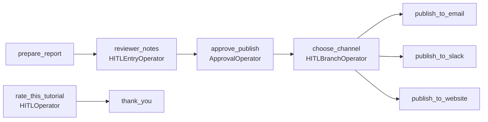

# Human-in-the-loop

**What you'll learn:** how to pause a DAG run until a person fills in a form, approves or
rejects something, or picks which branch to run, and how to answer those requests from the UI
or the REST API.

> **Run it**
> - DAG id: `18_human_in_the_loop`
> - File: [`../dags/18_human_in_the_loop.py`](../dags/18_human_in_the_loop.py)
> - Unpause it, **Trigger** it, then open **Browse ▸ Required Actions** in the UI and answer
>   the questions one by one.

---

## The idea

Most DAGs run from start to finish without anyone touching them. Sometimes a person has to
decide something in the middle:

- "The new model's accuracy dropped 2%. Deploy it anyway?"
- "These 14 rows look wrong. Fix the values, then continue."
- "Release notes are ready. Publish to email, Slack, or both?"

Before Airflow 3.1 people built this with sensors that polled a database flag, or by splitting the
pipeline into two DAGs. Airflow 3.1 added **human-in-the-loop (HITL) operators** in the standard
provider. They:

1. store a *request* (subject, body, options, form fields) in the metadata DB,
2. park the task in a waiting state until somebody answers,
3. resume the task with the answer and push it to [XCom](08-xcom.md) so later tasks can use it.

**New terms**

- **HITL**: human-in-the-loop, a step that needs a person's input.
- **Required action**: the UI's name for a pending HITL request.
- **awaiting_input**: the task state while a HITL task waits for an answer. In Airflow 3.3+ the
  task parks in this state directly. No worker slot and no triggerer are used while it waits
  (older versions deferred to a trigger on the triggerer instead).

See the [glossary](32-glossary.md) for other terms.

---

## The four operators

All four live in `airflow.providers.standard.operators.hitl`.

| Operator | What the person sees | Options | Typical use |
|---|---|---|---|
| `HITLOperator` | A list of options to choose from (one or several) plus optional form fields | You define them | Generic choice: rating, priority, category |
| `ApprovalOperator` | **Approve** / **Reject** buttons | Fixed: `["Approve", "Reject"]` | Gate before something risky |
| `HITLBranchOperator` | A list of downstream tasks to run | Downstream task ids (or labels mapped to them) | Person picks the branch |
| `HITLEntryOperator` | A form with fields, and an **OK** button | Default: `["OK"]` | Collect free-form input |

`ApprovalOperator`, `HITLBranchOperator` and `HITLEntryOperator` are subclasses of
`HITLOperator`, so they all accept the same base arguments.

### Shared arguments (from `HITLOperator.__init__`)

| Argument | Type | Meaning |
|---|---|---|
| `subject` | `str` | Headline of the request. **Templated** (Jinja works). |
| `body` | `str \| None` | Longer description, Markdown supported. **Templated.** |
| `options` | `list[str]` | What the person can choose. Must not be empty. |
| `defaults` | `str \| list[str] \| None` | Options used automatically when `response_timeout` passes. Must be a subset of `options`. Only one allowed unless `multiple=True`. |
| `multiple` | `bool` | Allow picking more than one option. Default `False`. |
| `params` | `dict` of [`Param`](14-params-variables-templating.md) | Form fields. Validated when the person submits. The key `_options` is reserved. |
| `notifiers` | notifier or list | Called when the task starts waiting, e.g. to send a Slack message with a link. |
| `assigned_users` | `{"id": ..., "name": ...}` or a list of them | Only these users may answer. If empty, anyone with permission on the DAG can answer. |
| `response_timeout` | `timedelta \| None` | How long to wait. `None` = wait forever. |

Plus every normal `BaseOperator` argument (`task_id`, `retries`, callbacks ...).

> **Note:** use `response_timeout`, not `execution_timeout`, to limit the waiting time. Passing
> only `execution_timeout` still works but triggers a deprecation warning and is converted to
> `response_timeout`.

---

## Walking through the example



The two chains are independent, so when you trigger the DAG **two** requests appear at about the
same time: `reviewer_notes` and `rate_this_tutorial`.

### 1. A notifier that announces the request

```python
from tutorial_lib.notifiers import LogNotifier

# Logs who must answer and what was asked (swap for SlackNotifier/SmtpNotifier in real life).
ask_notifier = LogNotifier("Human input needed: '{{ task.subject }}' (task {{ ti.task_id }})", level="info")
```

`LogNotifier` is the project's own notifier (`plugins/tutorial_lib/notifiers.py`). It writes the
rendered message to the task log. HITL operators call each notifier in `notifiers=[...]` right
before the task starts waiting. In a real project you'd use a Slack or e-mail notifier so
the reviewer actually hears about it.

### 2. `HITLEntryOperator`: collect a note

```python
reviewer_notes = HITLEntryOperator(
    task_id="reviewer_notes",
    subject="Review the weekly report",
    body="Revenue: {{ ti.xcom_pull(task_ids='prepare_report')['revenue'] }}. Add any notes for readers.",
    params={"notes": Param("Looks good", type="string")},
    notifiers=[ask_notifier],
)
```

- `body` is templated, so the reviewer sees the real revenue from `prepare_report`.
- `params` defines one text field, `notes`, pre-filled with "Looks good".
- No `options` are given, so the operator uses `["OK"]` (and default `["OK"]`).
- No `response_timeout`, so it waits until someone answers.

### 3. `ApprovalOperator`: a yes/no gate with a timeout

```python
approve_publish = ApprovalOperator(
    task_id="approve_publish",
    subject="Publish the weekly report?",
    body="Reviewer notes: {{ ti.xcom_pull(task_ids='reviewer_notes')['params_input']['notes'] }}",
    defaults="Reject",  # used if nobody answers before the timeout
    response_timeout=timedelta(minutes=30),
    notifiers=[ask_notifier],
)
```

- The body pulls the notes the reviewer typed in the previous step (`params_input['notes']`).
- **Approve**: downstream tasks run normally.
- **Reject**: the operator *succeeds* but **skips** its direct downstream tasks. Here that is
  `choose_channel`; the three `publish_to_*` tasks are then skipped too because their only
  upstream was skipped.
- After 30 minutes without an answer, the default `Reject` is applied automatically.

Two extra `ApprovalOperator` arguments:

| Argument | Default | Effect |
|---|---|---|
| `ignore_downstream_trigger_rules` | `False` | `True` skips **all** downstream tasks, not only direct ones, whatever their trigger rules. |
| `fail_on_reject` | `False` | `True` makes the task **fail** on Reject. The source code discourages this: a person answering "Reject" is a successful answer, not a task failure. |

You may not pass `options` or `multiple` to `ApprovalOperator`; it raises `ValueError`.
Teardown tasks are never skipped by a Reject.

### 4. `HITLBranchOperator`: the person picks the branch

```python
choose_channel = HITLBranchOperator(
    task_id="choose_channel",
    subject="Where should the report go?",
    options=["publish_to_email", "publish_to_slack", "publish_to_website"],  # = downstream task ids
    multiple=True,  # allow picking several
    notifiers=[ask_notifier],
)
...
choose_channel >> [publish_to_email(), publish_to_slack(), publish_to_website()]
```

It works like `@task.branch` from [chapter 09](09-branching-and-trigger-rules.md), except a
person returns the task ids. Chosen tasks run; unchosen direct downstream tasks are skipped.
With `multiple=True` the person can tick several.

If you'd rather show friendly labels, use `options_mapping`:

```python
HITLBranchOperator(
    task_id="choose_channel",
    subject="Where should the report go?",
    options=["E-mail", "Slack"],
    options_mapping={"E-mail": "publish_to_email", "Slack": "publish_to_slack"},
)
```

### 5. `HITLOperator`: a generic choice with a default

```python
rate_this_tutorial = HITLOperator(
    task_id="rate_this_tutorial",
    subject="How useful was this example?",
    options=["⭐", "⭐⭐", "⭐⭐⭐"],
    defaults=["⭐⭐⭐"],
    response_timeout=timedelta(hours=1),
)

@task
def thank_you(answer: dict):
    print(f"You chose {answer['chosen_options']} — thanks!")

thank_you(rate_this_tutorial.output)
```

`rate_this_tutorial.output` is the operator's XCom result. Passing it into a TaskFlow task works the same
way as with any classic operator ([chapter 08](08-xcom.md)).

---

## What the answer looks like in XCom

`HITLOperator`, `ApprovalOperator` and `HITLEntryOperator` return a dict like this (keys taken
from `HITLTriggerEventSuccessPayload` in the provider source):

```python
{
    "chosen_options": ["Approve"],          # always a list, even when multiple=False
    "params_input": {"notes": "Looks good"},  # values the person typed in the form ({} if no params)
    "responded_at": datetime(2026, 11, 11, 10, 32, 5, tzinfo=UTC),  # when the answer arrived
    "responded_by_user": {"id": "1", "name": "airflow"},  # None when a timeout default was applied
}
```

That's why the example reads:

- `ti.xcom_pull(task_ids='reviewer_notes')['params_input']['notes']`
- `answer['chosen_options']`

`HITLBranchOperator` is different: like other branch operators, its return value (and XCom) is
the **list of task ids it decided to run**, e.g. `["publish_to_email", "publish_to_slack"]`.

---

## Answering in the UI

1. Trigger `18_human_in_the_loop`.
2. Open **Browse ▸ Required Actions**. You'll see pending requests (`reviewer_notes` and
   `rate_this_tutorial`). The list can be filtered by Pending/Reviewed.
3. Click a request. You'll see the subject, the rendered body, the form fields and the options.
4. Fill in the form / pick options and press the option button (e.g. **OK**, **Approve**).

You can also reach the same form from the task instance: in the Grid view, click the waiting
task (state **Awaiting Input**). The task's page has a required-action tab with the form.

The DAG run stays **running** while it waits. After you respond, the task resumes, pushes the
answer to XCom and finishes. Then the next request (`approve_publish`) appears.

> **Tip:** a notifier can include a direct link to the form.
> `HITLOperator.generate_link_to_ui_from_context(context=context)` builds a URL like
> `<base_url>/dags/<dag_id>/runs/<run_id>/tasks/<task_id>/required_actions`. It reads the base
> URL from the `[api] base_url` config option unless you pass `base_url=`. The bundled example
> `airflow/providers/standard/example_dags/example_hitl_operator.py` (inside your `.venv`) shows a
> notifier that does this.

---

## Answering via the REST API

Useful when the answer comes from another system: a chat bot, a ticketing tool, a script.

First get a token (see [chapter 26](26-cli-and-rest-api.md)):

```bash
TOKEN=$(curl -s -X POST http://localhost:8080/auth/token \
  -H "Content-Type: application/json" \
  -d '{"username": "airflow", "password": "airflow"}' | jq -r .access_token)
```

**List pending requests** for all DAGs and runs (`~` means "any"):

```bash
curl -s -H "Authorization: Bearer $TOKEN" \
  "http://localhost:8080/api/v2/dags/~/dagRuns/~/hitlDetails?response_received=false"
```

Each item contains `options`, `subject`, `body`, `defaults`, `multiple`, `params`,
`assigned_users`, `created_at`, `response_received` and a `task_instance` object (with
`dag_id`, `dag_run_id`, `task_id`, `map_index`).

**Answer one request** with `PATCH`. The path includes the map index (`-1` for a task that
is not mapped):

```bash
curl -s -X PATCH \
  -H "Authorization: Bearer $TOKEN" -H "Content-Type: application/json" \
  "http://localhost:8080/api/v2/dags/18_human_in_the_loop/dagRuns/<RUN_ID>/taskInstances/approve_publish/-1/hitlDetails" \
  -d '{"chosen_options": ["Approve"], "params_input": {}}'
```

For the entry form:

```bash
  ".../taskInstances/reviewer_notes/-1/hitlDetails" \
  -d '{"chosen_options": ["OK"], "params_input": {"notes": "Approved by finance"}}'
```

Replace `<RUN_ID>` with the run id (e.g. `manual__2026-11-11T10:00:00+00:00`, URL-encode the `+`
as `%2B`). Error responses you may see:

| Status | Meaning |
|---|---|
| `400` | An option that isn't in `options`, or several options when `multiple=False` |
| `403` | `assigned_users` is set and you are not one of them |
| `404` | Wrong DAG/run/task id, or that task has no HITL request |
| `409` | Already answered, or the task is no longer waiting |

Check the exact schema in the OpenAPI docs at <http://localhost:8080/docs> (tag "Task Instance").

---

## What happens on timeout

When `response_timeout` passes without an answer, the scheduler resolves the request:

| Situation | Result |
|---|---|
| `defaults` is set | The defaults are written as the answer, form fields get their `Param` default values, `responded_by_user` is empty, and the task **succeeds** and continues as if someone chose the defaults. |
| `defaults` is not set | The task **fails** with `HITLTimeoutError`. Retries apply as for any failure. |
| No `response_timeout` | The task waits forever. |

In the example, `approve_publish` (default **Reject**) skips the publishing branch after
30 minutes, and `rate_this_tutorial` (default **⭐⭐⭐**) continues after 1 hour.

> **Tip:** to try timeouts quickly, temporarily change `response_timeout=timedelta(minutes=30)`
> to `timedelta(seconds=30)`. The scheduler checks for timed-out requests periodically, so the
> default may be applied a little after the deadline.

---

## Restricting who can answer: `assigned_users`

```python
ApprovalOperator(
    task_id="approve_deploy",
    subject="Deploy v2.3 to production?",
    assigned_users=[{"id": "1", "name": "airflow"}],
)
```

- `id` must match the user id that the auth manager reports. With the FAB auth manager used in
  this project's Docker setup that is the numeric user id as a string (the admin user created by
  `airflow-init` is normally `"1"`). Check your user id before relying on it.
- If `assigned_users` is empty, any user who may edit the DAG can answer.

---

## Real-world use cases

| Use case | Operator | Sketch |
|---|---|---|
| Approve a production deploy | `ApprovalOperator` | `build >> test >> approve_deploy >> deploy`. Put `response_timeout` + `defaults="Reject"` so forgotten requests don't hang forever. |
| Review ML model metrics | `ApprovalOperator` or `HITLOperator` | `train >> evaluate >> review`. Render metrics in `body` with Jinja: `"AUC: {{ ti.xcom_pull(task_ids='evaluate')['auc'] }}"`. Options: `["Promote", "Keep current", "Retrain"]` with `HITLBranchOperator`. |
| Manual data correction | `HITLEntryOperator` | Show suspicious rows in `body`; `params` hold the corrected values; the next task reads `params_input` and writes them back. |
| Choose a target environment | `HITLBranchOperator` | Options = task ids `deploy_staging`, `deploy_prod`. |
| Sign-off before sending invoices | `ApprovalOperator` | `fail_on_reject` stays `False`; a Reject skips sending. |

---

## Common mistakes

- **Branch options that are not task ids.** For `HITLBranchOperator`, each option must be a
  direct downstream task id, or be mapped to one with `options_mapping`.
- **`defaults` not in `options`.** Raises `ValueError` when the DAG is parsed (shows up as an
  import error). With `multiple=False` only one default is allowed.
- **No timeout on important gates.** Without `response_timeout`, a forgotten request keeps the
  DAG run "running" forever and can block later runs if `max_active_runs` is low.
- **Reading the wrong XCom key.** Use `['chosen_options']` (a *list*) and `['params_input']`.
  For `HITLBranchOperator` the XCom is a plain list of task ids.
- **Expecting Reject to fail the run.** By default Reject skips downstream tasks and the run can
  still end successfully. Use `fail_on_reject=True` only if you really want a failure.
- **Nobody knows a request is waiting.** Add a notifier (Slack, e-mail) with a link to the form.

## Try it yourself

1. Answer `approve_publish` with **Reject**. Which tasks are skipped? Then trigger again and
   answer **Approve**, picking two channels in `choose_channel`.
2. Add a second field to `reviewer_notes`: `"publish_date": Param("2026-11-15", type="string", format="date")`,
   and show it in the `approve_publish` body.
3. Shorten `approve_publish`'s timeout to 1 minute, don't answer it, and confirm the Reject
   default is applied (look for "Skipping downstream tasks" in its log).
4. Answer `rate_this_tutorial` with `curl` using the `PATCH` endpoint, then check the
   `thank_you` log.

---

**Next →** [Task loops (new in 3.4)](23-task-loops.md) · [Back to the index](README.md)
