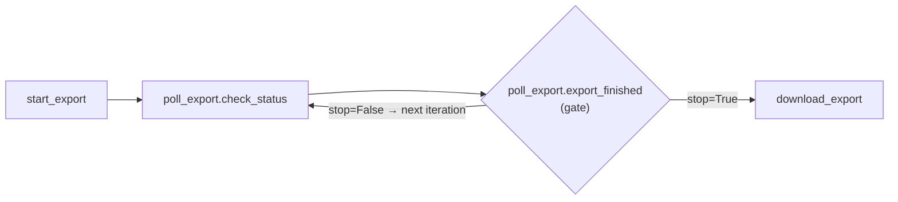

# Task loops (new in Airflow 3.4)

**What you'll learn:** how to run a task group again and again inside one DAG run, either a
fixed number of times or until a condition is met, using `@task_group(...).loop()`, the `loop`
object and `LoopDecision`.

> **Run it**
> - DAG ids: `19_task_loop_fixed` and `19_task_loop_until`
> - File: [`../dags/19_task_loops.py`](../dags/19_task_loops.py)
> - Unpause both and trigger them. Then open each run and look at the iterations of the loop group.

---

## Why loops are special in Airflow

A DAG is a **directed acyclic graph**: arrows only go forward and there are no cycles. So
until Airflow 3.4 you could not write "repeat these steps until X". People worked around it
with:

- a **sensor** that polls one condition ([chapter 12](12-sensors-and-deferrable.md)),
- **re-triggering the whole DAG** from its last task,
- a Python `while` loop inside one big task.

Airflow 3.4 adds **task loops** (AIP-111). You take a task group and call `.loop(...)` on it.
The scheduler creates the group's tasks again for each **iteration**, and each iteration can see
the previous iteration's result. The DAG is still acyclic. The repetition is managed by the
scheduler at runtime.

**New terms**

- **Iteration**: one pass through the loop body. Numbered from **1**.
- **Loop body**: the tasks inside the looped task group.
- **Terminal task**: the single last task of the body. Its return value is the iteration's
  *result*.
- **Gate**: a task Airflow adds after the terminal task. It decides "stop" or "go again".
- **`until` condition**: your function that the gate calls after each iteration.

See also the [glossary](32-glossary.md) and [task groups (chapter 11)](11-task-groups.md).

---

## Example 1: a fixed number of iterations

```python
@dag(dag_id="19_task_loop_fixed", schedule=None, start_date=START, tags=["tutorial", "14-advanced"])
def task_loop_fixed():
    @task_group
    def accumulate():
        @task
        def add_ten(*, loop):
            # loop.index starts at 1. loop.previous = this group's result last iteration.
            previous = 0 if loop.index == 1 else loop.previous
            print(f"Iteration {loop.index}: {previous} + 10")
            return previous + 10

        add_ten()

    @task
    def report():
        print("Loop finished after exactly 3 iterations (total = 30)")

    accumulate.loop(max_iterations=3) >> report()
```

Step by step:

1. `@task_group def accumulate()` defines a normal [task group](11-task-groups.md) with one task.
2. Instead of calling `accumulate()`, the DAG calls **`accumulate.loop(max_iterations=3)`**.
   That creates the group as a loop.
3. `add_ten` declares a keyword-only argument **`loop`**. Airflow injects the loop object
   at runtime, like it injects `ti` or `params`.
4. No `until=` is given, so the loop is a **fixed-count loop**: it runs exactly 3 times and then
   succeeds.
5. `>> report()` makes `report` wait for the **whole loop**, not only the first iteration.

What runs:

| Iteration | `loop.index` | `loop.previous` | `add_ten` returns |
|---|---|---|---|
| 1 | 1 | `None` | 10 |
| 2 | 2 | 10 | 20 |
| 3 | 3 | 20 | 30 |

### The tasks Airflow actually creates

Parsing the file shows a hidden **gate task** inside the group:

| task_id | type | upstream | downstream |
|---|---|---|---|
| `accumulate.add_ten` | Python task | – | `accumulate.__loop_gate` |
| `accumulate.__loop_gate` | `LoopGateOperator` | `accumulate.add_ten` | `report` |
| `report` | Python task | `accumulate.__loop_gate` | – |

`report` depends on the **gate**, not on `add_ten`. The gate only lets downstream tasks start
once the loop has decided to stop. Airflow rewires this for you when you write
`accumulate.loop(...) >> report()`.

---

## Example 2: loop until a condition is true

```python
@dag(dag_id="19_task_loop_until", schedule=None, start_date=START, tags=["tutorial", "14-advanced"])
def task_loop_until():
    @task
    def start_export() -> str:
        return "export-job-42"

    @task_group
    def poll_export():
        @task
        def check_status(*, loop) -> dict:
            # Pretend the job needs 4 checks to finish: progress grows each iteration.
            progress = min(loop.index * 25, 100)
            status = "done" if progress == 100 else "running"
            print(f"Check #{loop.index}: {progress}% ({status})")
            return {"status": status, "progress": progress}

        check_status()

    # The condition runs after each iteration. Return a bool, or a LoopDecision with a reason.
    def export_finished(*, loop) -> LoopDecision:
        result = loop.result
        if result["status"] == "done":
            return LoopDecision(stop=True, reason=f"finished after {loop.index} checks")
        return LoopDecision(stop=False, reason=f"{result['progress']}% done, checking again")

    @task
    def download_export():
        print("Export ready -> downloading")

    start_export() >> poll_export.loop(max_iterations=10, until=export_finished) >> download_export()
```

- `export_finished` is a **plain function**, not a task. Airflow wraps it in the gate task.
  The gate's task id is the function's name: `poll_export.export_finished`.
- After each iteration, the gate calls `export_finished`. `loop.result` is what the terminal
  task (`check_status`) returned **in this iteration**.
- `max_iterations=10` is a safety cap.

What runs:

| Iteration | `check_status` returns | Gate decision |
|---|---|---|
| 1 | `{"status": "running", "progress": 25}` | continue: "25% done, checking again" |
| 2 | `{"status": "running", "progress": 50}` | continue: "50% done, checking again" |
| 3 | `{"status": "running", "progress": 75}` | continue: "75% done, checking again" |
| 4 | `{"status": "done", "progress": 100}` | **stop**: "finished after 4 checks" |

Then `download_export` runs. Iterations 5–10 are never created.



The back-arrow in this picture is a **mental model**. In the real DAG there is no cycle: the
scheduler creates new task instances for the next iteration.

---

## The `loop` object

Any task inside the loop body can declare `*, loop` to receive it. The `until` function receives
it too. Fields (from `airflow/sdk/execution_time/loop.py`):

| Field | Meaning |
|---|---|
| `loop.index` | Current iteration number, starting at **1**. |
| `loop.max_iterations` | The cap you passed to `.loop()`. |
| `loop.previous` | The terminal task's result from the **previous** iteration. `None` in iteration 1. |
| `loop.result` | The terminal task's result in the **current** iteration. Mainly useful in `until`, which runs after the terminal task. |

There are also a few advanced fields (`region_id`, `trajectory`, `forked_from_region_id`,
`resumes_from_index`) used internally to track iterations and re-runs. You won't need them as a
beginner.

> **Tip:** `previous` and `result` always refer to the *terminal* task, the last task in the
> body. If your body has several tasks, make the last one return everything the next iteration
> needs.

---

## `until`: returning `bool` vs `LoopDecision`

The `until` callable can return:

| Return value | Meaning |
|---|---|
| `True` | Stop the loop. |
| `False` | Run another iteration. |
| `LoopDecision(stop=True, reason="...")` | Stop, and show the reason in the UI. |
| `LoopDecision(stop=False, reason="...")` | Continue, and show the reason in the UI. |
| Anything else | The gate **fails** ("until must return a bool or LoopDecision"). |

A bool is fine for simple cases:

```python
def batch_ready(*, loop):
    return min(loop.result) >= 3
```

`LoopDecision` (importable from `airflow.sdk`) adds an explanation that people can read later in
the UI. The reason must be a string of at most 512 bytes (UTF-8). Secrets that Airflow masks in
logs are masked in the reason too.

Rules for the `until` function:

- It must be **synchronous** (not `async def`).
- It receives context values by name, like a TaskFlow task: `*, loop`, `ti`, `params`, ...
- It runs inside the gate task on a worker, so keep it fast. Do the slow work (API calls,
  queries) in the body tasks and return the result.
- Its docstring, if any, becomes the gate task's documentation in the UI.

---

## `max_iterations`: what happens at the cap

`max_iterations` is **required**: `.loop()` has no default, and it must be a positive integer.
This protects you from a loop that never ends. What happens when the cap is reached depends on
whether you gave `until`:

| Loop type | At `max_iterations` |
|---|---|
| No `until` (fixed count) | The loop **succeeds**. This is the normal end. |
| With `until`, and it still says "continue" | The gate **fails** with "Loop condition remained false at max_iterations=N". It is raised as an `AirflowFailException`, so the gate does not retry. Downstream tasks don't run. |

So for `19_task_loop_until`, if the export needed 11 checks, the run would fail at iteration 10.
That is what you want: a stuck job should alert you, not loop forever.

Pick the cap from the real world: "the export normally finishes in 4 checks; 10 is clearly
broken".

---

## Mapped tasks inside a loop

The terminal task may be **mapped** ([chapter 10](10-dynamic-task-mapping.md)). Then
`loop.result` and `loop.previous` are sequences with one value per mapped task instance. From
the bundled example `airflow/example_dags/example_task_loops.py` (inside your `.venv`):

```python
@task_group
def process_batch():
    @task
    def choose_items(*, loop):
        return [1, 2] if loop.index == 1 else [value + 1 for value in loop.previous]

    @task
    def process(value, *, loop, ti):
        print(f"Iteration {loop.index}, mapped position {ti.map_index}")
        return value + loop.index

    process.expand(value=choose_items())

def batch_ready(*, loop):
    return min(loop.result) >= 3

process_batch.loop(max_iterations=3, until=batch_ready)
```

Each iteration creates a fresh set of mapped `process` instances. `loop.previous` is the list of
all `process` results from the previous iteration.

---

## `partial()` and `override()` with loops

Task-group factories support `.partial()` (fixed arguments) and `.override()` (group settings
such as `group_id`). You can chain them before `.loop()`. From the bundled example:

```python
@task_group
def accumulate(increment_by):
    @task
    def increment(increment_by, *, loop):
        return (0 if loop.index == 1 else loop.previous) + increment_by

    increment(increment_by)

accumulate.override(group_id="accumulate_more").partial(increment_by=5).loop(max_iterations=3)
```

- `.partial(increment_by=5)` passes the argument to the body function.
- `.override(group_id="accumulate_more")` renames the group, useful if you loop the same group
  twice in one DAG.

---

## Rules and limits

Airflow checks these when the DAG is parsed (you'll get an import error if one is broken):

| Rule | Why |
|---|---|
| The body must have **exactly one terminal task** | Its return value is the iteration's result. Add a final "collect" task if you have several leaves. |
| **No nested loops** | A loop inside another loop raises `NotImplementedError`. |
| A loop cannot be **inside a mapped task group** | Same error. |
| Tasks **outside** the loop can't `.expand()` over a loop task's output | The loop task ran once per iteration, so there is no single list to expand over. |
| `until` must be callable and synchronous | It runs inside the gate. |

> **Reading a loop task from outside:** if a task *after* the loop takes a loop task's output
> as an argument, Airflow gives it a lazy sequence of that task's values across iterations
> rather than one value. If you need only the final value, keep it in mind when you write the
> downstream task, or check what you receive in the logs first.

---

## How iterations look in the UI

The 3.4 UI has loop-specific views. Labels may change slightly between releases, but you
should find:

- An **iteration switcher** on the run so you can pick "Iteration 1", "Iteration 2" ... or
  "All", and see the task instances of that iteration.
- On a task instance's details: its **Iteration** number, and for the gate the **Decision**
  (your `LoopDecision.reason`) and **Iterations run**.
- A loop outcome such as "Stopped early at iteration 4", "Ran all 3 allowed iterations" or
  "Reached the iteration limit (10)".
- An **Iterations per run** chart on the DAG page, handy to see whether a polling loop is
  getting slower over time.
- In the **Clear** dialog for a loop task, an option to also clear **later iterations**.

Try both example DAGs and click around: this is new in 3.4, so the UI is the best place to
learn how your Airflow version presents it. See [chapter 25](25-ui-tour.md) for the general UI tour.

---

## Loops vs sensors vs re-triggering the DAG

| Need | Best tool | Why |
|---|---|---|
| Wait until one external thing is true (file exists, job finished), nothing to carry between checks | **Sensor**, ideally deferrable ([chapter 12](12-sensors-and-deferrable.md)) | One task, frees the worker while waiting (deferrable), built-in `timeout` and `poke_interval`. |
| Repeat **several steps** and feed each pass's result into the next (refine, paginate, retry-with-changes) | **Task loop** | Each iteration is visible as its own tasks with logs and state; `loop.previous` carries state. |
| Repeat a fixed number of times | **Task loop** without `until`, or [dynamic task mapping](10-dynamic-task-mapping.md) if the passes are independent and can run in parallel | Mapping runs in parallel; loops run one after another. |
| Process a new batch whenever new data arrives (unbounded) | **Schedule / [assets](13-assets-data-aware-scheduling.md)**, or `TriggerDagRunOperator` | Each batch is its own DAG run with its own history and backfills. |
| Very fast, tiny repetitions (milliseconds) | A Python loop **inside one task** | Each Airflow iteration has scheduling overhead of seconds. |

Rule of thumb: a loop iteration costs as much as running a few tasks. Use loops for
"a handful to a few dozen" passes, not thousands.

Note also that `.loop()` has only two settings, `max_iterations` and `until`. There is **no
built-in delay between iterations**: the next iteration is scheduled as soon as the gate says
"continue". For "check every 5 minutes" a deferrable sensor is usually the better fit.

---

## Common mistakes

- **Two leaf tasks in the body.** "A loop body must have exactly one terminal task definition".
  Join them with a final task that returns a combined result.
- **Forgetting `loop.index` starts at 1.** `loop.previous` is `None` in iteration 1, so handle
  that case (`0 if loop.index == 1 else loop.previous`).
- **A cap that's too small with `until`.** Reaching `max_iterations` while `until` still says
  "continue" **fails** the run. Choose a cap with headroom.
- **Doing slow work in `until`.** Put API calls in the body; `until` should only look at
  `loop.result`.
- **Using a loop to wait for time to pass.** Iterations run back to back; use a sensor for
  "check every N minutes".
- **Calling the group as well as looping it.** Use `accumulate.loop(...)` *instead of*
  `accumulate()`, not both.

## Try it yourself

1. In `19_task_loop_fixed`, change `max_iterations` to 5 and make `add_ten` add
   `loop.index` instead of 10. What is the final value? Update `report`'s message.
2. In `19_task_loop_until`, change progress to `loop.index * 10`. The job now needs 10 checks.
   Does the run succeed? Change it to `loop.index * 9` and observe the failure message on the gate.
3. Replace the `LoopDecision` in `export_finished` with a plain `return result["status"] == "done"`.
   What disappears from the UI?
4. Add a second task to the `poll_export` body (e.g. `log_progress(status)` after
   `check_status`) and make sure it is the terminal task that returns the status dict.

---

**Next →** [Capstone: production-style sales ETL](24-capstone-sales-etl.md) · [Back to the index](README.md)
