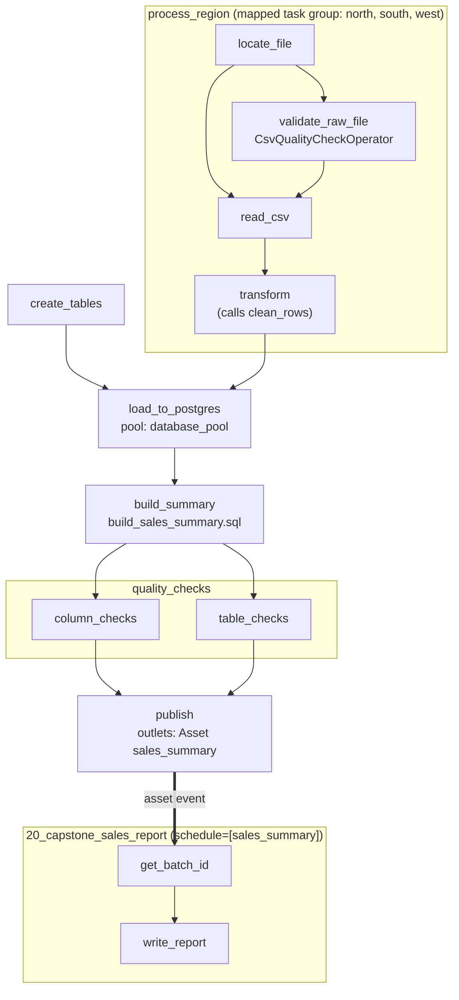

# Capstone: a production-style sales ETL

**What you'll learn:** how the features from the previous chapters fit together in one
realistic pipeline that extracts regional sales CSVs, validates and cleans them, loads them
idempotently into Postgres, checks data quality, and hands off to a reporting DAG through an
asset.

> **Run it**
> - DAG ids: `20_capstone_sales_etl` (the pipeline) and `20_capstone_sales_report` (the report)
> - File: [`../dags/20_capstone_sales_etl.py`](../dags/20_capstone_sales_etl.py)
> - Also used: [`../dags/include/sql/`](../dags/include/sql/),
>   [`../dags/include/data/`](../dags/include/data/),
>   [`../plugins/tutorial_lib/operators/csv_quality.py`](../plugins/tutorial_lib/operators/csv_quality.py)
> - Needs the `demo` Postgres database from the Docker setup ([chapter 03](03-installation-and-setup.md)).
> - **Unpause both DAGs**, then trigger `20_capstone_sales_etl`.

---

## The business problem

A company has three regional shops: **north**, **south** and **west**. Each one sends a CSV of
orders every day:

```text
order_id,order_date,region,product,quantity,unit_price,customer_id
1001,2026-11-01,north,Webcam,1,59.9,C002
...
```

We want a daily pipeline that:

1. checks each file is usable (columns present, no empty ids),
2. cleans the rows and computes `revenue = quantity × unit_price`,
3. loads clean rows into Postgres **without creating duplicates when re-run**,
4. builds a per-region summary table,
5. **stops** if the data looks wrong,
6. tells a downstream reporting DAG that new data is ready.

The sample files in `dags/include/data/` have 12 rows each (36 in total). Two rows are bad
**on purpose**: order `1017` in `sales_south.csv` has `quantity` **0**, and order `1032` in
`sales_west.csv` has `quantity` **-2**. The transform step rejects them.

---

## Architecture



`create_tables` has no upstream, so it runs **in parallel** with the extraction. Only
`load_to_postgres` waits for it (`create_tables >> loaded`). `publish` also reads the outputs of
`load_to_postgres` and `transform`, so it has those as upstreams too.

### Stage by stage and where you learned it

| Stage | Task(s) | Feature | Chapter |
|---|---|---|---|
| Configuration | `default_args`, `max_active_runs=1`, `dagrun_timeout`, `catchup=False`, `schedule="@daily"` | DAG arguments | [05](05-first-dag.md), [18](18-scheduling-and-timetables.md) |
| Create tables | `create_tables` | `SQLExecuteQueryOperator` + SQL file via `template_searchpath` | [07](07-operators-and-dependencies.md), [14](14-params-variables-templating.md) |
| Extract + validate + transform | `process_region.*` | `@task_group` + `.expand()` (mapped task group) | [10](10-dynamic-task-mapping.md), [11](11-task-groups.md) |
| Validate | `process_region.validate_raw_file` | Custom operator, `AirflowFailException` | [17](17-custom-operators-hooks-plugins.md), [16](16-error-handling-retries-alerts.md) |
| Read / transform | `read_csv`, `transform` | TaskFlow, XCom | [06](06-taskflow-api.md), [08](08-xcom.md) |
| Load | `load_to_postgres` | `PostgresHook`, idempotent delete-then-insert, pool | [15](15-connections-and-hooks.md), [19](19-pools-priority-concurrency.md) |
| Summarise | `build_summary` | SQL file with query parameters | [15](15-connections-and-hooks.md) |
| Data quality | `quality_checks.*` | `SQLColumnCheckOperator`, `SQLTableCheckOperator` | this chapter |
| Publish | `publish` | Asset outlet with `extra` metadata | [13](13-assets-data-aware-scheduling.md) |
| Report | `20_capstone_sales_report` | Asset-scheduled DAG, `triggering_asset_events` | [13](13-assets-data-aware-scheduling.md) |
| Alerts / retries | every task | `retries=2`, `retry_delay`, `on_failure_callback` | [16](16-error-handling-retries-alerts.md) |

---

## Walking through the code

### DAG settings

```python
default_args = {
    "owner": "data-platform",
    "retries": 2,
    "retry_delay": timedelta(seconds=20),
    "on_failure_callback": task_failure_alert,
}

@dag(
    dag_id="20_capstone_sales_etl",
    schedule="@daily",
    start_date=pendulum.datetime(2026, 1, 1, tz="UTC"),
    catchup=False,
    max_active_runs=1,
    default_args=default_args,
    dagrun_timeout=timedelta(minutes=30),
    template_searchpath=[str(SQL_DIR)],
    ...
)
```

- Every task retries twice, 20 s apart, and calls `task_failure_alert`
  (`plugins/tutorial_lib/callbacks.py`, which logs an "ALERT" line) after its final failure.
- `max_active_runs=1`: two runs never load at the same time.
- `dagrun_timeout`: a run that takes more than 30 minutes is failed.
- `template_searchpath=[str(SQL_DIR)]` lets operators refer to SQL files by name
  (`sql="create_sales_tables.sql"`) instead of a full path. `SQL_DIR` is
  `dags/include/sql` (see `plugins/tutorial_lib/paths.py`).

### `create_tables`

```python
create_tables = SQLExecuteQueryOperator(
    task_id="create_tables",
    conn_id=CONN_ID,                # "demo_postgres"
    sql="create_sales_tables.sql",
    split_statements=True,
)
```

[`create_sales_tables.sql`](../dags/include/sql/create_sales_tables.sql) uses
`CREATE TABLE IF NOT EXISTS`, so it is safe to run every day. Two tables:

- `sales_clean`: one row per order **per batch**. Primary key `(order_id, batch_id)`.
  `quantity` has a `CHECK (quantity > 0)` constraint as a last line of defence.
- `sales_daily_summary`: one row per region per batch. Primary key `(batch_id, region)`.

### The mapped task group `process_region`

```python
@task_group(tooltip="Locate, validate, read and clean one regional CSV")
def process_region(region: str):
    @task
    def locate_file(region: str) -> str:
        # In real life: find today's file in S3/SFTP. Here: the bundled sample CSVs.
        return str(SAMPLE_DATA_DIR / f"sales_{region}.csv")

    path = locate_file(region)

    validate = CsvQualityCheckOperator(
        task_id="validate_raw_file",
        file_path=path,
        required_columns=REQUIRED_COLUMNS,
        not_null_columns=["order_id", "product"],
        min_rows=1,
    )

    @task
    def read_csv(path: str) -> list[dict]: ...

    @task
    def transform(rows: list[dict]) -> dict:
        result = clean_rows(rows)
        print(f"{result['region']}: kept {len(result['rows'])} rows, rejected {result['rejected']}")
        return result

    rows = read_csv(path)
    validate >> rows
    return transform(rows)
...
transformed = process_region.expand(region=REGIONS)  # list of 3 results downstream
```

- `process_region.expand(region=["north", "south", "west"])` creates **three copies** of the
  whole group at runtime, one per region. In the Grid view you'll see map indexes 0, 1, 2.
- `file_path=path` passes a TaskFlow output (an XComArg) into a classic operator. Because
  `file_path` is in the operator's `template_fields`, Airflow resolves it before `execute()`.
- `validate >> rows` makes `read_csv` wait for the validation.
- The group **returns** `transform(rows)`. Downstream of the mapped group, that becomes a
  **list of three results**, one per region.

> **Why are all per-region steps inside one group?** In Airflow 3.4 you cannot `.expand()` a
> task over the output of a task that lives *inside* a mapped task group (it fails with
> "Cannot expand ... missing upstream values"). So keep the per-item steps together in the
> mapped group, and do the "reduce" step (here `load_to_postgres`) afterwards.

### `CsvQualityCheckOperator`: fail fast on a broken file

The custom operator ([`csv_quality.py`](../plugins/tutorial_lib/operators/csv_quality.py),
[chapter 17](17-custom-operators-hooks-plugins.md)) checks that the file exists, has the
required header columns, at least `min_rows` rows, and no empty values in `not_null_columns`.
On any problem it raises **`AirflowFailException`**, which fails the task **without retries**.
Retrying would not fix a broken file, so this is correct even though `retries=2` is set.

### `clean_rows`: business logic as a plain function

```python
def clean_rows(rows: list[dict]) -> dict:
    clean, rejected = [], []
    for row in rows:
        quantity = int(row["quantity"])
        if quantity <= 0:
            rejected.append(row["order_id"])
            continue
        unit_price = Decimal(row["unit_price"])
        clean.append({ ..., "revenue": str(unit_price * quantity), "customer_id": row["customer_id"] or None })
    region = clean[0]["region"] if clean else "unknown"
    return {"region": region, "rows": clean, "rejected": rejected}
```

- It lives at **module level** with no Airflow imports, so it can be unit-tested without
  Airflow running (see `tests/test_capstone_logic.py` and [chapter 27](27-testing-dags.md)).
- `Decimal`, not `float`, for money: `59.9 * 3` is exactly `179.70`.
- Decimals are returned as **strings** so they serialize cleanly into XCom.
- Rejected order ids are kept so `publish` can report how many rows were dropped.

### `load_to_postgres`: an idempotent load

```python
@task(pool="database_pool")
def load_to_postgres(results: list[dict], run_id=None) -> int:
    hook = PostgresHook(postgres_conn_id=CONN_ID)
    rows = [(..., run_id) for result in results for r in result["rows"]]
    # Delete anything this run loaded before (e.g. on a retry), then insert.
    hook.run("DELETE FROM sales_clean WHERE batch_id = %(batch_id)s", parameters={"batch_id": run_id})
    hook.insert_rows(table="sales_clean", rows=rows, target_fields=[..., "batch_id"])
    return len(rows)
```

`results` is the list of three dicts from the mapped group. `pool="database_pool"` (4 slots,
from `config/pools.json`) limits how many tasks hit the database at once.

---

## Idempotency: why `batch_id = run_id`

A task is **idempotent** if running it twice gives the same result as running it once
(see the [glossary](32-glossary.md)). In Airflow this matters because tasks *are* run more than
once:

- **retries**: the task failed halfway (e.g. after inserting half the rows),
- **clearing** a task in the UI to re-run it,
- **backfills** re-running old dates.

Without care, every re-run would insert the same orders again.

The pipeline tags every row with **`batch_id = run_id`** (e.g.
`scheduled__2026-11-11T00:00:00+00:00`), and each load does:

1. `DELETE FROM sales_clean WHERE batch_id = <this run_id>`
2. `INSERT` this run's rows.

| Situation | What happens |
|---|---|
| First attempt | Delete removes nothing, insert adds 34 rows. |
| Retry / clear of the same run | Delete removes this run's 34 rows, insert adds them again → still 34. |
| A *different* run | Different `run_id`, so it doesn't touch other runs' rows. |

`build_sales_summary.sql` follows the same pattern for the summary table:

```sql
DELETE FROM sales_daily_summary WHERE batch_id = %(batch_id)s;

INSERT INTO sales_daily_summary (batch_id, region, orders, units, revenue)
SELECT batch_id, region, COUNT(*), SUM(quantity), SUM(revenue)
FROM sales_clean
WHERE batch_id = %(batch_id)s
GROUP BY batch_id, region;
```

`%(batch_id)s` is a **query parameter** filled in safely by the database driver. The operator
passes `parameters={"batch_id": "{{ run_id }}"}`; `parameters` is a templated field, so Jinja
fills in the run id first.

> **Note:** idempotency here is *per run*. Because the demo loads the same sample CSVs every
> day, each new run adds another batch with the same order ids. In production each run would
> read *that day's* file, or you'd delete by business date (e.g. `order_date`) instead of run id.

---

## Data quality checks

After loading, two operators from the common SQL provider query the batch and **fail the task**
(and so block `publish`) if a check doesn't hold.

```python
batch_filter = "batch_id = '{{ run_id }}'"
```

Both use `partition_clause=batch_filter`, so they only look at **this run's** rows.

### `SQLColumnCheckOperator`: per-column statistics

```python
column_mapping={
    "order_id": {"null_check": {"equal_to": 0}, "unique_check": {"equal_to": 0}},
    "quantity": {"min": {"greater_than": 0}},
    "revenue": {"min": {"geq_to": 0}},
},
```

Read it as: *for column X, compute statistic Y, and it must compare like Z.*

| Statistic | SQL it runs |
|---|---|
| `null_check` | number of NULLs |
| `unique_check` | `COUNT(col) - COUNT(DISTINCT col)` = number of duplicates |
| `distinct_check` | number of distinct values |
| `min` / `max` | `MIN(col)` / `MAX(col)` |

| Comparison | Meaning |
|---|---|
| `equal_to` | exactly equal |
| `greater_than` / `less_than` | strictly greater / less |
| `geq_to` / `leq_to` | ≥ / ≤ |
| `tolerance` | allowed relative deviation, e.g. `0.1` = ±10% |

So: no NULL order ids, no duplicate order ids in this batch, every quantity > 0, no negative
revenue.

### `SQLTableCheckOperator`: whole-table conditions

```python
checks={
    "has_rows": {"check_statement": "COUNT(*) > 0"},
    "revenue_matches": {"check_statement": "SUM(revenue) = SUM(quantity * unit_price)"},
},
```

Each `check_statement` is a SQL boolean expression. The operator wraps it in
`CASE WHEN <statement> THEN 1 ELSE 0 END` and fails if any check returns 0. Here: the batch is
not empty, and stored revenue matches the recomputed revenue.

If any check fails, the task log lists which ones. Fix the data or the code, then clear the
run. The idempotent load makes that safe.

---

## The asset hand-off

```python
sales_summary = Asset(name="sales_summary", uri="postgres://postgres:5432/demo/public/sales_daily_summary")

@task(outlets=[sales_summary])
def publish(loaded_rows: int, transformed: list[dict], run_id=None, *, outlet_events=None) -> None:
    rejected = sum(len(t["rejected"]) for t in transformed)
    outlet_events[sales_summary].extra = {"batch_id": run_id, "rows": loaded_rows, "rejected": rejected}
```

When `publish` succeeds, Airflow records an **asset event** for `sales_summary` with `extra`
metadata: `{"batch_id": ..., "rows": 34, "rejected": 2}`. Because `publish` is downstream of the
quality checks, bad data never triggers the report.

The report DAG is scheduled on that asset:

```python
@dag(dag_id="20_capstone_sales_report", schedule=[sales_summary], ...)
def capstone_sales_report():
    @task
    def get_batch_id(*, triggering_asset_events=None) -> str:
        events = triggering_asset_events[sales_summary]
        extra = events[-1].extra
        return extra["batch_id"]
```

`triggering_asset_events` gives the events that started this run. The report reads the
`batch_id` from the event's `extra` and queries only that batch. In Airflow 3.4 each asset event
creates its own run by default ([chapter 13](13-assets-data-aware-scheduling.md)).

`write_report` writes a Markdown file to `data/reports/sales_report_<run id with special characters replaced by _>.md`
(in Docker: `/opt/airflow/data/reports/`, mounted from `./data`). With the sample data it looks
like:

```markdown
# Sales report — batch `manual__2026-11-11T10:00:00.123456+00:00`

| Region | Orders | Units | Revenue |
|---|---|---|---|
| north | 12 | 40 | 9,449.70 |
| south | 11 | 29 | 6,788.16 |
| west | 11 | 35 | 3,313.13 |

**Total revenue:** 19,550.99
```

---

## How to run it

1. Start the stack (once): `make init`, then `make up` ([chapter 03](03-installation-and-setup.md)).
   Open <http://localhost:8080> (login `airflow` / `airflow`).
2. **Unpause both** `20_capstone_sales_etl` and `20_capstone_sales_report`. New DAGs start
   paused in this project. If the report DAG is paused, the asset event is recorded but no
   report run starts.
3. Trigger `20_capstone_sales_etl`. Because `catchup=False`, unpausing may also start one
   scheduled run for the latest interval. That's fine.
4. Watch the Grid view. Expected results:

| Task | What to look for in the log |
|---|---|
| `process_region.transform` [north] | `north: kept 12 rows, rejected []` |
| `process_region.transform` [south] | `south: kept 11 rows, rejected ['1017']` |
| `process_region.transform` [west] | `west: kept 11 rows, rejected ['1032']` |
| `load_to_postgres` | `Loaded 34 rows for batch ...` |
| `publish` | `Published batch ...: 34 rows loaded, 2 rejected` |

5. A few seconds later `20_capstone_sales_report` starts by itself. Open `write_report`'s log or
   the file in `data/reports/`.

### Look at the data with `make psql`

`make psql` opens `psql` on the `demo` database inside the Postgres container:

```sql
-- Latest summaries
SELECT * FROM sales_daily_summary ORDER BY batch_id DESC LIMIT 10;

-- Rows per batch (should be 34 each)
SELECT batch_id, COUNT(*) AS rows, SUM(revenue) AS revenue
FROM sales_clean GROUP BY batch_id ORDER BY batch_id DESC;

-- Top products in the newest batch
SELECT product, SUM(quantity) AS units, SUM(revenue) AS revenue
FROM sales_clean
WHERE batch_id = (SELECT MAX(batch_id) FROM sales_clean)
GROUP BY product ORDER BY revenue DESC;
```

Type `\q` to quit.

### Prove it's idempotent

Open the latest run, click `load_to_postgres`, **Clear** it (with downstream). After it
finishes, run the "rows per batch" query again: still **34** for that batch, not 68.

---

## How to extend it

### Add a region

1. Create `dags/include/data/sales_east.csv` with the same header.
2. Add it to the list: `REGIONS = ["north", "south", "west", "east"]`.

The mapped group makes a fourth copy automatically. Nothing else changes.

### Add an API source

Add a task that fetches orders from an HTTP API using a connection and hook
([chapter 15](15-connections-and-hooks.md)), returns rows in the same shape as `read_csv`, and
passes them through `clean_rows`. For example a second mapped group or a single task whose
result you combine with `transformed` before `load_to_postgres`. Put the API call in an
`api_pool` task so you don't overload the API ([chapter 19](19-pools-priority-concurrency.md)).

### Read from S3 (or GCS, Azure) with `ObjectStoragePath`

`airflow.sdk.ObjectStoragePath` gives a `pathlib`-like API over object storage. `locate_file`
and `read_csv` could become:

```python
from airflow.sdk import ObjectStoragePath

BUCKET = ObjectStoragePath("s3://my-sales-bucket/incoming/", conn_id="aws_default")

@task
def locate_file(region: str, ds=None) -> str:
    return str(BUCKET / ds / f"sales_{region}.csv")

@task
def read_csv(path: str) -> list[dict]:
    with ObjectStoragePath(path, conn_id="aws_default").open("r") as f:
        return list(csv.DictReader(f))
```

You'd need the Amazon provider and an `aws_default` connection. `CsvQualityCheckOperator` uses
a local `Path`, so it would need the same change.

### Slack alerts

Replace the log-only callback with a real notifier, e.g. `SlackNotifier` from the Slack
provider (`apache-airflow-providers-slack`, add it to `requirements.txt` and build the image):

```python
from airflow.providers.slack.notifications.slack import SlackNotifier

default_args = {
    ...,
    "on_failure_callback": SlackNotifier(
        slack_conn_id="slack_default",
        text="Task {{ ti.task_id }} failed in {{ dag.dag_id }} (run {{ run_id }})",
        channel="#data-alerts",
    ),
}
```

---

## Production checklist for this pipeline

| Item | Status in the demo |
|---|---|
| Read **the day's** file (use `{{ ds }}` / `logical_date` in the path), not a fixed sample | Fixed sample files |
| Idempotent writes keyed on the business date or run id | Done (run id) |
| Validate raw input and fail fast without retries | Done (`AirflowFailException`) |
| Data quality checks **before** publishing | Done |
| Large data goes to files/object storage, only paths in XCom | Demo passes rows via XCom (fine for 36 rows) |
| Secrets in connections or a secrets backend, never in code | Done (env-var connection) |
| Real alerts (Slack, e-mail, PagerDuty) on failure | Log only |
| `DeadlineAlert` if the report must be ready by a certain time ([chapter 16](16-error-handling-retries-alerts.md)) | Not set |
| Pools sized for the database | `database_pool` (4 slots) |
| Unit tests for business logic, DAG integrity tests in CI | Done (`tests/`) |
| Schema changes managed with migrations, not `CREATE TABLE IF NOT EXISTS` in the DAG | Demo creates tables in the DAG |
| Retention: delete old batches / summaries | Not done |
| Backfills tested (`airflow backfill create ...`) | Try it yourself |

See [chapter 28](28-best-practices.md) for the general best practices.

---

## Common mistakes

- **Only unpausing the ETL DAG.** The report never runs. Unpause `20_capstone_sales_report` too.
- **Running without the `demo` database.** `create_tables` fails with a connection error. The
  `demo` DB is created by `scripts/postgres-init` on the **first** start of the Postgres volume.
  If you created the volume before, `make reset` and start again.
- **Thinking the 2 rejected rows are a bug.** They are intentional test data (quantity 0 and -2).
- **Removing the delete-before-insert.** Retries then hit the primary key `(order_id, batch_id)`
  and fail, or duplicate data if you drop the key.
- **Expanding a task over a task inside the mapped group.** Keep per-region steps inside
  `process_region` and reduce afterwards.
- **Passing big data through XCom.** Fine for this demo, but for millions of rows write files
  and pass paths.

## Try it yourself

1. Add a fourth region `east` with a CSV containing one row with an empty `product`. Which task
   fails, and does it retry?
2. Add a column check `"unit_price": {"max": {"less_than": 1000}}`. Then edit a CSV so a
   unit price is 1200 and watch `quality_checks.column_checks` block `publish`.
3. Add `"rejected"` to the report: read it from the asset event's `extra` in `get_batch_id`
   and print it in the Markdown.
4. Run a backfill for three past dates (see `airflow backfill create --help`) and check that
   each date gets its own batch in `sales_clean`.

---

**Next →** [A tour of the UI](25-ui-tour.md) · [Back to the index](README.md)
