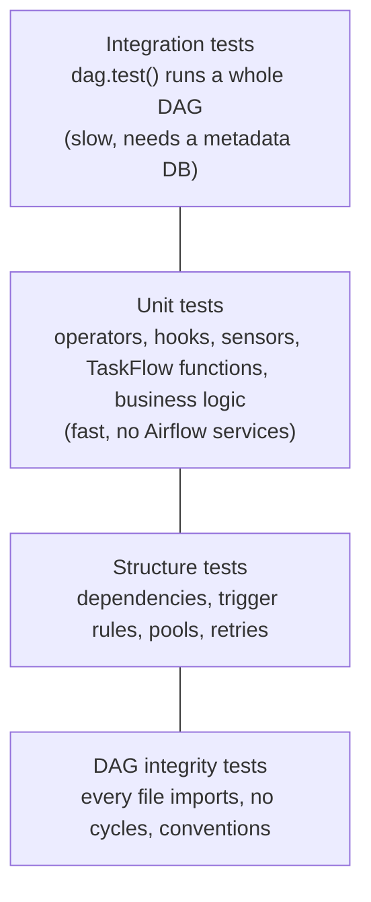

# Testing DAGs

**What you'll learn:** how to test an Airflow project at every level, from "does every DAG file
import?" to "does the whole pipeline run?", using the real test suite in this repo, plus
linting with ruff, a CI pipeline and debugging tips.

> **Run it**
> - Tests: [`../tests/`](../tests/) · config: [`../pyproject.toml`](../pyproject.toml) ·
>   [`../Makefile`](../Makefile) target `test`
> - One-time: `make venv` (creates `.venv` with Airflow 3.4 using the official constraints)
> - Fast tests: `make test` (runs `pytest -q tests -m "not integration"`)
> - Everything, including whole-DAG runs: `make test-all` (runs `airflow db migrate` first)
> - Lint: `make lint` (ruff, including the Airflow-specific `AIR` rules)

---

## Why test DAGs at all?

A DAG file is Python code that the dag-processor imports every ~30 seconds
([chapter 02](02-architecture.md)). If it has a typo, a bad import or a cycle, the DAG
**disappears from the UI** and shows up as an import error. Your scheduled runs silently stop.
Tests catch this **before** you deploy.

You also want to know that the *logic* is right: the branch picks the right path, the
transform computes revenue correctly, the hook parses the API response.

---

## The testing pyramid for Airflow



Lots of cheap tests at the bottom, a few expensive ones at the top:

| Level | File in this repo | Speed | Needs DB? | Catches |
|---|---|---|---|---|
| DAG integrity | `tests/test_dag_integrity.py` | seconds | No | Import errors, missing DAGs, convention breaks |
| Structure | `tests/test_dag_structure.py` | seconds | No | Someone rewired a dependency or changed a trigger rule |
| Unit | `tests/test_custom_components.py`, `tests/test_capstone_logic.py` | milliseconds | No | Logic bugs in operators, hooks, sensors, functions |
| Integration | `tests/test_dag_runs.py` (`@pytest.mark.integration`) | slower | **Yes** | Tasks failing at runtime, XCom wiring, branching |

At the time of writing, `pytest -q -m "not integration"` runs **57 tests** in about 12 seconds,
and 6 integration tests are deselected.

---

## How the test setup works

### `pyproject.toml`

```toml
[tool.pytest.ini_options]
# Make `tutorial_lib` (plugins/) importable in tests, exactly like inside Airflow.
pythonpath = ["plugins", "dags"]
testpaths = ["tests"]
markers = [
    "integration: runs a whole DAG with dag.test() (needs `airflow db migrate` first)",
]
filterwarnings = ["ignore::DeprecationWarning"]
```

- `pythonpath`: Airflow puts `dags/` and `plugins/` on `sys.path` at runtime. Tests need the
  same, so `from tutorial_lib... import ...` works.
- `markers`: registers the `integration` marker so you can select (`-m integration`) or skip
  (`-m "not integration"`) those tests.

### `tests/conftest.py`

```python
os.environ.setdefault("AIRFLOW_HOME", str(PROJECT_DIR / ".airflow_local"))
os.environ.setdefault("AIRFLOW__CORE__LOAD_EXAMPLES", "false")
os.environ.setdefault("AIRFLOW__CORE__DAGS_FOLDER", str(DAGS_DIR))
...

@pytest.fixture(scope="session")
def dagbag():
    """Parse every DAG file once per test session (same thing the dag-processor does)."""
    from airflow.models import DagBag

    return DagBag(dag_folder=str(DAGS_DIR))
```

- The `setdefault` calls mean plain `pytest` works even if you forgot
  `source scripts/local_env.sh` (you still need the `.venv` active).
- The **`dagbag` fixture** parses all DAG files **once per session**. A **DagBag** is a
  collection of parsed DAGs plus a dict of import errors (see the [glossary](32-glossary.md)).
  Every integrity and structure test reuses it.

---

## Level 1: DAG integrity tests

From [`tests/test_dag_integrity.py`](../tests/test_dag_integrity.py). If you only write one
kind of test, write this one:

```python
def test_no_import_errors(dagbag):
    assert dagbag.import_errors == {}, f"DAG import failures: {dagbag.import_errors}"
```

`import_errors` maps file path → traceback. A syntax error, a missing package, a cycle
(`a >> b >> a`), a duplicate task id or invalid operator arguments all end up here.

```python
EXPECTED_DAG_IDS = {"01_hello_airflow", "02_taskflow_api", ..., "20_capstone_sales_report"}

def test_expected_dags_are_present(dagbag):
    missing = EXPECTED_DAG_IDS - set(dagbag.dag_ids)
    assert not missing, f"Missing DAGs: {sorted(missing)}"
```

This catches a DAG that silently vanished, for example because someone forgot to *call* a
`@dag`-decorated function at the bottom of the file.

**Convention tests** enforce team rules:

```python
@pytest.mark.parametrize("dag_id", sorted(EXPECTED_DAG_IDS))
def test_every_dag_has_tutorial_tag(dagbag, dag_id):
    assert "tutorial" in dagbag.get_dag(dag_id).tags

def test_dag_ids_match_their_file_number(dagbag):
    """Convention in this repo: DAG ids start with the number of the file that defines them."""
    for dag_id, dag in dagbag.dags.items():
        if dag_id == "tutorial_daily_kpis":  # @asset DAGs are named after the function
            continue
        file_number = dag.fileloc.rsplit("/", 1)[-1][:2]
        assert dag_id.startswith(file_number), f"{dag_id} defined in {dag.fileloc}"
```

Other popular conventions: every DAG has an `owner`, `retries >= 1`, no `catchup=True`, a
`doc_md`, tags from an allowed list.

---

## Level 2: structure tests

From [`tests/test_dag_structure.py`](../tests/test_dag_structure.py). They pin down the
**shape** of important DAGs so a refactor can't change behaviour by accident.

```python
def downstream_ids(dag, task_id: str) -> set[str]:
    return set(dag.get_task(task_id).downstream_task_ids)

def test_hello_airflow_is_a_straight_line(dagbag):
    dag = dagbag.get_dag("01_hello_airflow")
    assert downstream_ids(dag, "start") == {"say_hello"}
    assert downstream_ids(dag, "say_hello") == {"print_context"}
    assert downstream_ids(dag, "print_context") == {"end"}
    assert dag.default_args["retries"] == 1
```

**Trigger rules** ([chapter 09](09-branching-and-trigger-rules.md)) are easy to break and hard
to notice:

```python
def test_branch_join_uses_correct_trigger_rule(dagbag):
    dag = dagbag.get_dag("05_branching_and_trigger_rules")
    assert dag.get_task("join").trigger_rule == "none_failed_min_one_success"
    assert dag.get_task("cleanup").trigger_rule == "all_done"
    assert dag.get_task("on_any_failure").trigger_rule == "one_failed"
```

Other structure tests in the file check retries and timeouts (`12_*`), setup/teardown flags
(`16_*`), pools and priority (`15_*`), and that the capstone's quality checks sit **before**
`publish`:

```python
def test_capstone_has_quality_gate_before_publish(dagbag):
    dag = dagbag.get_dag("20_capstone_sales_etl")
    publish = dag.get_task("publish")
    assert {"quality_checks.column_checks", "quality_checks.table_checks"} <= publish.upstream_task_ids
    assert dag.get_task("process_region.transform").upstream_task_ids == {"process_region.read_csv"}
    assert [o.name for o in publish.outlets] == ["sales_summary"]
    assert dag.max_active_runs == 1
```

Note the task ids inside task groups are prefixed with the group id
(`quality_checks.column_checks`).

---

## Level 3: unit tests

### Operators: call `execute()` directly

An operator is a normal Python class. Create it and call `execute(context)`. No scheduler, no
database. From [`tests/test_custom_components.py`](../tests/test_custom_components.py):

```python
def test_quality_check_passes_on_sample_file():
    op = CsvQualityCheckOperator(
        task_id="qc",
        file_path=str(SAMPLE_DATA_DIR / "sales_north.csv"),
        required_columns=COLUMNS,
        min_rows=5,
        not_null_columns=["order_id"],
    )
    result = op.execute(context={})
    assert result["rows"] == 12
    assert result["problems"] == []

def test_quality_check_fails_on_missing_column(tmp_path):
    csv_file = tmp_path / "bad.csv"
    csv_file.write_text("order_id,amount\n1,10\n")
    op = CsvQualityCheckOperator(task_id="qc", file_path=str(csv_file), required_columns=["order_id", "region"])
    with pytest.raises(AirflowFailException, match="missing columns"):
        op.execute(context={})
```

- `context={}` works because this operator doesn't read the context. If yours does, pass a dict
  with the keys it needs (e.g. `{"ds": "2026-11-11"}`).
- `tmp_path` is a pytest fixture: a fresh temporary folder per test.
- Templates are **not** rendered when you call `execute()` yourself, so pass final values.

### Sensors: call `poke()` directly

```python
def test_sensor_waits_then_succeeds(tmp_path):
    csv_file = tmp_path / "incoming.csv"
    sensor = CsvHasRowsSensor(task_id="wait", file_path=str(csv_file), min_rows=2)

    assert sensor.poke(context={}).is_done is False  # file doesn't exist yet

    csv_file.write_text("id\n1\n")
    assert sensor.poke(context={}).is_done is False  # only 1 row

    csv_file.write_text("id\n1\n2\n")
    result = sensor.poke(context={})
    assert result.is_done is True
    assert result.xcom_value == 2
```

`poke()` is one check. This sensor returns a `PokeReturnValue`
([chapter 12](12-sensors-and-deferrable.md)), so the test looks at `is_done` and `xcom_value`.

### Hooks: mock the network, supply connections via env vars

```python
@pytest.fixture
def open_meteo_connection(monkeypatch):
    # Connections can be supplied as env vars — perfect for tests.
    monkeypatch.setenv("AIRFLOW_CONN_OPEN_METEO_API", '{"conn_type": "http", "host": "https://example.test"}')

def test_hook_parses_api_response(open_meteo_connection):
    fake_response = mock.Mock()
    fake_response.json.return_value = {"current_weather": {"temperature": 21.5, "windspeed": 7.0}}
    fake_response.raise_for_status.return_value = None
    with mock.patch("tutorial_lib.hooks.open_meteo.requests.get", return_value=fake_response) as get:
        result = OpenMeteoHook().get_current_weather(1.0, 2.0)
    assert result == {"temperature": 21.5, "windspeed": 7.0, "source": "api"}
    assert get.call_args.args[0] == "https://example.test/v1/forecast"
```

Two key techniques:

1. **Connections from environment variables.** `monkeypatch.setenv("AIRFLOW_CONN_<ID>", ...)`
   creates a connection only for this test ([chapter 15](15-connections-and-hooks.md)). No
   database, and `monkeypatch` removes it afterwards. The same works for variables with
   `AIRFLOW_VAR_<KEY>`.
2. **Mock where the name is *used*.** The hook module does `import requests`, so you patch
   `tutorial_lib.hooks.open_meteo.requests.get`, not the global `requests.get`.

`side_effect=requests.ConnectionError("offline")` simulates a network failure, used to test the
offline fallback and the error path.

### TaskFlow functions: use `.python_callable`

A `@task` function becomes an operator, but the original function is still there:

```python
def test_taskflow_transform_logic(dagbag):
    """TaskFlow functions are plain Python — call the underlying function directly."""
    dag = dagbag.get_dag("02_taskflow_api")
    transform = dag.get_task("transform").python_callable
    assert transform({"a": 1.5, "b": 2.25}) == {"total": 3.75, "count": 2}
```

### Even better: keep business logic in plain functions

The capstone moves its cleaning logic into a module-level function `clean_rows(rows)` with no
Airflow imports ([chapter 24](24-capstone-sales-etl.md)). Testing it needs no DagBag at all.
From [`tests/test_capstone_logic.py`](../tests/test_capstone_logic.py):

```python
capstone = importlib.import_module("20_capstone_sales_etl")

@pytest.mark.parametrize("bad_quantity", ["0", "-2"])
def test_rejects_non_positive_quantity(bad_quantity):
    result = capstone.clean_rows([row(order_id="7", quantity=bad_quantity), row(order_id="8")])
    assert result["rejected"] == ["7"]
    assert [r["order_id"] for r in result["rows"]] == [8]
```

The DAG file name starts with a digit, so `import 20_capstone_sales_etl` is a syntax error.
`importlib.import_module("20_capstone_sales_etl")` works because `dags/` is on `pythonpath`.
In your own projects, put such logic in a normal package (e.g. `plugins/` or `include/`) so it
can be imported the usual way.

---

## Level 4: integration tests with `dag.test()`

[`tests/test_dag_runs.py`](../tests/test_dag_runs.py) **runs** whole DAGs:

```python
pytestmark = pytest.mark.integration

@pytest.mark.parametrize(
    "dag_id",
    ["01_hello_airflow", "02_taskflow_api", "04_xcom", "06_dynamic_task_mapping", "07_task_groups"],
)
def test_dag_runs_successfully(dagbag, dag_id):
    dag = dagbag.get_dag(dag_id)
    dag_run = dag.test(logical_date=pendulum.datetime(2026, 1, 5, tz="UTC"))
    assert dag_run.state == "success", f"{dag_id} finished in state {dag_run.state}"

def test_branching_follows_param(dagbag):
    dag = dagbag.get_dag("05_branching_and_trigger_rules")
    dag_run = dag.test(
        logical_date=pendulum.datetime(2026, 1, 6, tz="UTC"),
        run_conf={"order_count": 5, "make_it_fail": False},
    )
    states = {ti.task_id: ti.state for ti in dag_run.get_task_instances()}
    assert states["process_small"] == "success"
    assert states["process_large"] == "skipped"
```

**`dag.test()`** runs every task of one DAG run **in the current Python process**, in
dependency order, with no scheduler, executor or workers. It returns the finished `DagRun`, so
you can assert on its state and on each task instance's state.

Useful arguments (Airflow 3.4 signature):

| Argument | Use |
|---|---|
| `logical_date` | Fix the date so the test is repeatable |
| `run_conf` | Params / conf for the run (like "Trigger with config") |
| `conn_file_path`, `variable_file_path` | Load connections/variables from a file |
| `mark_success_pattern` | Regex of task ids to mark successful instead of running (skip sensors or slow steps) |
| `use_executor` | Run through the configured executor instead of in-process |

**It needs a metadata database**, because it records the run and task instances. The module
has an autouse fixture that **skips** the tests when the SQLite DB in `AIRFLOW_HOME` doesn't
exist:

```bash
source scripts/local_env.sh
airflow db migrate            # creates .airflow_local/airflow.db (SQLite)
pytest -q -m integration      # only the integration tests
```

> **Note:** `make test` skips the integration tests to stay fast. `make test-all` runs
> `airflow db migrate` and then **all** tests. If you call plain `pytest` without a migrated
> database, the integration tests are *skipped* (not failed), so check the summary line.
> DAGs that need Postgres (11, 20) are not part of the integration tests because they need
> the Docker database.

---

## Testing from the command line

| Command | What it does | Records state? |
|---|---|---|
| `airflow dags test <dag_id> [logical_date]` | Runs one full DAG run in one process (the CLI version of `dag.test()`) | Yes, in the metadata DB |
| `airflow tasks test <dag_id> <task_id> [logical_date_or_run_id]` | Runs **one task**, ignoring dependencies | No |
| `airflow dags list-import-errors` | Shows files that fail to parse | – |

Handy options (check `--help` for all):

```bash
source scripts/local_env.sh

# Whole DAG with params
airflow dags test 16_setup_teardown -c '{"fail_processing": true}'

# Skip tasks matching a regex (e.g. sensors) by marking them successful
airflow dags test 08_sensors_and_deferrable --mark-success-pattern "wait_.*"

# One task
airflow tasks test 01_hello_airflow say_hello

# One task with params (-t), opening a debugger if it crashes (--post-mortem)
airflow tasks test 05_branching_and_trigger_rules choose_plan -t '{"order_count": 5}' --post-mortem
```

For mapped tasks there is also `--map-index N` to run a single mapped instance.

`airflow tasks test` is great while writing a task: change code, run the one task, read the log
in your terminal. Remember it doesn't run upstream tasks, so XCom values it pulls may be
missing. With Docker, run these inside `make cli`.

---

## Linting with ruff (including Airflow rules)

[ruff](https://docs.astral.sh/ruff/) is a fast Python linter. The project's `pyproject.toml`
enables the Airflow-specific **AIR** rules:

```toml
[tool.ruff]
line-length = 110
target-version = "py311"

[tool.ruff.lint]
select = ["E", "F", "I", "B", "UP", "AIR"]  # AIR = Airflow-specific rules (e.g. Airflow 3 migration)
```

ruff is included in `requirements-dev.txt` (so `make venv` installs it) and `make lint` runs it. By hand:

```bash
ruff check dags/ plugins/ tests/
ruff check --select AIR dags/ # only the Airflow rules
ruff format dags/             # optional auto-formatting
```

The **AIR3xx** rules are especially useful when upgrading from Airflow 2: they flag names that
were **removed** in Airflow 3 (e.g. `schedule_interval`, `airflow.datasets.Dataset`) or **moved**
to a provider package (e.g. `airflow.operators.bash.BashOperator` →
`airflow.providers.standard.operators.bash.BashOperator`), and many can be fixed automatically
with `ruff check --select AIR --fix`. The rule list is at
<https://docs.astral.sh/ruff/rules/#airflow-air>. See also
[chapter 31](31-airflow-2-vs-3.md).

---

## A CI pipeline (example)

This is an **example** GitHub Actions workflow you could save as `.github/workflows/tests.yml`.
The repo doesn't ship one. It mirrors `make venv` and `make test`:

```yaml
name: airflow-tests

on:
  push:
  pull_request:

jobs:
  test:
    runs-on: ubuntu-latest
    env:
      CONSTRAINTS: https://raw.githubusercontent.com/apache/airflow/constraints-3.4.0/constraints-3.12.txt
    steps:
      - uses: actions/checkout@v4

      - name: Install uv
        uses: astral-sh/setup-uv@v6

      - name: Create venv with Airflow 3.4 (pinned by the official constraints)
        run: |
          uv venv --python 3.12 .venv
          uv pip install --python .venv/bin/python -r requirements-dev.txt --constraint "$CONSTRAINTS"

      - name: Lint (ruff, incl. Airflow rules)
        run: uvx ruff check dags/ plugins/ tests/

      - name: DAG integrity, structure and unit tests
        run: |
          source scripts/local_env.sh
          pytest -q -m "not integration"

      - name: Integration tests (dag.test)
        run: |
          source scripts/local_env.sh
          airflow db migrate
          pytest -q -m integration
```

Why each piece:

- **Constraints file**: Airflow has hundreds of dependencies. The constraints file pins tested
  versions so CI installs exactly what the Docker image uses. Match the Python version in the
  URL (`3.12`) to `--python`.
- **`source scripts/local_env.sh`** sets `AIRFLOW_HOME`, the DAG/plugin folders and the
  tutorial connections/variables, and activates `.venv`.
- **`airflow db migrate`** creates the SQLite metadata DB that `dag.test()` needs.
- Lint first: it is the fastest feedback.

---

## Debugging tips

### Run a DAG under your IDE's debugger

`dag.test()` runs everything in **one process**, so normal breakpoints work. Add this to the
bottom of a DAG file while debugging. For a `@dag`-decorated function, keep the returned DAG
object:

```python
the_dag = setup_teardown()   # instead of a bare `setup_teardown()`

if __name__ == "__main__":
    the_dag.test()
```

Then in VS Code / PyCharm: set a breakpoint inside a task function and **Debug** the file
(with the environment from `scripts/local_env.sh`, and after `airflow db migrate`). The
`if __name__ == "__main__"` guard means the dag-processor, which imports the file, never runs it.

### Other tips

- `breakpoint()` inside a task + `airflow dags test ...` in a terminal drops you into `pdb`.
- `airflow tasks test ... --post-mortem` opens the debugger at the line that raised.
- `dagbag.import_errors` (or `airflow dags list-import-errors`) shows the full traceback when a
  DAG is missing from the UI.
- Print the structure you think you built:
  `for t in dag.tasks: print(t.task_id, t.upstream_task_ids, t.trigger_rule)`.
- Test with a fixed `logical_date` so templated values (`ds`, `ts_nodash`) are predictable.

---

## Common mistakes

- **Doing work at the top level of a DAG file.** API calls or DB queries outside tasks run on
  *every parse* and in every test. Integrity tests get slow or flaky. Move them into tasks.
- **Mocking the wrong path.** Patch the name where it is looked up
  (`tutorial_lib.hooks.open_meteo.requests.get`), not where it is defined.
- **Running integration tests without a DB.** They are skipped, which looks like "passed". Run
  `airflow db migrate` first and check the summary line for `skipped`.
- **Testing only that the DAG imports.** Integrity tests don't catch a wrong trigger rule or bad
  business logic. Add structure and unit tests for important DAGs.
- **Forgetting the group prefix.** Tasks in a task group are `group_id.task_id`.
- **Using real credentials in tests.** Use `monkeypatch.setenv("AIRFLOW_CONN_...")` with fake
  hosts and mock the network.

## Try it yourself

1. Add a convention test: every DAG in `EXPECTED_DAG_IDS` must have `doc_md` set. Which DAGs
   fail? (Generated DAGs and `@asset` DAGs are good candidates to check.)
2. Write a structure test for `19_task_loop_until`: `download_export` must have the gate task
   `poll_export.export_finished` as its only upstream ([chapter 23](23-task-loops.md)).
3. Add a unit test for `CsvQualityCheckOperator` with `min_rows=20` on `sales_north.csv` and
   assert the error message mentions "only 12 rows".
4. Run `airflow db migrate`, then `pytest -m integration -k branching`. Change
   `run_conf={"order_count": 500, ...}` in a copy of the test and assert that
   `process_large` succeeds instead.

---

**Next →** [Best practices](28-best-practices.md) · [Back to the index](README.md)
