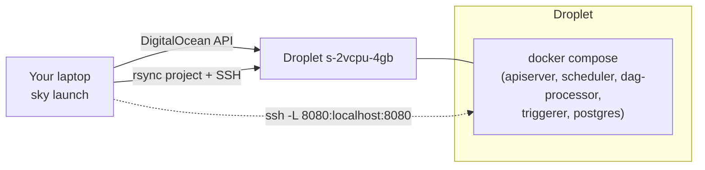

# Deploy to a DigitalOcean droplet with SkyPilot

**What you'll learn:** how to run this exact project on a small cloud VM with one command, keep it
private, reach the UI safely, push code changes, and shut it down so you stop paying.

> **Run it**
> - Task file: [`../deploy/skypilot/airflow-do.yaml`](../deploy/skypilot/airflow-do.yaml)
> - Port lock-down: [`../deploy/skypilot/docker-compose.remote.yaml`](../deploy/skypilot/docker-compose.remote.yaml)
> - Cluster name used below: `airflow-do`

---

## What SkyPilot does here

[SkyPilot](https://docs.skypilot.co) is a tool that launches a VM on a cloud from a short YAML file,
copies your project to it, and runs setup and start-up commands. For this project it:

1. Creates a DigitalOcean droplet `s-2vcpu-4gb` (2 vCPU, 4 GB RAM, about $0.036/hour) running Ubuntu 24.04.
2. Copies the project folder to `~/sky_workdir` on the VM (files in `.gitignore` are skipped).
3. **setup** (first launch): installs Docker, turns on the `ufw` firewall (SSH only), and generates
   random secrets in `~/.airflow-secrets.env`. These are the admin password, Fernet key and JWT secret.
4. **run**: copies the secrets to `.env` and runs `docker compose up` with the remote override, then
   waits until `/api/v2/monitor/health` answers.



## Security: why the UI is only reachable through SSH

SkyPilot does **not** put a firewall in front of DigitalOcean droplets: every port is open to the
internet. Docker also bypasses `ufw` for ports it publishes. The learning compose file publishes
8080 (UI) and 5432 (Postgres with password `airflow`), so running it unchanged on a VM would expose both.

`deploy/skypilot/docker-compose.remote.yaml` re-binds both ports to `127.0.0.1`:

```yaml
services:
  airflow-apiserver:
    ports: !override
      - "127.0.0.1:8080:8080"
  postgres:
    ports: !override
      - "127.0.0.1:5432:5432"
```

So the only way in is SSH, which uses the key SkyPilot created for you.

## Prerequisites (one time)

1. SkyPilot with DigitalOcean support: `pip install "skypilot[do]"`.
2. A DigitalOcean API token with read/write scope. SkyPilot reads it **only** from doctl's config
   file, `~/Library/Application Support/doctl/config.yaml` on macOS or `~/.config/doctl/config.yaml`
   on Linux, as `access-token: <token>`. Environment variables are not used.
   - If you keep the token in Bitwarden Secrets Manager as `DIGITALOCEAN_ACCESS_TOKEN`, write it
     without printing it:

     ```bash
     ( umask 077; mkdir -p "$HOME/Library/Application Support/doctl"; printf 'access-token: %s\n' "$(bws secret list -o json | jq -r '.[] | select(.key=="DIGITALOCEAN_ACCESS_TOKEN") | .value')" > "$HOME/Library/Application Support/doctl/config.yaml" )
     ```

3. Check it: `sky check do` should print `DO: enabled`.

## Launch

From the project root:

```bash
sky launch -c airflow-do deploy/skypilot/airflow-do.yaml
```

The first launch takes about 5–10 minutes: droplet, Docker install, image pulls, then DB migration.

## Open the UI

```bash
ssh -L 8080:localhost:8080 airflow-do
```

Keep that terminal open and browse **http://localhost:8080**. The username is `airflow`. Get the
generated password:

```bash
ssh airflow-do 'grep _AIRFLOW_WWW_USER_PASSWORD ~/.airflow-secrets.env'
```

To inspect the demo database the same way: `ssh -L 5433:localhost:5432 airflow-do`, then connect
to `localhost:5433` with user and password `airflow`, database `demo`.

## Day-to-day commands

| Task | Command |
|------|---------|
| Status of your clusters (and cost so far) | `sky status` / `sky cost-report` |
| Shell on the VM | `ssh airflow-do` |
| Container status | `ssh airflow-do 'cd ~/sky_workdir && docker compose ps'` |
| Scheduler logs | `ssh airflow-do 'cd ~/sky_workdir && docker compose logs --tail 100 airflow-scheduler'` |
| Push code changes (DAGs, plugins, compose) | `sky launch -c airflow-do deploy/skypilot/airflow-do.yaml` (re-syncs and re-runs `up -d`; secrets are kept) |
| Only sync DAG edits quickly | `sky exec airflow-do --workdir . 'echo synced'` (the dag-processor picks changes up within 30 s) |
| Stop the VM, keep the disk | `sky stop airflow-do` — not supported on every DigitalOcean setup; if it fails, use `sky down` |
| Delete everything (stop paying) | `sky down airflow-do` |

> Billing: DigitalOcean bills droplets while they exist, even when powered off. `sky down` deletes
> the droplet. The Airflow database is lost, but all your code is in this repo.

## Common mistakes

- Removing `-f deploy/skypilot/docker-compose.remote.yaml` from the run command. That exposes the
  UI and Postgres to the internet.
- Expecting `export DIGITALOCEAN_ACCESS_TOKEN=...` to work. SkyPilot ignores it; write the doctl config file.
- Forgetting `sky down` when you're finished.
- Editing `.env` on the VM. It is overwritten from `~/.airflow-secrets.env` on every run; edit that file instead.

## Try it yourself

1. Change a DAG locally, push it with `sky exec ... --workdir .`, and watch it update in the UI.
2. Switch the YAML to `instance_type: s-4vcpu-8gb`, relaunch, and compare how fast DAG 15 finishes.
3. Read [chapter 29](29-executors-and-production.md). What would you add before calling this "production"? (Hints: TLS, managed Postgres, backups, remote logs.)

---

← [Back to the index](README.md) · Previous: [33 · Exercises](33-exercises.md)
