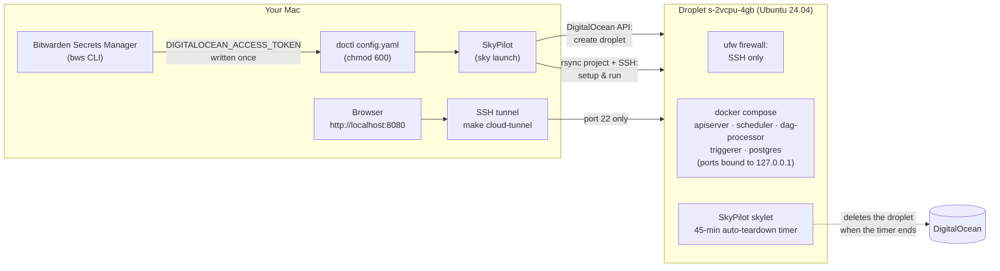
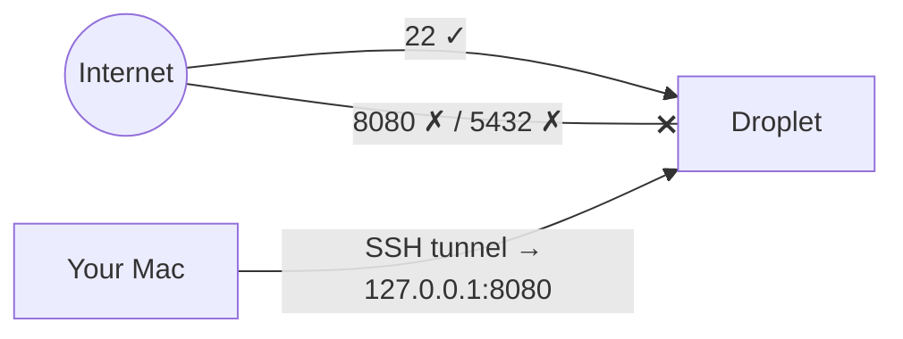

# Deploy to a DigitalOcean VM with SkyPilot

**What you'll learn:** how to run this whole project on a temporary cloud VM with one command,
reach the Airflow UI safely, push code changes, and make sure the VM deletes itself so you never
pay for a forgotten server.

> **Run it**
> - `make cloud-up` → `make cloud-tunnel` → open **http://localhost:8080**
> - Task file: [`../deploy/skypilot/airflow-do.yaml`](../deploy/skypilot/airflow-do.yaml)
> - Port lock-down: [`../deploy/skypilot/docker-compose.remote.yaml`](../deploy/skypilot/docker-compose.remote.yaml)
> - Quick runbook: [`../deploy/skypilot/README.md`](../deploy/skypilot/README.md)

Everything in this chapter was run for real on Airflow 3.4.0 and SkyPilot 0.14.2 in November 2026:
the stack came up healthy, the capstone DAG and its asset-triggered report succeeded on the VM,
outside port scans showed only SSH open, and the 45-minute auto-teardown deleted the droplet and
its disk on schedule.

---

## 1. The big picture



| Piece | What it does |
|---|---|
| **SkyPilot** (`sky`) | Creates the VM from a YAML file, copies the project to it, runs setup and start-up commands, and arms the auto-teardown timer. |
| **DigitalOcean droplet** | A small Linux VM: 2 vCPU, 4 GB RAM, 80 GB disk, about **$0.036/hour**. |
| **Bitwarden Secrets Manager** (`bws`) | Where the DigitalOcean API token is kept. It is copied once into the file SkyPilot reads. |
| **SSH tunnel** | Forwards `localhost:8080` on your Mac to Airflow on the VM. Nothing on the VM is reachable from the internet except SSH. |
| **skylet** | SkyPilot's agent on the VM. It enforces the auto-teardown, even if your laptop is asleep. |

---

## 2. One-time setup

You need this once per computer. Steps 3–4 are the only ones that touch secrets.

### 2.1 Install SkyPilot with DigitalOcean support

```bash
pip install "skypilot[do]"
```

Installing into a virtualenv is fine, but then `sky` is only on your `PATH` while that venv is
active. If your shell says `zsh: command not found: sky`, use the full path, for example
`~/path/to/venv/bin/sky`, or activate the venv first.

### 2.2 Tell `make` where `sky` lives (only if it's not on your PATH)

Create a file `.cloud.mk` in the project root. It's git-ignored, so each person can have their own:

```make
SKY := /Users/<you>/path/to/venv/bin/sky
```

Other settings you can override there, or on the command line (`make cloud-up CLOUD_TTL=90`):

| Variable | Default | Meaning |
|---|---|---|
| `SKY` | `sky` | Path to the SkyPilot CLI |
| `CLUSTER` | `airflow-do` | SkyPilot cluster name, which is also the SSH host alias |
| `CLOUD_TTL` | `45` | Minutes until the VM deletes itself |
| `TUNNEL_PORT` | `8080` | Local port for the UI. Change it if 8080 is busy on your Mac. |

### 2.3 Put the DigitalOcean token where SkyPilot looks for it

SkyPilot's DigitalOcean support reads the API token **only** from doctl's config file. It ignores
environment variables, so `export DIGITALOCEAN_ACCESS_TOKEN=...` or `bws run -- sky ...` won't work.

| OS | File |
|---|---|
| macOS | `~/Library/Application Support/doctl/config.yaml` |
| Linux | `~/.config/doctl/config.yaml` |

The file contains a single line: `access-token: <token>`.

This project keeps the token in **Bitwarden Secrets Manager** as `DIGITALOCEAN_ACCESS_TOKEN`. To copy it
into the file without ever printing it (macOS, run in your normal shell so the `bws` wrapper works):

```bash
( umask 077; mkdir -p "$HOME/Library/Application Support/doctl"; printf 'access-token: %s\n' "$(bws secret list -o json | jq -r '.[] | select(.key=="DIGITALOCEAN_ACCESS_TOKEN") | .value')" > "$HOME/Library/Application Support/doctl/config.yaml" )
```

- `umask 077` makes the file readable by you only (mode 600).
- `jq` picks the one secret by name, so other secrets are never shown.
- To see which secrets exist **without values**: `bws secret list -o json | jq -r '.[].key'`.

> **About the `bws` wrapper on this machine:** `bws` is a zsh function that reads the Bitwarden
> access token from the macOS Keychain item `bws-token` (set it with `bws-set-token`), and `doctl` is
> aliased to `bws run -- doctl`. Both exist only in your interactive shell, not inside `make` or scripts.

### 2.4 Check it

```bash
make cloud-check
```

You should see `DO: enabled [compute]`.

---

## 3. Launch, use, tear down

### 3.1 Launch

```bash
make cloud-up
```

That runs:

```bash
sky launch -c airflow-do deploy/skypilot/airflow-do.yaml -y -i 45 --down --wait-for none
```

| Flag | Meaning |
|---|---|
| `-c airflow-do` | Cluster name. It also becomes an SSH host alias, so `ssh airflow-do` works. |
| `-y` | Don't ask for confirmation. |
| `-i 45` | Auto-stop after 45 minutes. |
| `--down` | **Delete** the VM instead of stopping it. DigitalOcean bills stopped droplets too. |
| `--wait-for none` | A **hard deadline**: the timer is not reset by SSH sessions or running jobs. |

It takes about **6–8 minutes**: about 2 to create the droplet, then Docker install, image pulls and
database migration. When it finishes, `sky status` shows `AUTOSTOP 45m (down)`.

### 3.2 Open Airflow

```bash
make cloud-tunnel
```

Leave that terminal open; closing it closes your access. Then:

- **Endpoint:** http://localhost:8080
- **Username:** `airflow`
- **Password:** randomly generated on the VM. Get it in another terminal with `make cloud-password`.

All example DAGs start **paused**: flip a DAG's toggle, then press ▶ Trigger.

### 3.3 Check how much time is left

```bash
make cloud-expiry
```

```
Timer:      45 min, wait_for=none, action=deleted (autodown)
Started:    2026-11-12 03:00:47 UTC
Ends:       2026-11-12 03:45:47 UTC  (SkyPilot checks about once a minute)
Remaining:  23 min
```

The timer starts when SkyPilot **arms** it during `sky launch`, a few minutes after you type the
command, not when Airflow becomes ready. In the test run the timer was armed at 03:00:47 UTC.
The droplet and its disk had been deleted when we checked at 03:53 UTC, and DigitalOcean showed 0
droplets and 0 volumes.

### 3.4 Need more time?

```bash
make cloud-extend
```

This restarts the countdown: `CLOUD_TTL` minutes **from now**. For a different length,
use `make cloud-extend CLOUD_TTL=30`. To switch auto-teardown off completely, which is not recommended,
run `sky autostop airflow-do --cancel`.

### 3.5 Push code changes

Edit DAGs or plugins locally, then:

```bash
make cloud-sync
```

This copies the project to `~/sky_workdir` on the VM. The DAG processor picks up DAG changes within
**30 seconds**. If you changed `docker-compose.yaml`, `config/pools.json` or plugins, re-run
`make cloud-up` instead. It reuses the same VM, re-syncs, runs `docker compose up -d` again
and **re-arms** the timer.

### 3.6 Tear down early

```bash
make cloud-down
```

Then confirm with DigitalOcean that nothing is left. The disk volume can take about **30 seconds**
to disappear after the droplet:

```bash
bws run -- doctl compute droplet list
```

```bash
bws run -- doctl compute volume list
```

Both lists should be empty.

---

## 4. What happens on the VM

`sky launch` copies the project folder to `~/sky_workdir`. Files matched by `.gitignore` are
skipped: `.venv`, `logs/`, `data/`, `.env` and so on. Then it runs the YAML's two scripts.

**`setup`** runs on the first launch and again on each `sky launch` to the same cluster:

1. Waits for the droplet's boot-time package updates (`cloud-init`, `unattended-upgrades`) to release
   the apt lock. Without this, the Docker install can fail. See the troubleshooting section.
2. Installs Docker Engine and the compose plugin with `get.docker.com`.
3. Enables `ufw` with **SSH only**.
4. Generates `~/.airflow-secrets.env` **once**: a random admin password, a Fernet key (encrypts
   connection passwords) and a JWT secret (signs tokens between Airflow components).

**`run`** starts Airflow:

1. Copies the secrets to `~/sky_workdir/.env`.
2. `docker compose -f docker-compose.yaml -f deploy/skypilot/docker-compose.remote.yaml up airflow-init`
   migrates the DB, creates the admin user and imports the pools.
3. `... up -d` starts everything, then waits for `/api/v2/monitor/health`.

> The scheduler reports `unhealthy` for the first minute or so. It starts last, because it waits for
> the API server to be healthy. That is expected; it turns healthy on its own.

---

## 5. Security model

| Risk | What this setup does |
|---|---|
| SkyPilot puts **no firewall** in front of DigitalOcean droplets: every port is open. | `docker-compose.remote.yaml` binds 8080 (UI) and 5432 (Postgres) to `127.0.0.1` only. |
| Docker's published ports bypass `ufw`. | The 127.0.0.1 binding above is what actually protects them. `ufw` (SSH only) covers non-Docker services such as SkyPilot's skylet. |
| Default learning passwords (`airflow/airflow`) | Replaced by random secrets generated on the VM; they never leave it unless you ask (`make cloud-password`). |
| Plain HTTP | Only travels inside the encrypted SSH tunnel. |
| DigitalOcean token on the VM | For auto-teardown, SkyPilot copies your DigitalOcean credentials to the VM so it can delete itself. The VM is reachable only over SSH with your key, and it's deleted after 45 minutes. Use a dedicated, revocable token. |

This was verified after launch from outside the VM: port 22 open, ports 8080 and 5432 closed.



> **Need a public URL instead?** Remove the `ports: !override` lines and use the
> `ports:` section in the SkyPilot YAML. Do that only together with TLS, a reverse proxy and strong
> credentials. See [chapter 29](29-executors-and-production.md).

---

## 6. Using the REST API on the VM

With the tunnel open, the REST API is at `http://localhost:8080/api/v2`. This is how the end-to-end check
triggered DAGs on the VM:

```bash
PW=$(make -s cloud-password)
```

```bash
TOKEN=$(curl -s -X POST http://localhost:8080/auth/token -H 'Content-Type: application/json' -d "{\"username\":\"airflow\",\"password\":\"$PW\"}" | jq -r .access_token)
```

```bash
curl -s -X PATCH http://localhost:8080/api/v2/dags/20_capstone_sales_etl -H "Authorization: Bearer $TOKEN" -H 'Content-Type: application/json' -d '{"is_paused": false}'
```

```bash
curl -s -X POST http://localhost:8080/api/v2/dags/20_capstone_sales_etl/dagRuns -H "Authorization: Bearer $TOKEN" -H 'Content-Type: application/json' -d "{\"logical_date\": \"$(date -u +%Y-%m-%dT%H:%M:%SZ)\"}"
```

More endpoints are in [chapter 26](26-cli-and-rest-api.md).

To query the demo database from your Mac, use a second tunnel on another local port:

```bash
ssh -N -L 5433:localhost:5432 airflow-do
```

Then connect to `localhost:5433` with user `airflow`, password `airflow`, database `demo`.

---

## 7. Command reference

| Task | Command |
|---|---|
| Launch (45-min auto-teardown) | `make cloud-up` |
| Launch with a different lifetime | `make cloud-up CLOUD_TTL=90` |
| Open the UI | `make cloud-tunnel` → http://localhost:8080 |
| Admin password | `make cloud-password` |
| Time left | `make cloud-expiry` |
| Restart the countdown | `make cloud-extend` |
| Push code | `make cloud-sync` |
| Status | `make cloud-status` (or `sky status`) |
| Delete now | `make cloud-down` |
| Shell on the VM | `ssh airflow-do` |
| Container status | `ssh airflow-do 'cd ~/sky_workdir && docker compose ps'` |
| Scheduler logs | `ssh airflow-do 'cd ~/sky_workdir && docker compose logs --tail 100 airflow-scheduler'` |
| Launch/setup logs | `sky logs airflow-do 1` · provisioning: `sky logs --provision airflow-do` |
| Cost so far | `sky cost-report` |

---

## 8. Troubleshooting

All of these happened during the real runs.

### `zsh: command not found: sky`
SkyPilot is installed in a virtualenv that isn't active. Use the full path, activate the venv, or set
`SKY := ...` in `.cloud.mk` (section 2.2).

### `Job 1's setup failed` … `Could not get lock /var/lib/dpkg/lock-frontend`
A fresh droplet runs its own package updates for the first minute or two after boot. The setup script
now waits for them. If you still see it, just run `make cloud-up` again: it reuses the same VM and
re-runs setup.

### I pressed Ctrl-C during `sky launch`, but the VM still appeared
Ctrl-C only stops *watching*. SkyPilot prints `Request will continue running asynchronously`
and keeps launching in its background API server. To really stop:

```bash
sky api cancel <request-id>
```

```bash
make cloud-down
```

The request id is printed on the line `To cancel the request, run: sky api cancel ...`.

### Health shows `"scheduler": "unhealthy"` right after launch
It starts last, after the API server is healthy. Wait about a minute.

### A DAG fails on the VM with `File not found` but works locally
The file wasn't copied. SkyPilot copies with `rsync` and uses `.gitignore` as its exclude list, and rsync
reads unanchored patterns differently from git: `data/*` also matched `dags/include/data/*`. This
project anchors those patterns (`/data/*`, `/logs/*`). Check what landed:
`ssh airflow-do 'ls ~/sky_workdir/dags/include/data'`.

### `make cloud-tunnel` fails with `bind [127.0.0.1]:8080: Address already in use`
Something on your Mac already uses 8080, for example the local Docker stack (`make down` stops it). Or pick
another port with `make cloud-tunnel TUNNEL_PORT=18080` and open http://localhost:18080.

### The tunnel prints `Operation timed out` / `Broken pipe`
The VM is gone, usually because the timer ran out. `make cloud-status` shows `No existing clusters`.
Launch again if you need it.

### `ssh: Could not resolve hostname airflow-do` (from `make cloud-password`, `cloud-expiry`, `cloud-tunnel`)
The cluster doesn't exist (any more). SkyPilot removes the `airflow-do` SSH alias when the cluster is
deleted. If the VM is gone but the alias is still there, the commands give up after 10 seconds with a
timeout instead. Either way, run `make cloud-status` and launch again if needed.

### `sky check do` says DO is disabled
The doctl config file is missing or has the wrong format. Re-run step 2.3. The file must contain
`access-token: <token>`. Environment variables are ignored.

### After `sky down`, `doctl compute volume list` still shows `airflow-do-...-head`
The disk is deleted a few seconds after the droplet. Check again after about 30 seconds.

---

## 9. Cost

| Item | Price |
|---|---|
| Droplet `s-2vcpu-4gb` | about $0.036 per hour, so a 45-minute session costs about **$0.03** |
| 80 GB disk | included while it exists; deleted with the VM |
| Data transfer | negligible for this project |

The droplet is only offered in `nyc1`, `nyc3`, `sfo3` and `tor1`, and SkyPilot picks the cheapest. To change
size, edit `instance_type` in the YAML (for example `s-4vcpu-8gb`, about $0.071 per hour).

---

## Common mistakes

- Running the compose stack on the VM **without** `docker-compose.remote.yaml`, which exposes the UI and
  Postgres to the internet.
- Launching without `--down`: a *stopped* droplet is still billed.
- Using `--wait-for jobs_and_ssh` (the default) and expecting a 45-minute limit. An open SSH tunnel then
  keeps resetting the timer and the VM never goes away.
- Editing `~/sky_workdir/.env` on the VM: it's overwritten from `~/.airflow-secrets.env` on every launch.
- Keeping important data on the VM. The Airflow database is deleted with it; your code lives in git.

## Try it yourself

1. Launch with `CLOUD_TTL=15`, run `make cloud-expiry` twice, and watch `Remaining` count down.
2. Add a new DAG locally, `make cloud-sync`, and see it appear in the UI within 30 seconds.
3. Run the capstone pipeline on the VM through the REST API (section 6) and check that
   `20_capstone_sales_report` starts by itself (run type `asset_triggered`).
4. Switch to `s-4vcpu-8gb` and compare how fast `15_pools_priority_concurrency` finishes.

---

← [Back to the index](README.md) · Previous: [33 · Exercises](33-exercises.md)
